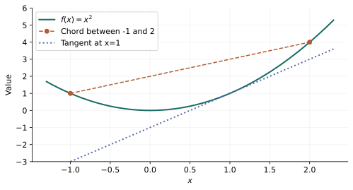

# 第 3 章：凸函数与构造规则

> 来源：讲义 PDF 第 44～86 页；教材第 3 章。强凸与后面的收敛关系还对应讲义第 293 页。

上一章只回答方案是否允许，现在还要比较方案的成本。即使两点之间的线段都可行，沿线段的成本也可能先降、再升、再降；这会使局部搜索难以判断是否已经找到全局最好方案。凸函数提供一种可以证明和利用的结构：中间方案的成本不超过两端成本的加权平均。

要使用这条规律，首先必须知道函数在哪些点上有定义。例如对数成本不能在非正输入上直接求值。我们因此先明确定义域，再建立凸性及其构造规则。

## 定义域是定义的一部分 {#base-01}

函数的定义域记为 $\operatorname{dom}f$。

例如：

$$
f(x)=-\log x,\qquad \operatorname{dom}f=(0,\infty).
$$

不能把 $x=0$ 或负数直接代入这个实值函数。

讨论凸函数时，**先要求定义域是凸集**，再讨论函数值不等式。

## 凸函数的定义 {#base-02}

$$
f(\theta x+(1-\theta)y)
\leq
\theta f(x)+(1-\theta)f(y),
\qquad \theta\in[0,1].
$$

左边：先把输入混合，再计算函数值。

右边：先分别计算函数值，再把结果混合。

直观解释：**函数图像在两点连线的下方或线上。**

以 $f(x)=x^2$、$x=0,y=2,\theta=\frac12$ 为例：

$$
f(1)=1
\leq
\frac12f(0)+\frac12f(2)=2.
$$

这只是对一个点对的验证；要证明整个函数凸，需要对所有允许的点对成立。

## 凹函数 {#base-03}

如果 $-f$ 是凸函数，那么 $f$ 是凹函数。其定义不等式方向相反：

$$
f(\theta x+(1-\theta)y)
\geq\theta f(x)+(1-\theta)f(y).
$$

例如 $\log x$ 在 $x>0$ 上是凹函数。

注意：**凸/凹描述弯曲方式，不描述是否递增。**

例如 $e^x$ 递增且凸；$-\log x$ 递减且凸。

## 三个不同层次：凸、严格凸、强凸 {#base-04}

**凸：** 允许定义中的等号成立。

**严格凸：** 对 $x\neq y$、$\theta\in(0,1)$，严格小于：

$$
f(\theta x+(1-\theta)y)
<
\theta f(x)+(1-\theta)f(y).
$$

**$\mu$-强凸：** 存在固定常数 $\mu>0$，使：

$$
f(\theta x+(1-\theta)y)
\leq
\theta f(x)+(1-\theta)f(y)
-\frac{\mu}{2}\theta(1-\theta)\|x-y\|_2^2.
$$

它表示函数相对于一条弦，至少有一个统一的二次弯曲量。

关系：

$$
\text{强凸}\Longrightarrow\text{严格凸}\Longrightarrow\text{凸}.
$$

反方向通常不成立：

- 仿射函数凸，但通常不严格凸。
- $x^4$ 在 $\mathbb R$ 上严格凸，但不强凸；因为 $f''(0)=0$，不存在全域统一的正曲率下界。
- $x^2$ 是 $2$-强凸函数，因为 $f''(x)=2$。

严格凸的目标函数在凸可行域上**至多有一个最优解**。这里说“至多”，并没有保证最优解一定存在。

## 一阶条件：切线是全局下界 {#base-05}

设 $f$ 在开凸定义域上可微，则：

$$
f\text{ 凸}
\quad\Longleftrightarrow\quad
f(y)\geq f(x)+\nabla f(x)^T(y-x),\quad\forall x,y.
$$

右边就是在 $x$ 处的一阶近似。

一般函数的一阶近似只在附近近似准确；凸函数的一阶近似还有一个更强的性质：**它在整个定义域上都是下界。**

### 看一个精确计算

对于 $f(x)=x^2$：

$$
f(y)-[f(x)+f'(x)(y-x)]
=y^2-x^2-2x(y-x)
=(y-x)^2\geq0.
$$

因此一阶下界条件成立。

### 这个条件如何从定义得到

对 $t\in(0,1)$，凸性给出：

$$
f(x+t(y-x))\leq(1-t)f(x)+tf(y).
$$

移项、除以 $t$：

$$
f(y)\geq f(x)+
\frac{f(x+t(y-x))-f(x)}{t}.
$$

令 $t\to0^+$，最后一项趋于 $\nabla f(x)^T(y-x)$，得到一阶条件。

反过来，对 $z=\theta x+(1-\theta)y$，分别在 $z$ 处对 $x,y$ 使用一阶下界，再乘权重相加；由于
$\theta(x-z)+(1-\theta)(y-z)=0$，梯度项抵消，就得到凸性的定义不等式。

## 无约束问题为什么可以“令梯度等于零” {#base-06}

若 $f$ 可微且凸，且某个定义域内的点满足：

$$
\nabla f(x^\star)=0,
$$

那么一阶条件直接给出：

$$
f(y)\geq f(x^\star),\qquad\forall y.
$$

所以它是全局最优解。

如果没有凸性，梯度为零可能是局部最大点或鞍点。例如 $f(x)=-x^2$ 在 $0$ 处导数为零，却不是最小值点。

如果有约束，最优点也可能梯度非零。例如 $\min_{x\geq1}x^2$ 在 $x^\star=1$ 处梯度是 $2$。这正是后面需要 KKT 的原因。

## 二阶条件：Hessian 半正定 {#base-07}

设 $f$ 在开凸定义域上二阶连续可微：

$$
f\text{ 凸}
\quad\Longleftrightarrow\quad
\nabla^2f(x)\succeq0,\quad\forall x\in\operatorname{dom}f.
$$

一元情况下变成：

$$
f''(x)\geq0.
$$

直觉来自任意方向上的一元函数：

$$
\phi(t)=f(x+td),\qquad
\phi''(t)=d^T\nabla^2f(x+td)d.
$$

Hessian 半正定，就是所有方向的二阶导数都非负。

进一步：

- 处处 $\nabla^2f(x)\succ0$，足以推出严格凸，但不是必要条件。
- 处处 $\nabla^2f(x)\succeq\mu I$，等价于可微二阶情形下的 $\mu$-强凸。

不要只检查某一个点的 Hessian 就宣布函数全域凸。

## 常用函数表 {#base-08}

| 函数 | 定义域 | 性质 |
|---|---|---|
| $a^Tx+b$ | $\mathbb R^n$ | 既凸又凹 |
| $x^2$ | $\mathbb R$ | 强凸 |
| $x^4$ | $\mathbb R$ | 严格凸，但不全域强凸 |
| $\lvert x\rvert$ | $\mathbb R$ | 凸，在 $0$ 处不可微 |
| $e^x$ | $\mathbb R$ | 严格凸 |
| $-\log x$ | $x>0$ | 严格凸 |
| $\log x$ | $x>0$ | 严格凹 |
| $1/x$ | $x>0$ | 严格凸 |
| $\sqrt{x}$ | $x\geq0$ | 凹 |
| $\|x\|$，任意范数 | $\mathbb R^n$ | 凸 |
| $\frac12x^TPx+q^Tx+r$，$P=P^T$ | $\mathbb R^n$ | 当且仅当 $P\succeq0$ 时凸 |

函数的性质可能随定义域改变。例如 $1/x$ 在负半轴上是凹函数，不能脱离定义域说“$1/x$ 总是凸”。

在正半轴上，幂函数 $x^\alpha$ 的二阶导数为 $\alpha(\alpha-1)x^{\alpha-2}$：$\alpha\leq0$ 或 $\alpha\geq1$ 时凸，$0\leq\alpha\leq1$ 时凹。$|x|^p$ 在 $p\geq1$ 时凸；正部 $\max(0,x)$ 凸，负部 $\min(0,x)$ 凹。熵函数 $-x\log x$ 在 $x>0$ 上凹，取边界延拓 $0\log0=0$ 时仍可连续地讨论。

## 下水平集与上图 {#base-09}

**下水平集**：

$$
C_\alpha=\{x:f(x)\leq\alpha\}.
$$

凸函数的每一个下水平集都凸。因此凸函数的小于等于约束可以定义凸区域。

但反过来不成立：所有下水平集都凸，只能说明它是**拟凸函数**。例如 $x^3$ 在 $\mathbb R$ 上严格递增，每个下水平集都是半直线，但它不在整个实轴上凸。

**上图（epigraph）**：

$$
\operatorname{epi}f=\{(x,t):x\in\operatorname{dom}f,\ f(x)\leq t\}.
$$

它是函数图像“上方的整个区域”，而不只是函数曲线。

$$
f\text{ 凸}\quad\Longleftrightarrow\quad\operatorname{epi}f\text{ 是凸集}.
$$

这条性质将直接用于建模变换。

## 推荐的判断顺序 {#base-10}

1. 先检查定义域是否凸。
2. 看是不是已知的基本凸函数。
3. 尝试用保持凸性的运算拆解。
4. 可微时考虑一阶条件，二阶可微时考虑 Hessian。
5. 想否定凸性时，找一组违反定义的点，或一个负曲率方向。

## 非负加权和 {#base-11}

若 $f_i$ 凸，$\alpha_i\geq0$，则：

$$
f(x)=\sum_i\alpha_i f_i(x)
$$

在共同定义域上凸。

例如：

$$
\|Ax-b\|_2^2+\lambda\|x\|_1,\qquad\lambda\geq0
$$

是凸函数。

权重的非负性不能随意删除。$x^2$ 凸，但乘以 $-1$ 后得到的 $-x^2$ 是凹函数。

非负测度下的积分、期望以及有良好定义的逐点无穷和也可保留相应凸性，前提是表达式存在、没有未定义的无穷相减；不能省略可积性和有效定义域的检查。

## 与仿射映射复合 {#base-12}

若 $f$ 凸，则：

$$
g(x)=f(Ax+b)
$$

在其定义域上凸。

例如：

$$
\|Ax-b\|_2,\qquad
\|Ax-b\|_2^2,\qquad
e^{a^Tx+b}
$$

都凸。

不需要要求 $A$ 的元素非负，也不需要要求 $A$ 可逆。

## 逐点最大值 {#base-13}

如果 $f_1,\ldots,f_k$ 凸，则：

$$
f(x)=\max\{f_1(x),\ldots,f_k(x)\}
$$

凸。即使每个 $f_i$ 可微，它们的最大值也可能在切换位置不可微。

例如：

$$
|x|=\max\{x,-x\}.
$$

进一步，逐点上确界也保持凸性。

例如，向量中最大的 $r$ 个分量之和，是所有大小为 $r$ 的下标子集对应的分量和之最大值，因此凸。对称矩阵的最大特征值 $\lambda_{\max}(X)=\sup_{\|v\|_2=1}v^TXv$，也是关于 $X$ 的仿射函数族的上确界，所以凸。集合的支撑函数 $s_C(x)=\sup_{y\in C}y^Tx$ 同理；集合 $C$ 本身甚至不必凸。

**逐点最小值一般不保凸。** $\min\{x,-x\}=-|x|$ 就是反例。

## 一般复合要看单调性 {#base-14}

“凸函数套凸函数，结果仍凸”是错误的。

两个常用的充分规则是：

- 外层 $h$ 凸且非递减，内层 $g$ 凸，则 $h(g(x))$ 凸。
- 外层 $h$ 凸且非递增，内层 $g$ 凹，则 $h(g(x))$ 凸。

使用时还需要检查复合定义域，并保证单调性条件适用于所用的函数及其定义域延拓；不能只在某个局部区间看到单调，就直接套用。

多元外层 $h(g_1(x),\ldots,g_k(x))$ 的规则逐坐标检查：$h$ 联合凸，对每个输入，要么对应的 $g_i$ 凸且外层对此坐标非递减，要么 $g_i$ 凹且外层对此坐标非递增，要么 $g_i$ 仿射。定义域与扩展值条件仍要成立。这是 DCP 表达式树使用的通用规则。

安全的典型例子：

- $e^{g(x)}$：指数函数在实轴上凸且递增，因此 $g$ 凸时结果凸。
- $1/g(x)$：在 $g(x)>0$ 的区域，如果 $g$ 凹，则结果凸。

### 一个反例

令：

$$
h(u)=u^2,\qquad g(x)=x^2-1.
$$

两者都凸，但：

$$
h(g(x))=(x^2-1)^2,\qquad
\frac{d^2}{dx^2}(x^2-1)^2=12x^2-4.
$$

在 $x=0$ 处二阶导数为 $-4$，所以复合函数不凸。原因之一是外层平方函数在整个实轴上并不单调递增。

## 两个函数的乘积没有一般的保凸规则 {#base-15}

即使 $f,g$ 都凸，$fg$ 也未必凸。例如 $f(x)=x$、$g(x)=-x$ 都是仿射函数，但乘积 $-x^2$ 不凸。

不要把“非负加权求和保持凸性”误记成“任何代数运算都保持凸性”。

## 连线在上方，切线在下方 {#function-figure}

这两句话看起来方向相反，其实比较对象不同。下图把它们放在同一张图里。

两点间的弦给出插值上界；一个点处的切线给出全局下界。不要把“函数在弦下”错误推广为“函数在切线下”。

## 矩阵函数与沿直线限制 {#matrix-functions}

变量可以是矩阵 $X\in\mathbb R^{m\times n}$。仿射标量函数可写为：

$$
\langle A,X\rangle+b=\operatorname{tr}(A^TX)+b
=\sum_{i,j}A_{ij}X_{ij}+b.
$$

谱范数 $\|X\|_2=\sup_{\|v\|_2=1}\|Xv\|_2$ 是凸函数；这里它不是逐元素平方和的平方根，后者叫 Frobenius 范数。

对 $X\succ0$，$\log\det X$ 是凹函数。为了证明矩阵函数的凸凹性，可以固定对称方向 $V$，研究：

$$
h(t)=\log\det(X+tV).
$$

令 $B=X^{-1/2}VX^{-1/2}$，其特征值为 $\lambda_i$。在 $X+tV\succ0$ 的区间内：

$$
h(t)=\log\det X+\sum_i\log(1+t\lambda_i),
\qquad
h''(t)=-\sum_i\frac{\lambda_i^2}{(1+t\lambda_i)^2}\leq0.
$$

每一条允许直线上的限制都凹，因此矩阵函数凹。这个结论解释了后面协方差估计和椭球体积模型的凸性。

## 扩展值、指示函数和隐含约束 {#extended-values}

为了不在每个公式旁都重复定义域，可以把凸函数在域外的值设成 $+\infty$：

$$
\widetilde f(x)=
\begin{cases}
f(x),&x\in\operatorname{dom}f,\\
+\infty,&\text{否则}.
\end{cases}
$$

凸集合 $C$ 的凸分析指示函数是域内为 $0$、域外为 $+\infty$ 的 $I_C$。它不是概率论中取值 $0,1$ 的示性函数。

于是 $\min_{x\in C}f(x)$ 可写成 $\min_x[f(x)+I_C(x)]$。这并没有移除约束，只是把约束放进目标的有效定义域。

## Jensen 不等式：平均以后再计算 {#jensen}

两点凸组合可递推到有限多个点：

$$
f\left(\sum_i\theta_i x_i\right)
\leq\sum_i\theta_i f(x_i),
\qquad\theta_i\geq0,\quad\sum_i\theta_i=1.
$$

权重若是概率，就得到 Jensen 不等式。在相关期望存在且有意义的条件下：

$$
f(\mathbb EX)\leq\mathbb Ef(X).
$$

例如 $X$ 等概率取 $-1,1$，对 $f(x)=x^2$，左边为 $0$，右边为 $1$。

讲义的对数正态例子中，$X\sim N(\mu,\sigma^2)$：

$$
\exp(\mathbb EX)=e^\mu
\leq\mathbb Ee^X=e^{\mu+\sigma^2/2}.
$$

$\sigma>0$ 时严格不等；退化情形 $\sigma=0$ 时取等。不能把一次随机模拟看成这个不等式的证明。

## log-sum-exp 与二次除线性 {#atoms}

不少复杂模型依赖几个可复用的基本函数。

令 $f(x)=\log\sum_i e^{x_i}$，定义正权重：

$$
p_i=\frac{e^{x_i}}{\sum_j e^{x_j}},\qquad\sum_i p_i=1.
$$

求导得到：

$$
\nabla f=p,\qquad
\nabla^2f=\operatorname{diag}(p)-pp^T.
$$

任意方向 $v$ 的二次型为：

$$
v^T\nabla^2f\,v
=\sum_i p_i v_i^2-\left(\sum_i p_i v_i\right)^2\geq0,
$$

它是以 $p_i$ 为概率的方差，因此非负。还可直接估计：

$$
\max_i x_i\leq\log\sum_i e^{x_i}\leq\max_i x_i+\log n.
$$

所以它可作为最大值的光滑近似；数值计算时先减去最大分量，避免指数溢出。

几何平均 $h(x)=(\prod_i x_i)^{1/n}$ 在正正交域上凹。沿方向 $v$ 的 Hessian 二次型为：

$$
v^T\nabla^2h(x)v
=\frac{h(x)}{n^2}
\left[\left(\sum_i\frac{v_i}{x_i}\right)^2
-n\sum_i\left(\frac{v_i}{x_i}\right)^2\right]\leq0,
$$

最后一步来自 Cauchy–Schwarz。这是“乘积看起来复杂”却能利用结构证明凹性的例子。

二次除线性函数 $q(u,v)=u^2/v$ 在 $v>0$ 上联合凸：

$$
\nabla^2q(u,v)=\frac{2}{v^3}
\begin{bmatrix}v\\-u\end{bmatrix}
\begin{bmatrix}v&-u\end{bmatrix}\succeq0.
$$

“联合凸”是关于 $(u,v)$ 同时变化的性质，比只固定其中一个变量检查更强。

## 部分最小化与 Schur 补 {#partial-min}

逐点最小值一般不保凸，但下面的情形有额外的联合结构：

$$
g(x)=\inf_{y\in C}f(x,y).
$$

若 $f$ 关于 $(x,y)$ 联合凸，$C$ 凸，则在适当的扩展值意义下 $g$ 凸。这里不是任意挑选一组凸函数后取最小值。

一个能算到底的例子：

$$
f(x,y)=x^TAx+2x^TBy+y^TCy,
\quad
\begin{bmatrix}A&B\\B^T&C\end{bmatrix}\succeq0,\quad C\succ0.
$$

对 $y$ 求导，得 $y^\star=-C^{-1}B^Tx$。代回：

$$
g(x)=x^T(A-BC^{-1}B^T)x.
$$

因此 $A-BC^{-1}B^T\succeq0$。它叫 Schur 补，也将成为分块消元和 LMI 变换的重要工具。

对于非空凸集 $C$，到集合的距离 $\inf_{y\in C}\|x-y\|$ 也由这个规则得到凸性。

## 透视函数：让尺度也成为变量 {#perspective}

与上一章的透视映射不同，函数的透视为：

$$
g(x,t)=tf(x/t),\qquad t>0,\ x/t\in\operatorname{dom}f.
$$

若 $f$ 凸，$g$ 联合凸。证明中，令 $s=\theta t_1+(1-\theta)t_2$，将混合输入除以 $s$ 后写成以 $\theta t_1/s$ 为权重的凸组合，再用 $f$ 的凸性，最后乘回 $s$。

例子：

$$
f(u)=\|u\|_2^2
\quad\Longrightarrow\quad
g(x,t)=\frac{\|x\|_2^2}{t}.
$$

以 $f(u)=-\log u$ 出发，则得到 $t\log(t/x)$ 在 $x,t>0$ 上联合凸。这是相对熵模型的基本形式。

## 共轭函数：用所有斜率观察函数 {#conjugate}

对给定斜率向量 $y$，考察线性函数 $y^Tx$ 能比 $f(x)$ 高多少：

$$
f^*(y)=\sup_{x\in\operatorname{dom}f}[y^Tx-f(x)].
$$

$f^*$ 关于 $y$ 总是凸的，因为每个固定 $x$ 给出的表达式都是关于 $y$ 的仿射函数，再取上确界。

若 $f(x)=\frac12x^TQx$ 且 $Q\succ0$，最大化的一阶条件为 $y-Qx=0$，代回得：

$$
f^*(y)=\frac12y^TQ^{-1}y.
$$

对 $f(x)=-\log x$、$x>0$，有：

$$
f^*(y)=
\begin{cases}
-1-\log(-y),&y<0,\\
+\infty,&y\geq0.
\end{cases}
$$

求下界与求共轭之间差一个符号：$\inf_x[f(x)+a^Tx]=-f^*(-a)$。后面推导对偶时会频繁使用。

## DCP：可自动检查的充分规则 {#dcp}

复杂表达式可以画成树：叶子是变量或常数，父节点是原子函数。逐层记录凸凹性、正负与单调性，直到根节点。这就是构造式凸性验证。

例如：

$$
\frac{(x-y)^2}{1-\max(x,y)},\qquad x<1,\ y<1.
$$

分子输入 $x-y$ 仿射，分母 $1-\max(x,y)$ 凹且正；二次除线性原子对分母递减，因此复合规则认证其凸性。讲义第 74 页的表达式树正是在做这个分层检查。

DCP 要求每个节点都满足已知规则。它是充分而不必要的：$\sqrt{1+x^2}$ 本来凸，但直接按“凹平方根套凸平方和”不能认证。改写为：

$$
\left\|\begin{bmatrix}1\\x\end{bmatrix}\right\|_2
$$

就容易认证。因此“系统没有认证”不等于“数学上非凸”。

## 拟凸、拟凹与收益率例子 {#quasiconvex}

当所有下水平集凸时，称函数拟凸。它等价于：

$$
f(\theta x+(1-\theta)y)\leq\max\{f(x),f(y)\}.
$$

拟凹表示所有上水平集凸，同时拟凸拟凹称拟线性。单调函数如 $\log x$ 拟线性；$\sqrt{|x|}$ 拟凸但不凸。正分母线性分式函数也拟线性。

可微、凸定义域时，拟凸性等价于：

$$
f(y)\leq f(x)\Longrightarrow\nabla f(x)^T(y-x)\leq0.
$$

它比凸函数的一阶下界弱；拟凸函数的零梯度不自动证明全局最小。

拟凸函数求和也一般不保拟凸。不能把凸函数的求和规则不加条件地搬到拟凸类。

讲义还讨论现金流 $c_0<0,\sum_i c_i>0$ 的内部收益率。定义净现值 $V(c,r)=\sum_{i=0}^n c_i(1+r)^{-i}$，内部收益率取最小非负零点。根据连续性，$\operatorname{IRR}(c)\geq R$ 等价于对所有 $0\leq r<R$ 有 $V(c,r)>0$，是关于现金流的半空间交，因而给出拟凹性。这个例子依赖指定的现金流域和“最小零点”的定义。
