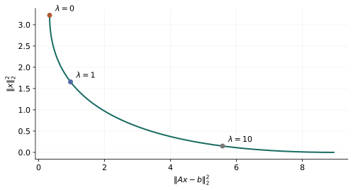

# 第 4 章：凸问题、标准模型与变换

> 来源：讲义 PDF 第 87～153 页；教材第 4 章。先识别完整问题，再学习如何改变表示而不改变原问题。

知道某个函数凸，还不能直接断定整个问题凸：约束的方向、等式的形式和共同定义域都参与判断。本章把前两章的几何与函数规则组合起来，回答“这个实际模型能否使用凸优化方法”。接着学习 LP、QP、SOCP、SDP 等常见形式，并区分保持原问题的等价变换与只给出界的松弛。

在下式中，$x\in\mathbb R^n$ 是决策列向量，标量函数 $f_0$ 衡量成本，$f_i$ 表示第 $i$ 个不等式限制；$A\in\mathbb R^{p\times n}$ 与 $b\in\mathbb R^p$ 是给定的等式数据。

## 标准形式的三项要求 {#base-01}

$$
\begin{aligned}
\min_x\quad &f_0(x)\\
\text{s.t.}\quad &f_i(x)\leq0,\quad i=1,\ldots,m,\\
&Ax=b.
\end{aligned}
$$

这是一个标准形式凸优化问题，只要：

1. 目标函数 $f_0$ 凸；
2. 每个不等式函数 $f_i$ 凸；
3. 等式约束是仿射的。

共同定义域也包含在可行性要求中。

## 为什么不等式方向重要 {#base-02}

比较：

$$
x^2\leq1
\quad\Longrightarrow\quad x\in[-1,1],
$$

是凸区域；而：

$$
x^2\geq1
\quad\Longrightarrow\quad x\in(-\infty,-1]\cup[1,\infty),
$$

不是凸区域。

可以记为：

- 凸函数 $\leq$ 常数：定义凸集。
- 凹函数 $\geq$ 常数：定义凸集。
- 凸函数 $\geq$ 常数：一般不能保证凸。

常数只是一种特殊情况。更一般地，“凸函数 $\leq$ 凹函数”移项后仍是凸约束。

## 为什么等式通常要求仿射 {#base-03}

非线性等式一般不能保证可行域凸，例如：

$$
x_1^2+x_2^2=1
$$

定义的是圆周。

但不能反过来说“任何非线性等式都一定定义非凸集”。例如 $x^2=0$ 的解集只有 $\{0\}$，仍然凸，可以改写成 $x=0$。

所以要区分：

- **表达式符合凸标准形式**；
- **实际问题能否等价改写成凸形式**。

## 最大化凹函数也属于凸优化 {#base-04}

$$
\max_{x\in C}g(x)
\quad\Longleftrightarrow\quad
\min_{x\in C}-g(x).
$$

如果 $C$ 凸、$g$ 凹，那么 $-g$ 凸。

例如：

$$
\max_{x_i>0,\ \sum_i x_i=1}\sum_i\log x_i
$$

属于凸优化。不要把“所有最大化问题都非凸”当成规则。

## 为什么局部最优一定是全局最优 {#base-05}

设 $x^\star$ 是局部最优，却存在另一个可行点 $y$，满足 $f(y)<f(x^\star)$。

由于可行域凸，对任意 $t\in(0,1)$：

$$
z_t=(1-t)x^\star+ty
$$

都可行。目标函数凸，因此：

$$
f(z_t)\leq(1-t)f(x^\star)+tf(y)<f(x^\star).
$$

当 $t$ 很小时，$z_t$ 任意接近 $x^\star$，却更好，与局部最优矛盾。

证明同时用到了**可行域凸**和**目标函数凸**。

## 最优解是否存在、是否唯一 {#base-06}

两个常用结论：

- 如果可行域非空、闭且有界，目标函数在其上连续，那么最优解存在。
- 如果目标函数严格凸、可行域凸，那么最优解至多一个。

在有限维空间里，“闭且有界”意味着紧。存在性也可以通过其他条件保证，例如适当的下水平集紧致，不必要求整个可行域有界。

“连续 + 非空紧可行域”是充分条件，不是所有问题都必须满足的必要条件。

## 线性规划 LP {#base-07}

$$
\begin{aligned}
\min_x\quad &c^Tx+d\\
\text{s.t.}\quad &Gx\leq h,\\
&Ax=b.
\end{aligned}
$$

目标和约束都是仿射函数，可行域是多面体，因此是凸问题。

线性规划的最优解不一定唯一；没有约束条件保证时，也不能一概说它必定在“某个顶点”取得答案。

## 凸二次规划 QP {#base-08}

$$
\begin{aligned}
\min_x\quad &\frac12x^TPx+q^Tx+r\\
\text{s.t.}\quad &Gx\leq h,\quad Ax=b,
\end{aligned}
\qquad P\succeq0.
$$

若 $P\succ0$，则目标严格凸，最优解一旦存在就唯一。

如果约束也包含凸二次不等式，通常叫凸二次约束二次规划（QCQP），不要与只有仿射约束的 QP 混为一谈。

## 二阶锥规划 SOCP：认识形式即可 {#base-09}

典型约束：

$$
\|A_ix+b_i\|_2\leq c_i^Tx+d_i.
$$

左边凸，右边仿射；移项后是凸函数小于等于零。该约束也隐含右边必须非负。

线性目标、这类约束与仿射等式组成的模型，是常见的 SOCP 形式。

## 半定规划 SDP：把非负推广到矩阵 {#base-10}

一种常见形式是：

$$
\begin{aligned}
\min_x\quad &c^Tx\\
\text{s.t.}\quad &F_0+\sum_i x_iF_i\succeq0,\\
&Ax=b,
\end{aligned}
$$

其中 $F_i$ 都是已知实对称矩阵。

这是仿射矩阵映射落入半正定锥的约束，因此是凸约束。不要将它解释成对矩阵每个元素分别施加非负限制。

## 上图变换：把目标函数搬到约束里 {#base-11}

原问题：

$$
\min_{x\in C}f(x).
$$

等价写成：

$$
\min_{x,t}\ t,\qquad
f(x)\leq t,\quad x\in C.
$$

为什么等价？固定 $x$ 后，最小允许的 $t$ 就是 $f(x)$。

这个变换常用于把复杂目标变成简单的线性目标。

## 最大值目标的变换 {#base-12}

$$
\min_x\max_i f_i(x)
$$

可以改写为：

$$
\min_{x,t}t,\qquad f_i(x)\leq t,\quad\forall i.
$$

例如：

$$
\min_x\max\{x,2-x\}.
$$

两项交于 $x=1$，对应目标值 $1$。改写后：

$$
\min_{x,t}t,\qquad x\leq t,\quad 2-x\leq t.
$$

两约束相加得到 $2\leq2t$，所以 $t\geq1$；$x=t=1$ 达到下界，因而最优。

## 绝对值与一范数 {#base-13}

$$
|u|\leq t
\quad\Longleftrightarrow\quad
-t\leq u\leq t.
$$

所以：

$$
\min_x\|Ax-b\|_1
$$

可以改写成 LP：

$$
\begin{aligned}
\min_{x,t}\quad &\sum_i t_i\\
\text{s.t.}\quad &-t_i\leq(Ax-b)_i\leq t_i,\quad\forall i.
\end{aligned}
$$

这两侧不等式已经隐含 $t_i\geq0$。

## 建模变换的检查标准 {#base-14}

每次变换后，至少问：

1. 原模型的可行解能否转成新模型的可行解？
2. 新模型是否引入了原来不允许的 $x$？
3. 目标值或最优值是否保持对应？
4. 新变量是否有遗漏的符号或定义域限制？

把某项“换个写法”并不自动意味着等价；有时得到的只是松弛问题。

## 从梯度看约束最优性 {#variational}

如果只想找一个满足所有约束的点，可把目标设为常数 $0$，这叫可行性问题：可行时最优值为 $0$，不可行时约定为 $+\infty$。求解器返回的“不确定”不是这两个数学状态中的一个，应另行处理。

设目标 $f$ 可微且凸、可行域 $C$ 凸。点 $x^\star$ 最优，当且仅当它可行且：

$$
\nabla f(x^\star)^T(y-x^\star)\geq0,\qquad\forall y\in C.
$$

充分性来自一阶下界。必要性则是沿可行线段 $x^\star+t(y-x^\star)$ 求右导数：若某个方向导数为负，取足够小的正 $t$ 就会改善目标。

在无约束空间里，所有方向都允许，因此梯度必须为零；在非负正交锥中，正坐标处梯度为零，零坐标处的梯度只需非负。这解释了边界解，而不是忽然引入一套无关的规则。

## 饮食问题与最大内接球 {#lp-examples}

饮食问题中，$x_j\geq0$ 是第 $j$ 种食物的数量，$c_j$ 是单位成本，$A_{ij}$ 是单位食物的第 $i$ 种营养含量，$b_i$ 是最低需求：

$$
\min c^Tx,\qquad Ax\geq b,\quad x\geq0.
$$

所有系数都是数据，因此这是 LP；若把食品是否购买设为布尔变量，则已超出连续 LP。

另一个不同场景是找多面体 $a_i^Tx\leq b_i$ 中最大的球。球中心为 $c$，半径 $r\geq0$。对球内全部点满足约束，等价于：

$$
\sup_{\|u\|_2\leq r}a_i^T(c+u)
=a_i^Tc+r\|a_i\|_2\leq b_i.
$$

第一项不随 $u$ 变化；第二项由 Cauchy–Schwarz 得到，沿 $a_i$ 方向取到上界。因此：

$$
\max_{c,r\geq0}r,\qquad a_i^Tc+r\|a_i\|_2\leq b_i
$$

仍是 LP。这个中心叫 Chebyshev 中心，不等于任何定义下的“平均点”。

## 约束最小二乘、随机成本与 QCQP {#quadratic-models}

普通最小二乘加入 $x\geq0$，得到非负最小二乘；加入 $x_1\leq\cdots\leq x_n$，得到一种保序回归。它们保留凸二次目标和线性约束，因此都是 QP。

如果线性成本 $c$ 是随机向量，均值为 $\bar c$、协方差为 $\Sigma\succeq0$，固定设计 $x$ 的成本均值和方差分别为：

$$
\mathbb E(c^Tx)=\bar c^Tx,\qquad
\operatorname{var}(c^Tx)=x^T\Sigma x.
$$

采用权重 $\gamma\geq0$，最小化 $\bar c^Tx+\gamma x^T\Sigma x$ 得到 QP。均值、方差是不同量，权重的单位也应与它们匹配。

如果目标与不等式都是二次函数：

$$
\frac12x^TP_ix+q_i^Tx+r_i\leq0,\qquad P_i\succeq0,
$$

得到凸 QCQP。正定二次约束的非空非退化下水平集是椭球；右端水平不同也可能出现空集或单点，不能只看 $P_i\succ0$ 就宣布一定是实心椭球。

## 不确定约束如何变成二阶锥 {#robust-socp}

设某一约束系数不是确定的 $a$，而是：

$$
a=\bar a+Pu,\qquad\|u\|_2\leq1.
$$

$\bar a\in\mathbb R^n$ 与 $P$ 已知，$u$ 表示不确定性。要求对所有 $a$ 都有 $a^Tx\leq b$：

$$
\sup_{\|u\|_2\leq1}(\bar a+Pu)^Tx
=\bar a^Tx+\|P^Tx\|_2\leq b.
$$

结果是 SOCP 约束。这里“最坏情况”并没有用抽样近似，而是精确消去了整个椭球内的扰动。

若改为 $a\sim N(\bar a,\Sigma)$，要求单个约束满足概率至少 $\eta\in[1/2,1)$，令 $z_\eta=\Phi^{-1}(\eta)\geq0$，则：

$$
\mathbb P(a^Tx\leq b)\geq\eta
\quad\Longleftrightarrow\quad
\bar a^Tx+z_\eta\|\Sigma^{1/2}x\|_2\leq b.
$$

当方差为零时，直接解释为确定性约束 $\bar a^Tx\leq b$；不要真的去除以零。该等价式依赖高斯模型，而且是单条概率约束，不表示多条约束“同时成立”的概率也达到 $\eta$。

## 锥模型之间的关系与谱范数 {#conic-relations}

锥形式 $\min c^Tx,\ Fx+g\preceq_K0,\ Ax=b$ 把许多模型统一到“仿射映射落入一个锥”。

LP 可以用对角矩阵的 LMI 表示；SOCP 也可以写成 LMI。例如：

$$
\|u\|_2\leq t
\quad\Longleftrightarrow\quad
\begin{bmatrix}tI&u\\u^T&t\end{bmatrix}\succeq0.
$$

对 $t>0$，这个等价性可用 Schur 补验证；$t=0$ 时两边都要求 $u=0$。

若矩阵 $A(x)\in\mathbb R^{p\times q}$ 仿射依赖于 $x$：

$$
\|A(x)\|_2\leq t
\quad\Longleftrightarrow\quad
\begin{bmatrix}
tI_p&A(x)\\
A(x)^T&tI_q
\end{bmatrix}\succeq0.
$$

于是最小化矩阵谱范数可写成 SDP。能写成更一般形式，不代表计算时应当放弃原来较便宜的专门结构。

## 等价变换与松弛必须分开 {#transformations}

一一变量代换 $x=q(z)$ 必须覆盖原来允许的 $x$，并能恢复原解。只对一部分区域可逆，会悄悄改变问题。

消去仿射等式时，先找到 $Ax_0=b$，再取零空间基 $F$，令：

$$
x=x_0+Fz,\qquad AF=0.
$$

反过来，引入 $y_i=A_ix+b_i$ 可以暴露可分结构。线性不等式可以加松弛变量：

$$
a_i^Tx+s_i=b_i,\qquad s_i\geq0.
$$

注意一般的 $f(x)\leq0$ 写成 $f(x)+s=0$ 后，若 $f$ 非仿射，这个表示不再符合标准凸等式规则。等价并不等于表达式仍是 DCP。

严格递增的目标变换保持最优点，例如范数和范数平方；目标值要通过逆关系恢复。非严格单调变换可能增加最优点，不能不加区分。

松弛则扩大可行域、降低目标，得到原最小化问题的下界：

$$
\widehat C\supseteq C,\quad\widehat f\leq f
\quad\Longrightarrow\quad
\inf_{\widehat C}\widehat f\leq\inf_C f.
$$

例如将布尔变量 $z_i\in\{0,1\}$ 改为 $0\leq z_i\leq1$。把连续解四舍五入可能违反约束；它只是启发式，不是等价求解。

## 几何规划：非凸外观可以来自坐标选择 {#gp}

几何规划的“单项式”允许任意实指数，但变量与系数为正：

$$
m(x)=c\prod_{i=1}^n x_i^{a_i},\qquad c>0,\ x_i>0.
$$

若把有限个这类项相加，称为正项式（posynomial）。它不同于通常允许负系数的多项式。

GP 标准形式是最小化正项式，约束为“正项式 $\leq1$”和“单项式 $=1$”。

令 $x_i=e^{y_i}$，再对正目标和约束取对数：

$$
\log m(e^y)=\log c+a^Ty,
$$

$$
\log\left(\sum_k c_k\prod_i x_i^{a_{ik}}\right)
=\log\sum_k\exp(a_k^Ty+\log c_k).
$$

第一种是仿射函数，第二种是 log-sum-exp，因此得到标准凸问题。

**手算例题。** 最小化 $x_1+x_2$，约束 $x_1x_2\geq1,\ x_1,x_2>0$。将约束写为 $x_1^{-1}x_2^{-1}\leq1$，它是 GP。变换后：

$$
\min_{y_1,y_2}\log(e^{y_1}+e^{y_2}),
\qquad y_1+y_2\geq0.
$$

由算术—几何平均不等式，原目标至少为 $2$，且 $x_1=x_2=1$ 取得。变换前的目标值是 $2$，变换后的最优值是 $\log2$，不要混用。

讲义的对角缩放例子中，$D=\operatorname{diag}(d_i)$、$d_i>0$：

$$
\|DMD^{-1}\|_F^2=\sum_{i,j}M_{ij}^2d_i^2d_j^{-2}.
$$

非零项构成正项式。零系数项应直接省去，不能计算 $\log0$。例如 $M=\left[\begin{smallmatrix}0&2\\1&0\end{smallmatrix}\right]$，取比率 $r=d_1/d_2$，目标为 $4r^2+r^{-2}$，在 $r=1/\sqrt2$ 时取最小值 $4$。

## 拟凸优化与二分法 {#bisection}

拟凸目标未必有凸函数的局部最优性质，但它的每个水平可行性问题是凸的。

假设 $f(x)\leq t$ 能写成 $\phi_t(x)\leq0$，其中固定 $t$ 后 $\phi_t$ 凸。维护包含最优值的区间 $[\ell,u]$：

1. 取 $t=(\ell+u)/2$；
2. 求解原约束加上 $\phi_t(x)\leq0$ 的可行性问题；
3. 可行则令 $u=t$，不可行则令 $\ell=t$；
4. 直到 $u-\ell\leq\varepsilon$。

初始上下界有效、可行性判定可靠时，需要至多 $\lceil\log_2((u_0-\ell_0)/\varepsilon)\rceil$ 次。数值上判定不确定时不能把它强行当成“不可行”。

若 $p(x)$ 凸且非负、$q(x)$ 凹且正：

$$
\frac{p(x)}{q(x)}\leq t
\quad\Longleftrightarrow\quad
p(x)-tq(x)\leq0,\qquad t\geq0.
$$

线性分式目标还可用 $z=1/(e^Tx+f)>0,\ y=zx$ 变换成线性目标：

$$
\min c^Ty+dz,\quad
Gy\leq hz,\quad Ay=bz,\quad e^Ty+fz=1,\quad z>0.
$$

用 $z\geq0$ 得到常用 LP 的闭包表示，但若答案落在 $z=0$，就不能直接恢复 $x=y/z$，必须检查取得性。这是讲义简写需要补充的边界条件。

讲义的 Von Neumann 增长模型最大化各部门增长率的最小值。给定候选增长率 $\rho$ 后，$x_i^+\geq\rho x_i$ 与资源条件 $Bx^+\leq Ax$ 都是线性的，因此同样适合水平可行性搜索。

## 多目标、Pareto 与标量化 {#pareto}

拟合误差和参数大小、期望回报和方差，通常不能同时各自最小。令 $F(x)=(F_1(x),\ldots,F_q(x))$。若一个可行点在所有目标上不差，并至少一项更好，就称它支配另一个点。

没有其他可行点支配 $x$，称 $x$ 为 Pareto 最优。它通常是一条曲线或一个面，而不是单一“最佳答案”。

选严格正权重 $w_i>0$，求解：

$$
\min_x\sum_i w_iF_i(x)
$$

的最优解一定 Pareto 最优：若存在支配点，正加权和就严格更小，产生矛盾。

某些边界 Pareto 点需要允许零权重或极限才能得到；非凸目标值集合还可能有加权和找不到的有效点。因此不能无条件说“扫一遍正权重就覆盖所有 Pareto 点”。

图由本项目确定性数据计算，横轴是平方拟合误差，纵轴是参数平方范数。改变正则权重是在权衡曲线上选点，而不是改善两项目标的免费方法。

讲义中的投资组合模型是这个结构的数学应用：权重向量 $x\geq0,\ \mathbf1^Tx=1$，收益均值 $\bar p^Tx$，收益方差 $x^T\Sigma x$。图的风险轴若使用标准差，应为 $\sqrt{x^T\Sigma x}$，不能把它与方差标签混用。
