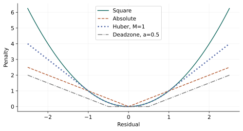

# 第 6 章：逼近、拟合与鲁棒模型

> 来源：讲义 PDF 第 193～217 页；教材第 6 章。先把最小二乘完整算一遍，再看改变误差度量、正则项与不确定性假设会发生什么。

## 从误差出发建模 {#base-01}

设已知：

$$
A\in\mathbb R^{m\times n},\qquad b\in\mathbb R^m,
$$

希望选择参数 $x\in\mathbb R^n$，让模型输出 $Ax$ 接近观测值 $b$。

残差向量为 $r=Ax-b$。最小二乘使用平方误差：

$$
\min_x f(x)=\frac12\|Ax-b\|_2^2.
$$

它会对较大的残差给予更大的惩罚。

## 推导梯度和 Hessian {#base-02}

展开：

$$
f(x)=\frac12x^TA^TAx-b^TAx+\frac12b^Tb.
$$

因此：

$$
\nabla f(x)=A^T(Ax-b),\qquad
\nabla^2f(x)=A^TA.
$$

对任意 $z$：

$$
z^TA^TAz=\|Az\|_2^2\geq0.
$$

所以 $A^TA\succeq0$，最小二乘总是凸问题。

## 最优性条件与唯一性 {#base-03}

令梯度为零：

$$
A^TAx^\star=A^Tb.
$$

这就是**正规方程**。

如果 $A$ 列满秩，则 $A^TA\succ0$：

$$
x^\star=(A^TA)^{-1}A^Tb.
$$

这说明理论上的解，但数值计算一般不直接求逆，通常用线性方程求解、QR 分解或 SVD。

如果 $A$ 列不满秩，最小二乘仍有解，但参数解不唯一。不要把“矩阵不可逆”误解成“问题无解”。

## 一个完整的数值例子 {#base-04}

取：

$$
A=
\begin{bmatrix}
1&0\\
0&1\\
1&1
\end{bmatrix},
\qquad
b=
\begin{bmatrix}1\\2\\2\end{bmatrix}.
$$

三个观测要求：

$$
x_1\approx1,\qquad x_2\approx2,\qquad x_1+x_2\approx2.
$$

三者不能全部精确满足，因此需要折中。

计算：

$$
A^TA=\begin{bmatrix}2&1\\1&2\end{bmatrix},
\qquad
A^Tb=\begin{bmatrix}3\\4\end{bmatrix}.
$$

解方程：

$$
\begin{cases}
2x_1+x_2=3,\\
x_1+2x_2=4,
\end{cases}
\quad\Longrightarrow\quad
x^\star=
\begin{bmatrix}2/3\\5/3\end{bmatrix}.
$$

残差和目标值为：

$$
Ax^\star-b=
\begin{bmatrix}-1/3\\-1/3\\1/3\end{bmatrix},
\qquad
f(x^\star)=\frac12\cdot\frac13=\frac16.
$$

代回 $A^T(Ax^\star-b)=0$，就完成了最优性检查。这个检查比“看起来误差很小”更有说服力。

## 岭回归：不只要求拟合好，还要控制参数大小 {#base-05}

加入平方正则项：

$$
\min_x
\frac12\|Ax-b\|_2^2+
\frac{\lambda}{2}\|x\|_2^2,
\qquad\lambda>0.
$$

梯度和 Hessian：

$$
\nabla f(x)=A^T(Ax-b)+\lambda x,
\qquad
\nabla^2f(x)=A^TA+\lambda I\succ0.
$$

因此无论 $A$ 是否列满秩，都有唯一最优解：

$$
x^\star=(A^TA+\lambda I)^{-1}A^Tb.
$$

仍用上面的数据，取 $\lambda=1$：

$$
\begin{bmatrix}3&1\\1&3\end{bmatrix}x^\star
=\begin{bmatrix}3\\4\end{bmatrix}
\quad\Longrightarrow\quad
x^\star=
\begin{bmatrix}5/8\\9/8\end{bmatrix}.
$$

和原来的 $(2/3,5/3)^T$ 相比，参数整体更小，但通常需要牺牲一部分训练数据上的拟合效果。

$\lambda$ 是建模参数：它控制两项目标的权衡。它不是由“凸性”自动确定的。

## 一范数正则化：认识稀疏性的入口 {#base-06}

$$
\min_x\frac12\|Ax-b\|_2^2+\lambda\|x\|_1,\qquad\lambda\geq0.
$$

它仍是凸问题，但在一些坐标为零的位置不可微。它常用于鼓励稀疏解，也就是让一部分参数精确为零；并不是任何数据和任何 $\lambda$ 都必然产生大量零元素。

这里先理解模型。不能直接对绝对值在零点使用普通导数，再套用光滑问题的梯度为零条件。

## 范数选择改变了“拟合好”的含义 {#norm-fitting}

同样的残差 $r=Ax-b$ 可以对应三个不同问题：

$$
\min_x\|r\|_2^2,\qquad
\min_x\|r\|_1,\qquad
\min_x\|r\|_\infty.
$$

平方误差强调大残差，绝对值误差以固定斜率对待较大偏差，无穷范数则只关注最大残差。它们不是同一问题的三种算法。

几何上，$Ax$ 位于 $A$ 的列空间；我们是在该子空间中找离 $b$ 最近的点，距离由所选范数决定。一范数模型用分量辅助变量写成 LP；无穷范数模型使用单个 $t$：

$$
\min_{x,t}t,\qquad -t\mathbf1\leq Ax-b\leq t\mathbf1.
$$

## 从范数推广到残差惩罚 {#penalties}

如果业务允许一定误差却不能容忍超限，可以使用：

$$
\min_{x,r}\sum_i\phi(r_i),\qquad r=Ax-b.
$$

只要一元惩罚 $\phi$ 凸，整个模型凸。讲义讨论：

- 平方惩罚 $\phi(u)=u^2$；
- 死区线性惩罚 $\phi(u)=\max(0,|u|-a)$，$a\geq0$；
- 硬边界的光滑障碍 $\phi(u)=-a^2\log(1-u^2/a^2)$，定义域 $|u|<a$、$a>0$。

死区内没有惩罚，表示可接受的小误差；障碍在边界前发散，表示必须严格保留余量。它们对残差直方图的影响是讲义中的计算示例，并非任何数据都具有相同分布。

Huber 惩罚采用讲义的归一化：

$$
\phi_M(u)=
\begin{cases}
u^2,&|u|\leq M,\\
2M|u|-M^2,&|u|>M,
\end{cases}\qquad M>0.
$$

两段在 $|u|=M$ 处值与一阶导数连续，导数单调，因此凸。较大残差的斜率限制在 $\pm2M$，这使异常值对拟合的影响小于平方误差；不能据此保证任何异常值都被正确识别。

看图时比较大残差处的增长速度，而不只是原点附近谁更低。不同归一化的 Huber 函数可能差一个 $1/2$，必须与正文参数约定保持一致。

## 最小范数：约束必须满足，再挑最小的解 {#least-norm}

当 $Ax=b$ 有很多解时，可以求：

$$
\min_x\|x\|,\qquad Ax=b.
$$

它与最小二乘的顺序不同：这里残差必须为零，优化的是参数大小。

若 $A\in\mathbb R^{m\times n}$ 行满秩，最小欧氏范数解为：

$$
x^\star=A^T(AA^T)^{-1}b.
$$

证明：拉格朗日驻点给出 $x=-A^T\nu$，代入等式解出 $\nu=-(AA^T)^{-1}b$。这里目标取 $\frac12\|x\|_2^2$，不会改变最优解。

若不满秩但系统可行，可以用伪逆表示最小欧氏范数解。采用一范数则可写为 LP，常鼓励稀疏解，但唯一性与精确稀疏恢复还需要额外条件。

## 正则化的等价增广表示 {#augmented}

岭回归可以写成普通最小二乘：

$$
\|Ax-b\|_2^2+\lambda\|x\|_2^2
=
\left\|
\begin{bmatrix}A\\\sqrt\lambda I\end{bmatrix}x
-\begin{bmatrix}b\\0\end{bmatrix}
\right\|_2^2.
$$

这不仅用于推导，还说明正则项是在附加“参数应接近零”的软信息。更一般的 $\|Lx\|_2^2$ 则可编码平滑性或结构。

## 输入设计与信号平滑 {#signals}

卷积系统的输出为 $y(t)=\sum_{\tau=0}^t h(\tau)u(t-\tau)$。冲激响应 $h$ 与期望输出 $y_{\mathrm{des}}$ 已知，控制输入 $u$ 是变量。

三个目标分别是跟踪误差、输入变化和输入幅度：

$$
J_{\mathrm{track}}=\sum_t(y(t)-y_{\mathrm{des}}(t))^2,\quad
J_{\mathrm{der}}=\sum_t(u(t+1)-u(t))^2,\quad
J_{\mathrm{mag}}=\sum_tu(t)^2.
$$

固定非负权重后，最小化三者的加权和是线性系统上的二次优化。变化惩罚大，会倾向于平缓输入；幅度惩罚大，会倾向于更小输入，但均可能牺牲跟踪性能。

信号重建中，已知噪声观测 $y\in\mathbb R^n$，未知真实信号 $z$，定义差分矩阵 $D$ 使 $(Dz)_i=z_{i+1}-z_i$：

$$
\min_z\frac12\|z-y\|_2^2+\lambda\|Dz\|_2^2
$$

是二次平滑，而

$$
\min_z\frac12\|z-y\|_2^2+\lambda\|Dz\|_1
$$

是总变差（TV）平滑。前者倾向于把相邻差分都压小，后者允许少量较大的跳变，常能保留阶跃。不能保证每个真实边缘都保留，也可能出现过度平滑。

自编可手算例：$y=(0,0,2,2)^T$，TV 权重 $0\leq\lambda\leq2$。解为：

$$
z^\star=(\lambda/2,\lambda/2,2-\lambda/2,2-\lambda/2)^T.
$$

可通过次梯度条件核查；$\lambda\geq2$ 时解融合为常量 $1$。实验图采用这一确定性例子，不假装复现讲义中未提供原始数据的大型信号。

## 随机鲁棒最小二乘为什么等于正则化 {#stochastic-robust}

设 $A=\bar A+U$，其中 $\bar A$ 已知，随机误差矩阵满足 $\mathbb EU=0$、$\mathbb E(U^TU)=P$。对固定 $x$：

$$
\begin{aligned}
\mathbb E\|Ax-b\|_2^2
&=\mathbb E\|\bar Ax-b+Ux\|_2^2\\
&=\|\bar Ax-b\|_2^2
+2(\bar Ax-b)^T\mathbb E(U)x
+x^T\mathbb E(U^TU)x\\
&=\|\bar Ax-b\|_2^2+x^TPx.
\end{aligned}
$$

交叉项消失用到了零均值，而不是“随机误差总能忽略”。当 $P=\lambda I$，这就是岭回归。若误差有非零均值，应先并入 $\bar A$，或保留交叉项。

## 最坏情况鲁棒拟合与 SDP {#worstcase}

设不确定矩阵为：

$$
A(u)=\bar A+\sum_{k=1}^p u_kA_k,\qquad\|u\|_2\leq1.
$$

对固定设计 $x$，令 $P(x)=[A_1x\ \cdots\ A_px]$、$q(x)=\bar Ax-b$。最坏平方残差是：

$$
\sup_{\|u\|_2\leq1}\|P(x)u+q(x)\|_2^2.
$$

利用单位球上单个二次约束的强对偶，可以等价写为：

$$
\begin{aligned}
\min_{x,t,\lambda}\quad&t+\lambda\\
\text{s.t.}\quad&
\begin{bmatrix}
I&P(x)&q(x)\\
P(x)^T&\lambda I&0\\
q(x)^T&0&t
\end{bmatrix}\succeq0.
\end{aligned}
$$

这里 $P(x)$ 和 $q(x)$ 都仿射依赖 $x$，因此矩阵约束是 LMI。$\lambda$ 是这一步鲁棒表示中的辅助标量，不是第一个模型中预先选定的正则化参数。

一个简单的确定性扰动是 $A(u)=A_0+uA_1,\ u\in[-1,1]$：名义模型只看 $u=0$，随机模型按给定分布平均，最坏模型看整个区间上的最大损失。三者优化的量不同，不能仅凭名义误差大小判断哪个“更鲁棒”。

讲义中比较三种拟合策略的曲线与直方图表达了这个差别；原始矩阵和抽样数据未附在目录中，因此本项目保留方法解释并提供自编小数据，不宣称原图数值已被复现。
