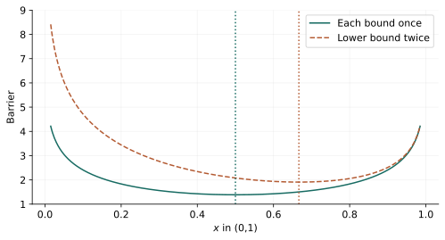
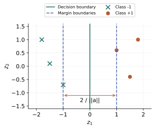

# 第 8 章：椭球、中心、分类与位置设计

> 来源：讲义 PDF 第 243～263 页；教材第 8 章对应主题。目标是把空间关系翻译为约束，而不是凭图形直觉猜凸性。

## 同一个椭球的两种参数化 {#ellipsoid-volume}

如果想用一个椭球包住数据，应该最小化它的体积；如果想在安全区域内放入一个椭球，应该最大化体积。两者约束方向相反，适合的变量也不同。

外包模型使用：

$$
E=\{z:\|Az+b\|_2\leq1\},\qquad A\in\mathbb S_{++}^n.
$$

中心是 $-A^{-1}b$。变量变换 $u=Az+b$ 给出体积 $\operatorname{vol}(E)=v_n/\det A$，其中 $v_n$ 是单位球体积。因此最小体积等价于最小化 $-\log\det A$。

对点集 $z_1,\ldots,z_m$：

$$
\min_{A\succ0,b}-\log\det A,\qquad
\|Az_i+b\|_2\leq1,\quad\forall i.
$$

每个已知 $z_i$ 固定，$Az_i+b$ 关于变量仿射，因此约束凸。由于椭球凸，包住所有点，也就包住它们的凸包。

对一般集合 $C$，约束是 $\sup_{z\in C}\|Az+b\|_2\leq1$。即使能证明关于 $(A,b)$ 凸，计算这个上确界仍可能很难；凸性与可有效求值是不同问题。

## 最大体积内接椭球 {#inscribed}

内接模型采用：

$$
E=\{Bu+d:\|u\|_2\leq1\},\qquad B\in\mathbb S_{++}^n.
$$

此时中心是 $d$，体积为 $v_n\det B$。如果容器为多面体 $C=\{z:a_i^Tz\leq b_i\}$，要求整个椭球都在其中：

$$
\sup_{\|u\|_2\leq1}a_i^T(Bu+d)
=\|B^Ta_i\|_2+a_i^Td\leq b_i.
$$

我们选择 $B$ 对称，所以 $B^Ta_i=Ba_i$。得到：

$$
\max_{B\succ0,d}\log\det B,\qquad
\|Ba_i\|_2+a_i^Td\leq b_i.
$$

这是凹函数最大化。不能用外包参数化的体积公式直接替换这里的目标，否则方向会错。

对于有内部的紧凸体，最优内接椭球围绕自身中心放大 $n$ 倍可以覆盖该凸体；对称情形因子可改进为 $\sqrt n$。外包椭球也有相应的收缩包含关系。这些是全局几何近似定理，不是说任意随便画的椭球都满足该保证。

## “中心”不是唯一的定义 {#centers}

最大内接球的中心、最大内接椭球的中心、解析中心，解决的是不同问题。内接球依赖欧氏坐标尺度，最大体积内接椭球在可逆仿射变换下具有自然对应关系。

解析中心最小化给定不等式的对数障碍：

$$
\min_x\phi(x)=-\sum_{i=1}^m\log(b_i-a_i^Tx),
\qquad Fx=g.
$$

定义域要求每个松弛量严格为正。靠近某一个边界会产生很大代价，因此它趋向于远离所有给定不等式边界。

它依赖**约束表示**，不只依赖集合。例如区间 $0<x<1$ 的障碍 $-\log x-\log(1-x)$ 在 $1/2$ 取最小；如果把 $x\geq0$ 重复一遍，障碍变为 $-2\log x-\log(1-x)$，最小点变成 $2/3$，允许区域却没有改变。

这个反例说明“多写一个冗余约束不会改变可行域”，却可能改变基于障碍的中心。

对于有界、满维、严格可行的线性不等式系统，设解析中心 $x_{\rm ac}$、$H=\nabla^2\phi(x_{\rm ac})\succ0$，则：

$$
\{x:(x-x_{\rm ac})^TH(x-x_{\rm ac})\leq1\}
\subseteq C
\subseteq
\{x:(x-x_{\rm ac})^TH(x-x_{\rm ac})\leq m(m-1)\}.
$$

这里 $C$ 包括边界。若有等式约束，应先限制到其仿射空间并使用相应的切向 Hessian；不能把一个满空间椭球说成包含于低维可行面。

## 线性可分性先是一个可行性问题 {#classification}

两组已知点为 $x_i$ 与 $y_j$。寻找超平面 $a^Tz+b=0$，使：

$$
a^Tx_i+b>0,\qquad a^Ty_j+b<0.
$$

有限点集严格可分时，所有分离余量有正的最小值。把 $(a,b)$ 同比放大，可规范为：

$$
a^Tx_i+b\geq1,\qquad a^Ty_j+b\leq-1.
$$

于是变成关于 $(a,b)$ 的线性可行性问题。规范化依赖有限点集的严格余量；不是任意无限约束都能这样统一缩放。

## 最大间隔与软间隔 {#margin}

两条平行边界 $a^Tz+b=1$ 和 $a^Tz+b=-1$ 的距离为 $2/\|a\|_2$，假设 $a\neq0$。最大化间隔等价于：

$$
\min_{a,b}\frac12\|a\|_2^2,\qquad
a^Tx_i+b\geq1,\quad a^Ty_j+b\leq-1.
$$

它是 QP。若点不可分，增加非负松弛量 $u_i,v_j$，将右侧分别改为 $1-u_i$ 与 $-1+v_j$。只最小化松弛总和会得到 LP；加入范数惩罚，得到间隔与违约量之间的凸权衡。

讲义使用 $\|a\|_2+\gamma(\mathbf1^Tu+\mathbf1^Tv)$；常见的另一种模型使用 $\frac12\|a\|_2^2$。它们都是凸模型，但相同权重下不应当说成完全同一个目标。

图中实线是分类边界，虚线是规范化间隔边界，符号区分两类点。松弛量衡量的是间隔约束违反量，不直接等于误分类样本的个数。

## 非线性边界不等于非凸训练 {#nonlinear}

先固定特征映射 $F(z)\in\mathbb R^k$，再学习系数 $\theta$：

$$
f_\theta(z)=\theta^TF(z).
$$

虽然它对输入 $z$ 可以非线性，对参数 $\theta$ 仍然线性，因此固定训练点后的分类约束仍是线性不等式。

例如二次判别：

$$
f(z)=z^TPz+q^Tz+r.
$$

对每个已知 $z_i$，$z_i^TPz_i=\operatorname{tr}(Pz_iz_i^T)$ 关于未知矩阵 $P$ 是线性的。若再要求 $P\preceq-I$，则引入一个 LMI，仍保持凸性。任意固定阶的多项式基也可这样处理。

如果连特征映射的内部参数一起训练，例如一般多层神经网络，就不能继续沿用这个线性参数化结论。

## 位置设计与设施选址 {#placement}

设部分位置固定，其他点 $x_i\in\mathbb R^2$ 或 $\mathbb R^3$ 可选择，已知边集合为 $\mathcal E$：

$$
\min_{\{x_i\}}\sum_{(i,j)\in\mathcal E}
h_{ij}(\|x_i-x_j\|_2).
$$

若每个 $h_{ij}$ 在非负轴上凸且非递减，则每项是凸函数的合法复合，整个模型凸。讲义比较 $h(s)=s,s^2,s^4$：较高幂对长边惩罚更强，可能形成更均衡的边长。

目标并不保证唯一位置；如果所有点都自由且没有锚点，整体平移不会改变任何距离。约束是否消除这种自由度，也必须检查。

本章的关键方法是先把“包住、放入、分开、靠近”写成量词明确的数学关系，再消去最坏方向或选取合适参数化。
