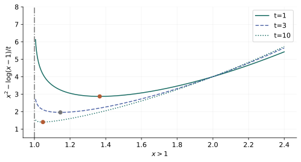

# 第 11 章：障碍法、中心路径与内点法

> 来源：讲义 PDF 第 353～395 页；教材第 11 章。基本设定：$f_i$ 凸且二阶连续可微，$A$ 行满秩，原最优值有限且取得，并存在严格可行点。中心子问题的存在、唯一性和牛顿系统可解性需要另行检查。

## 用障碍代替不能穿越的边界 {#barrier}

对于 $f_i(x)\leq0$，凸分析指示函数可以把违反约束的代价设为 $+\infty$，但这种目标不光滑。对数障碍保留严格可行域：

$$
\phi(x)=-\sum_{i=1}^m\log(-f_i(x)),\qquad f_i(x)<0.
$$

当某个松弛量 $-f_i(x)$ 趋于零，障碍趋于 $+\infty$。

考虑 $\min_{Ax=b}[tf_0(x)+\phi(x)]$，$t>0$。除以 $t$ 后看成原目标加 $\phi/t$：增大 $t$，障碍的相对影响变小。

图中只是一个一维例子 $\min_{x\geq1}x^2$ 的障碍子问题 $tx^2-\log(x-1)$。边界 $x=1$ 始终不可进入，但最优中心点随着 $t$ 增大从内部接近它。

分段线性或范数目标可以先用上图变换写为 LP，再应用光滑障碍框架；不能直接在不可微点套用光滑牛顿公式。

## 障碍梯度和 Hessian 从哪里来 {#derivatives}

一项 $-\log(-f_i(x))$ 的梯度为 $-\nabla f_i(x)/f_i(x)$，因此：

$$
\nabla\phi(x)=\sum_i\frac{\nabla f_i(x)}{-f_i(x)}.
$$

再用乘积法则：

$$
\nabla^2\phi(x)=
\sum_i\left[
\frac{\nabla f_i(x)\nabla f_i(x)^T}{f_i(x)^2}
+\frac{\nabla^2f_i(x)}{-f_i(x)}
\right].
$$

第一项为外积半正定，第二项因 $-f_i(x)>0$ 且 $f_i$ 凸而半正定，因此障碍凸。这里正分母是推导符号的关键。

线性不等式的梯度产生“向内的力”，其大小随离对应超平面的距离倒数增长。中心点可理解为目标的推动与各边界阻力平衡，但力场类比不能代替以上导数和最优性条件。

## 中心路径与精确对偶间隙 {#central-path}

设每个 $t$ 的子问题有唯一解 $x(t)$。其等式乘子记为 $w(t)$，驻点条件为：

$$
t\nabla f_0(x(t))
+\sum_i\frac{\nabla f_i(x(t))}{-f_i(x(t))}
+A^Tw(t)=0.
$$

两侧除以 $t$，定义：

$$
\lambda_i(t)=\frac{-1}{tf_i(x(t))}>0,\qquad
\nu(t)=w(t)/t.
$$

这恰好成为原拉格朗日函数的驻点条件。由于该函数关于 $x$ 凸，$x(t)$ 达到它的全局下确界，得到：

$$
g(\lambda(t),\nu(t))
=f_0(x(t))+\sum_i\lambda_i(t)f_i(x(t))
=f_0(x(t))-\frac mt.
$$

因此：

$$
0\leq f_0(x(t))-p^\star\leq\frac mt.
$$

中心路径与原 KKT 的差别只在互补松弛：

$$
-\lambda_i(t)f_i(x(t))=1/t
$$

代替了零。这个正的小量避免过早碰到边界，逐渐让它变小便接近最优。

自编一维例子可解出：

$$
x(t)=\frac{1+\sqrt{1+2/t}}2>1.
$$

直接代入 $2tx-1/(x-1)=0$ 可验证。对应乘子 $2x(t)$，原始与对偶目标差正好为 $1/t$，而不是仅仅“看起来差不多”。

## 基本障碍法与参数权衡 {#algorithm}

给定严格可行点、$t_0>0$、放大因子 $\rho>1$：

1. 用等式约束牛顿法近似最小化 $tf_0+\phi$；
2. 若精度和估计的目标间隙已足够，停止；
3. 令 $t\leftarrow\rho t$，以上一步的点热启动新子问题。

小 $\rho$ 需要较多外层阶段，但相邻中心点接近；大 $\rho$ 外层较少，却可能让每次中心化更难。讲义的 LP、GP、SOCP、SDP 曲线是这项权衡的示例，不能把某条经验曲线固定为所有模型的最佳参数。

理想精确中心情形，从 $t_0$ 到满足 $m/t\leq\varepsilon$，更新次数是：

$$
\max\left(0,\left\lceil
\frac{\log(m/(\varepsilon t_0))}{\log\rho}
\right\rceil\right),
$$

另加初始中心化。实际算法须计入子问题误差，不能只把 $m/t$ 打印出来就声称获得了该精度。

## Phase I：严格可行起点从哪里来 {#phase-one}

增加一个共同松弛量 $s$：

$$
\min_{x,s}s,\qquad f_i(x)\leq s,\quad Ax=b.
$$

若已经有一个位于函数共同定义域、满足等式的 $\widetilde x$，可以选 $s>\max_i f_i(\widetilde x)$，让辅助问题严格满足不等式。

- 找到 $s<0$ 的可行点，就找到了原问题的严格可行点；
- 证明辅助最优值为正，便证明原约束不可行；
- 辅助下确界为零时，需要区分可行但无严格余量，以及下确界不取得等退化情况。

替代方法是最小化违约量总和：

$$
\min_{x,s}\mathbf1^Ts,\qquad
f_i(x)\leq s_i,\quad s_i\geq0,\quad Ax=b.
$$

其目标为零且取得，当且仅当原系统可行。但某个零目标最优点可能在原边界上，**不能保证任意最优解都严格可行**。需要严格余量时，应检查它，或使用共同松弛量模型。

总违约量方法在不可行系统中常产生较少的非零违约项，帮助识别一个较大的可行子系统；这是常见现象，不是每个实例都满足的计数保证。讲义第 375 页的 39 与 79 是特定数据的结果。

## 为什么能有多项式迭代界 {#complexity}

复杂度分析比“实际迭代不多”需要更强假设：相关下水平集有界且闭，所用障碍子问题符合自协调条件等。

从中心 $x(t)$ 热启动下一阶段 $x(\rho t)$，利用 $\log u\leq u-1$ 与旧对偶下界，可以把新子问题的初始目标间隙控制为：

$$
[\rho tf_0+\phi](x(t))
-[\rho tf_0+\phi](x(\rho t))
\leq m(\rho-1-\log\rho).
$$

再结合自协调牛顿法的每阶段界，选择 $\rho=1+1/\sqrt m$，可得到理想化框架下：

$$
O\left(\sqrt m\log\frac{m}{t_0\varepsilon}\right)
$$

量级的牛顿迭代界。总运算成本还需乘上每步求导、矩阵构造与线性系统求解成本。该选择优化的是分析中的最坏情况界，不等于实际最快参数。

熵目标等问题有时需要把隐含域限制改为显式约束，构造适当的自协调障碍后，才能使用这套证明。算法能运行与这项特定理论适用，是两个问题。

## 广义不等式的障碍 {#cone-barriers}

对于真锥 $K$，用一个凹的广义对数 $\psi$ 表示内部，其对数齐次性为：

$$
\psi(sy)=\psi(y)+\vartheta\log s,\qquad s>0.
$$

$\vartheta>0$ 是障碍的度，不是决策变量。常见例子：

| 锥 | 广义对数 | 度 |
|---|---|---:|
| $\mathbb R_+^n$ | $\sum_i\log y_i$ | $n$ |
| $\mathbb S_+^n$ | $\log\det Y$ | $n$ |
| 二阶锥 $\|u\|_2<t$ | $\log(t^2-\|u\|_2^2)$ | $2$ |

对齐次等式关于 $s$ 求导并取 $s=1$：

$$
\langle y,\nabla\psi(y)\rangle=\vartheta.
$$

其梯度位于相应对偶锥，矩阵情形的内积是迹。对约束 $f_i(x)\preceq_{K_i}0$，障碍为：

$$
\phi(x)=-\sum_i\psi_i(-f_i(x)).
$$

精确中心点的对偶乘子可由 $\lambda_i=\nabla\psi_i(-f_i(x))/t$ 构造，间隙从 $m/t$ 改成：

$$
\frac{\sum_i\vartheta_i}{t}.
$$

所以一个 $n\times n$ 的 PSD 约束，度是 $n$，不是矩阵元素个数 $n^2$。

## SDP 的中心路径 {#sdp}

讲义采用 $F(x)=G+\sum_i x_iF_i\preceq0$：

$$
\min c^Tx,\qquad
\phi(x)=-\log\det(-F(x)).
$$

中心点满足：

$$
tc_i-\operatorname{tr}(F(x)^{-1}F_i)=0.
$$

定义 $Z=-F(x)^{-1}/t\succ0$，则：

$$
\operatorname{tr}(F_iZ)+c_i=0,
$$

它是对偶 $\max\operatorname{tr}(GZ)$ 的可行点，间隙为矩阵阶数除以 $t$。符号来自负半定约束的写法；换成正半定写法时应重新核对。

## 原始与对偶内点方向 {#primal-dual}

基本障碍法固定一个 $t$ 再完成中心化；原始与对偶方法同时更新 $x,\lambda,\nu$，追踪修改后的 KKT 系统。

令 $f(x)=(f_1(x),\ldots,f_m(x))^T$、$J$ 的第 $i$ 行为 $\nabla f_i(x)^T$，残差为：

$$
r_{\rm d}=\nabla f_0(x)+J^T\lambda+A^T\nu,\quad
r_{\rm p}=Ax-b,\quad
r_{\rm c}=-\operatorname{diag}(\lambda)f(x)-\tau\mathbf1.
$$

固定目标互补量 $\tau>0$ 时，Newton 系统为：

$$
\begin{bmatrix}
H_L&J^T&A^T\\
-\operatorname{diag}(\lambda)J&-\operatorname{diag}(f(x))&0\\
A&0&0
\end{bmatrix}
\begin{bmatrix}\Delta x\\\Delta\lambda\\\Delta\nu\end{bmatrix}
=-\begin{bmatrix}r_{\rm d}\\r_{\rm c}\\r_{\rm p}\end{bmatrix},
$$

其中 $H_L=\nabla^2f_0+\sum_i\lambda_i\nabla^2f_i$。选择步长时维持相应内部与乘子正性，并减小残差。

更一般的内点实现允许不可行起点并使用额外机制恢复可行性。本节只给出讲义末页提到的修改 KKT 思想和教材补充方程，不把它当成完整的通用求解器实现。
