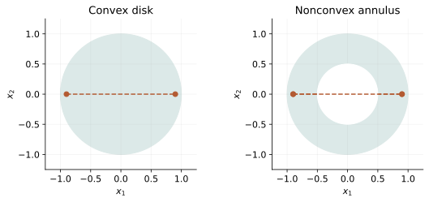
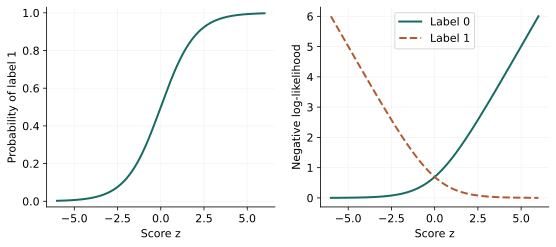
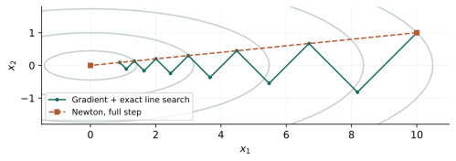
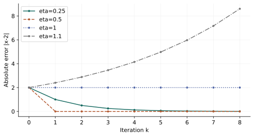

# 凸优化系统学习笔记

依据本地 Boyd–Vandenberghe 讲义与教材整理。正文来源为 docs/；本文件自动生成，不直接维护。

## 阅读目录

- [阅读指南与统一符号](#guide)
- [预备章：数学语言与计算基础](#00-foundations)
- [第 1 章：优化建模与学习起点](#01-modeling)
- [第 2 章：凸集与几何结构](#02-sets)
- [第 3 章：凸函数与构造规则](#03-functions)
- [第 4 章：凸问题、标准模型与变换](#04-problems)
- [第 5 章：对偶、KKT 与最优性证书](#05-duality)
- [第 6 章：逼近、拟合与鲁棒模型](#06-approximation)
- [第 7 章：统计估计、检测与实验设计](#07-statistics)
- [第 8 章：椭球、中心、分类与位置设计](#08-geometry)
- [附录：数值线性代数与优化实现](#appendix-numerics)
- [第 9 章：无约束优化算法](#09-unconstrained)
- [第 10 章：等式约束与不可行起点牛顿法](#10-equality)
- [第 11 章：障碍法、中心路径与内点法](#11-interior)
- [第 12 章：综合实践与继续学习](#12-practice)
- [练习与自编参考解](#exercises)
- [可复现的程序实验](#experiments)
- [学习大纲与知识地图](#syllabus)
- [全课程知识点清单](#knowledge)
- [讲义逐页覆盖索引](#coverage)
- [资料来源、版本与勘误](#sources)
- [教学可视化与设计说明](#visualizations)
- [维护与更新](#maintenance)
- [建设与验收报告](#report)

---

## 阅读指南与统一符号

### 这门课真正训练什么

面对一个工程或数据问题，你要能说清：什么可以选择，怎样评价好坏，什么条件不能违反；随后识别凸结构，设计适合计算的表达式，并检查结果是否可信。

教材围绕三个动作组织：**识别、建模、求解**。证明与算法服务于这些动作，不是分散的公式集合。

### 零基础怎样开始

如果向量、矩阵、偏导数已经陌生，先读[数学预备章](#00-foundations)，每个例子至少手算一次。它只补当前需要的知识，不要求先学完全部高等数学。

主线路线：

~~~text
数学语言 → 优化建模 → 凸集 → 凸函数 → 标准问题
                                  ↓
                             对偶与 KKT
                                  ↓
                  拟合 / 统计估计 / 几何应用
                                  ↓
                 数值线性代数 → 无约束牛顿
                                  ↓
                    等式约束 → 障碍与内点法
~~~

应用章节可以在完成凸性与建模后先读模型，再在学完对偶后回头理解证书与敏感性。数值附录放在算法前，是因为线性方程是牛顿法的计算核心。

每章读到新公式时，先识别变量与数据，再看定义域和假设，最后沿推导检查维度。能够解释公式在解决什么问题，比立即背下它更重要。

### 各部分怎样配合

- 正文：完整解释主线概念、推导、典型应用与限制。
- 图表：解决某个几何或变化直觉，不替代证明。
- 练习：前 12 题建立入门基础，扩展题覆盖应用与算法。
- 实验：使用固定小数据，解析值与程序结果交叉检查。
- 知识清单：定位概念，标明重要性、深度与来源。
- 覆盖索引：从每个讲义物理页回到实际正文，结构页单独标记。

没有独立的课程作业文件、教师答案或原始大型案例数据。练习和新增实验均明确标为自编，不把教材的习题库说成已经全部完成。

### 统一符号

| 符号 | 数学对象与含义 |
|---|---|
| $x\in\mathbb R^n$ | 待选择的列向量；统计章的未知参数也会写作 $\theta$ |
| $A\in\mathbb R^{m\times n},b\in\mathbb R^m$ | 已知矩阵与观测或约束右端 |
| $f_0,f_i$ | 目标函数、不等式函数 |
| $Ax=b$ | 仿射等式；$A$ 是否满秩需按具体定理检查 |
| $D,\mathcal F$ | 共同定义域、可行域 |
| $x^\star,p^\star$ | 最优点、原始最优值 |
| $g,d^\star$ | 对偶函数、对偶最优值 |
| $\lambda\geq0,\nu$ | 对应 $f_i\leq0$ 的乘子、自由符号等式乘子 |
| $\nabla f,\nabla^2f$ | 梯度、Hessian |
| $\mathbb S^n,\mathbb S_+^n,\mathbb S_{++}^n$ | 对称、半正定、正定矩阵集合 |
| $x\leq y$ | 向量时按分量比较 |
| $X\succeq0$ | 对称矩阵半正定，不能按元素解释 |
| $\langle X,Y\rangle$ | 矩阵内积，一般为 $\operatorname{tr}(X^TY)$ |
| $x^k,\eta_k$ | 第 $k$ 个迭代点、梯度步长；$k$ 不表示乘方 |
| $\mu,L$ | 强凸常数、梯度的 Lipschitz 常数 |
| $\delta$ | 牛顿减量，避免与对偶乘子 $\lambda$ 混淆 |
| $t,\rho,\vartheta$ | 障碍权重、外层放大因子、锥障碍的度 |
| $\Sigma,S$ | 协方差、精度矩阵 $\Sigma^{-1}$ |

正则化文献经常也用 $\lambda$ 表示预先选定的权重，它不是同一个模型中的对偶乘子。每次进入新模型，会在附近重新说明角色。

### 来源与讲解层次

主要来源是当前本地修订讲义，共 402 页，包括 12 个编号部分和夹在第 8、9 章之间的数值线性代数附录。教材共 714 页，用于解释、证明和核正。教材还包含一些本讲义没有展开的章节细节，本项目不声称逐页覆盖整本教材。

正文中核心主线充分展开；应用页保留建模和关键推导；只作展望的内容保留为后续入口。原课件、教材补充、自编例题与复现实验由章节说明和清单区分。

全项目的来源页码统一为 **PDF 物理页码，从 1 开始**。如另写教材印刷页码，会明确标注。当前教材正文的物理页码为印刷页码加 14。

发现原讲义疑似笔误时，查看图像并用教材或独立推导核对，再在[来源与勘误](#sources)记录；不能直接复制提取文本。

### 怎样判断自己理解了

对每个主要概念，尝试回答：

1. 如果去掉一个假设，结论会不会失效？
2. 能否手算最小的非平凡例子？
3. 数值程序应该检查哪一个残差或界？
4. 换一组变量或单位，模型含义是否保持？

例如学完 KKT，应该能解释为什么 $\min_{x\geq1}x^2$ 的最优点梯度不是零，却满足完整最优性条件。若只记得“令导数等于零”，需要返回约束最优性一节。

---

## 预备章：数学语言与计算基础

### 集合、属于与“所有满足条件的点”

$x\in C$ 表示“$x$ 属于集合 $C$”。

$$
C=\{x\in\mathbb R\mid x\geq 0\}
$$

读作“所有非负实数组成的集合”。竖线 $\mid$ 表示“满足”。

$\mathbb R$ 是实数集合；$\mathbb R^n$ 是由 $n$ 个实数组成的向量空间。$\forall$ 表示“对任意”，$\exists$ 表示“存在”。

### 标量、向量、矩阵

**标量**是一个数，例如预算 $b=100$。

**向量**把多个数放在一起：

$$
x=\begin{bmatrix}x_1\\x_2\end{bmatrix}\in\mathbb R^2.
$$

可以把它理解成“购买第一种、第二种原料的数量”。

**矩阵**把多个线性关系放在一起：

$$
A=
\begin{bmatrix}
1&2\\
3&4
\end{bmatrix},\qquad
Ax=
\begin{bmatrix}
x_1+2x_2\\
3x_1+4x_2
\end{bmatrix}.
$$

如果 $A\in\mathbb R^{m\times n}$、$x\in\mathbb R^n$，那么 $Ax\in\mathbb R^m$。不会做题时，先检查维度，常能发现错误。

### 转置与内积

$x^T$ 表示把列向量转成行向量。

$$
a^Tx=\sum_{i=1}^n a_ix_i.
$$

例如：

$$
a=\begin{bmatrix}2\\3\end{bmatrix},
\quad
x=\begin{bmatrix}4\\5\end{bmatrix}
\quad\Longrightarrow\quad
a^Tx=2\cdot4+3\cdot5=23.
$$

内积可以表示总成本，也可以描述方向。两个向量的内积为零时，它们在欧氏意义下相互垂直。

### 范数：衡量一个向量有多大

最常见的三个范数：

$$
\|x\|_1=\sum_i|x_i|,\qquad
\|x\|_2=\sqrt{\sum_i x_i^2},\qquad
\|x\|_\infty=\max_i|x_i|.
$$

对 $x=(3,-4)^T$：

$$
\|x\|_1=7,\qquad \|x\|_2=5,\qquad \|x\|_\infty=4.
$$

可以分别理解为“绝对值总量”“直线长度”“最大单项幅度”。以后看到 $\|Ax-b\|$，就是在用某种规则衡量误差向量的大小。

注意：

$$
\|x\|_2^2=x^Tx
$$

是欧氏范数的平方，它本身不再是范数，但仍是凸函数。

### 导数、偏导数、梯度

一元函数的导数 $f'(x)$ 描述局部变化率。例如：

$$
f(x)=(x-2)^2,\qquad f'(x)=2(x-2).
$$

多元函数对每个变量分别求导，得到偏导数。把偏导数排成列向量，就是**梯度**：

$$
\nabla f(x)=
\begin{bmatrix}
\frac{\partial f}{\partial x_1}\\
\vdots\\
\frac{\partial f}{\partial x_n}
\end{bmatrix}.
$$

例如：

$$
f(x_1,x_2)=x_1^2+3x_2^2,
\qquad
\nabla f(x)=
\begin{bmatrix}2x_1\\6x_2\end{bmatrix}.
$$

局部一阶近似是：

$$
f(x+d)\approx f(x)+\nabla f(x)^Td.
$$

如果取 $d=-\eta\nabla f(x)$，其中 $\eta>0$，近似变化量为：

$$
-\eta\|\nabla f(x)\|_2^2\leq 0.
$$

这解释了为什么负梯度是一个自然的下降方向。实际下降还取决于步子是否足够小、是否仍在定义域中。

### Hessian：描述不同方向的弯曲程度

Hessian，也叫海森矩阵，是二阶偏导数组成的矩阵：

$$
\nabla^2f(x)=
\left[\frac{\partial^2 f}{\partial x_i\partial x_j}\right]_{i,j=1}^n.
$$

对于 $f(x_1,x_2)=x_1^2+3x_2^2$：

$$
\nabla^2f(x)=
\begin{bmatrix}2&0\\0&6\end{bmatrix}.
$$

二阶近似是：

$$
f(x+d)\approx
f(x)+\nabla f(x)^Td+
\frac12d^T\nabla^2f(x)d.
$$

最后一项告诉我们函数沿方向 $d$ 的弯曲情况。

### 正定与半正定

对称矩阵 $P=P^T$：

$$
P\succeq0
\quad\Longleftrightarrow\quad
z^TPz\geq0,\ \forall z,
$$

称为**半正定**。

$$
P\succ0
\quad\Longleftrightarrow\quad
z^TPz>0,\ \forall z\neq0,
$$

称为**正定**。

直觉：半正定表示沿任何方向的二次型都不会为负；正定表示非零方向上的二次型都严格为正。

对实对称矩阵：

- 所有特征值非负，等价于半正定。
- 所有特征值为正，等价于正定。

这里的 $\succeq0$ **不是“每个元素都非负”**。例如：

$$
P=\begin{bmatrix}1&2\\2&1\end{bmatrix}
$$

所有元素为正，但取 $z=(1,-1)^T$，有 $z^TPz=-2$，因此它不是半正定矩阵。

对于对称的 $2\times2$ 矩阵：

$$
P=\begin{bmatrix}a&b\\b&c\end{bmatrix},
$$

半正定当且仅当：

$$
a\geq0,\quad c\geq0,\quad ac-b^2\geq0.
$$

正定当且仅当 $a>0$ 且 $ac-b^2>0$。

### 二次函数的求导公式

设 $P=P^T$，则：

$$
f(x)=\frac12x^TPx+q^Tx+r
$$

满足：

$$
\nabla f(x)=Px+q,\qquad \nabla^2f(x)=P.
$$

前面的 $\frac12$ 是为了让求导后不再多出一个 $2$。

如果 $P$ 不对称，梯度应为 $\frac12(P+P^T)x+q$；讨论二次型时通常直接使用对称矩阵。

**本节自检：** 能否算出 $\nabla(x_1^2+x_1x_2+2x_2^2)$？答案应为 $(2x_1+x_2,\ x_1+4x_2)^T$。

---

## 第 1 章：优化建模与学习起点

> 来源：讲义 PDF 第 2～19 页；最优点、可行性与定义域的进一步讨论见第 89～99 页。本章的两产品数值例子为自编例题。

### 优化就是“在限制条件下选择最好的方案”

假设你想买一些原料：

- 购买多少，是你可以决定的量，叫作**优化变量**。
- 花费多少钱，是评价方案的指标，叫作**目标函数**。
- 预算不能超标、原料不能为负，是**约束条件**。

数学上常写成：

$$
\begin{aligned}
\operatorname{minimize}_{x}\quad &f_0(x)\\
\text{subject to}\quad &f_i(x)\leq 0,\quad i=1,\ldots,m,\\
&h_j(x)=0,\quad j=1,\ldots,p.
\end{aligned}
$$

读法：“在满足下面所有条件的 $x$ 中，让 $f_0(x)$ 尽可能小。”

这里的下标 $0$ 只是用来区分目标函数与约束函数，没有特殊的运算含义。

### 先看一个能直接算出的例子

$$
\min_x (x-2)^2,\qquad \text{满足 }x\geq 3.
$$

如果没有约束，$x=2$ 最好；但它违反了 $x\geq 3$。在允许的范围 $[3,\infty)$ 中，离 $2$ 最近的是 $3$，所以：

$$
x^\star=3,\qquad p^\star=(3-2)^2=1.
$$

注意两个量：

- $x^\star$ 是**最优解**，回答“选什么”。
- $p^\star$ 是**最优值**，回答“选完以后目标是多少”。

二者不能混用。

### 为什么专门研究“凸”优化

一般的优化问题可能有很多局部低谷，算法找到一个低点后，仍不容易判断它是否是全局最优。

凸优化的关键性质是：

> 对凸问题，任何局部最优解都是全局最优解。

它还提供了清楚的最优性条件和对偶理论，可以帮助我们证明一个答案确实最优。许多常见的有限维凸模型也有成熟的数值求解方法。

但“凸”不自动保证：

- 问题存在可行点；
- 有限的最优值能够被某个点取得；
- 最优解唯一；
- 任意算法、任意步长都收敛；
- 不考虑规模与结构也能迅速计算。

### 区分变量和已知数据

假设两种产品的生产数量是 $x_1,x_2$，单位成本分别为 $2,3$，至少生产 $10$ 件：

$$
\begin{aligned}
\min_{x_1,x_2}\quad &2x_1+3x_2\\
\text{s.t.}\quad &x_1+x_2\geq10,\\
&x_1\geq0,\quad x_2\geq0.
\end{aligned}
$$

这里 $x_1,x_2$ 是变量，$2,3,10$ 是已知数据。s.t. 是 subject to 的缩写，即“满足约束”。

如果允许连续数量，最优解是 $(10,0)$，最优值为 $20$。证明很简单：

$$
2x_1+3x_2=2(x_1+x_2)+x_2\geq20,
$$

而 $(10,0)$ 达到了这个下界。

若要求数量必须为整数，就额外引入了整数约束。即使这个小例子答案仍相同，问题类别也发生了变化，不能因此认为一般整数规划都是凸优化。

### 统一写成“小于等于零”

为了方便套用理论，常把约束统一写成 $f_i(x)\leq0$：

$$
\begin{aligned}
x_1+x_2\geq10
&\Longleftrightarrow 10-x_1-x_2\leq0,\\
x_1\geq0
&\Longleftrightarrow -x_1\leq0.
\end{aligned}
$$

这一步看起来只是移项，却决定了后面拉格朗日乘子的符号。

### 可行域、最优解、最优值

把满足所有约束且位于函数定义域中的点放在一起，得到**可行域**：

$$
\mathcal F=
\{x\in D\mid f_i(x)\leq0,\ h_j(x)=0\}.
$$

$D$ 是目标函数和约束函数的共同定义域。

最优值一般定义为：

$$
p^\star=\inf_{x\in\mathcal F}f_0(x).
$$

$\inf$ 是“下确界”，可以理解为所有目标值的最大下界。使用它，是为了容纳“能无限接近，但没有点真正达到”的情况。

### 四种结果必须分清

| 情况 | 例子 | 结果 |
|---|---|---|
| 有最优解 | $\min_{x\in\mathbb R}x^2$ | $x^\star=0,\ p^\star=0$ |
| 不可行 | 同时要求 $x\geq1$ 和 $x\leq0$ | 可行域为空，约定 $p^\star=+\infty$ |
| 向下无界 | $\min_{x\in\mathbb R}x$ | $p^\star=-\infty$ |
| 下确界有限但不取得 | $\min_{x\in\mathbb R}e^x$ | $p^\star=0$，没有最优解 |

最后一个例子尤其重要：$e^x$ 永远大于 $0$，只能在 $x\to-\infty$ 时趋近于 $0$。

“可行域无界”和“目标向下无界”也不同。例如 $\min_{\mathbb R}x^2$ 的可行域无界，却有最优解。

### 同一个框架的四种用途

优化变量可以代表行动，也可以代表模型参数。行动问题中，目标可能是能耗或成本；拟合问题中，目标可能是预测误差加模型复杂度。数学外形相同，解释却不同，建模前必须说明什么是可以控制的。

最坏情况分析中，变量还可以代表不受我们控制的环境。设 $u$ 是扰动，$x$ 是设计，那么先对 $u$ 求最坏值，再选设计：

$$
\min_{x\in C}\sup_{u\in U}\ell(x,u).
$$

$C$ 是可选设计集合，$U$ 是允许的扰动集合。对每个固定 $u$，若 $\ell(\cdot,u)$ 凸，则上确界关于 $x$ 凸；但“可计算这个上确界”仍是另一项要求。

讲义也介绍“用最优化描述一个主体的行为”，例如效用最大化。这属于建模假设，不能因为数学模型最优，就断言真实主体一定严格服从模型。

### 识别结构与调用求解器

讲义用建模语言演示非负最小二乘：

$$
\min_{x\in\mathbb R^n}\|Ax-b\|_2^2,\qquad x_i\geq0.
$$

$A\in\mathbb R^{m\times n}$ 与 $b\in\mathbb R^m$ 是输入数据。建模系统可以把表达式转换为标准二次或锥形式，调用求解器，再把标准问题的解转换回 $x$。**模型、转换规则、数值求解器是三个层次。**

本项目的必做实验不依赖建模软件，以便先看清迭代和最优性。讲义中的 CVXPY 代码页在来源索引中保留，其具体用法可在理解 DCP 后继续学习；本项目不把未安装、未执行的原始软件示例列为已复现。

讲义从凸分析、线性规划、内点法到大型一阶方法回顾历史。历史帮助理解工具的来由；其中具体硬件速度、规模和运行时间属于讲义示例，不能当作今天任何电脑或模型的性能保证。

---

## 第 2 章：凸集与几何结构

> 来源：讲义 PDF 第 20～43 页；教材第 2 章。先用线段理解可行区域，再认识后面标准模型需要的几何对象。

在优化建模中，一个点代表一套方案，所有允许的点组成可行域。如果两套方案都能实施，把它们按比例混合后是否仍能实施？例如，两份满足营养下限的食谱按重量比例混合，营养量也按比例变化，仍满足线性下限。这个“中间方案仍然可行”的性质，就是凸集要捕捉的结构。

本章先在平面上看线段，再把同一个定义推广到向量、矩阵和锥。这里 $x,y\in\mathbb R^n$ 是两套方案对应的列向量，$\theta$ 是一个标量比例。

### 凸组合先于凸集

取两个点 $x,y$，定义：

$$
z=\theta x+(1-\theta)y,\qquad 0\leq\theta\leq1.
$$

$z$ 是两点的**凸组合**。

例如 $x=2,y=8$：

- $\theta=1$ 时，$z=2$；
- $\theta=0$ 时，$z=8$；
- $\theta=\frac12$ 时，$z=5$；
- 让 $\theta$ 在 $[0,1]$ 内变化，就扫过整条线段。

多个点的凸组合满足：

$$
z=\sum_{i=1}^k\theta_i x_i,\qquad
\theta_i\geq0,\quad\sum_i\theta_i=1.
$$

### 凸集的定义

集合 $C$ 是凸集，如果：

$$
x,y\in C,\quad\theta\in[0,1]
\quad\Longrightarrow\quad
\theta x+(1-\theta)y\in C.
$$

通俗说：**集合里任取两点，它们之间的整条线段都不能跑到集合外。**

注意“任取”和“整条”：画出一条没有越界的线段，不能证明凸性；找到一条越界的线段，却足以否定凸性。

### 典型例子

| 集合 | 是否凸 | 理由 |
|---|---|---|
| 区间 $[a,b]$ | 是 | 两个区间内数的加权平均仍在区间内 |
| 整个空间 $\mathbb R^n$ | 是 | 没有边界限制 |
| 单点集合 | 是 | 任意凸组合仍是这个点 |
| 空集 | 是 | 没有违反定义的点对 |
| 实心圆盘 $\{x:\|x\|_2\leq1\}$ | 是 | 线段留在圆盘内 |
| 圆周 $\{x:\|x\|_2=1\}$ | 否 | 对径点的中点在圆心 |
| $\{-1,1\}$ | 否 | 中点 $0$ 不属于集合 |
| 半空间 $\{x:a^Tx\leq b\}$ | 是 | 线性不等式对凸组合保持成立 |

圆盘和圆周只差一个符号，凸性却不同。判断时一定看实际约束。

### 仿射集与凸集

如果集合对所有 $\theta\in\mathbb R$ 都包含 $\theta x+(1-\theta)y$，它就是**仿射集**。

区别在于：

- 凸集包含两点之间的线段；
- 仿射集包含穿过两点的整条直线。

例如 $\{x:Ax=b\}$ 是仿射集，因此也是凸集。

函数 $f(x)=a^Tx+b$ 称为仿射函数；当 $b=0$ 时，它还是线性函数。优化文献有时把带常数项的表达式也习惯称为“线性”。

### 多面体、单纯形和凸包

**多面体**是有限个线性等式、不等式的交集：

$$
C=\{x:Ax\leq b,\ Ex=d\}.
$$

这里向量不等式按分量理解。多面体不一定有界，例如一个半空间。

**概率单纯形**：

$$
\Delta_n=\left\{x\in\mathbb R^n:x_i\geq0,\ \sum_i x_i=1\right\}.
$$

它可以表示概率分布，也可以表示总预算为 $1$ 的非负分配比例。

**凸包** $\operatorname{conv}(S)$ 是包含 $S$ 的最小凸集，等价于 $S$ 中点的所有有限凸组合组成的集合。

例如三个不共线点的凸包，是包含边界的实心三角形。

### 锥与半正定锥：先认识名字

如果 $x\in K,\ t\geq0$ 总能推出 $tx\in K$，则 $K$ 是一个锥。若它同时是凸集，则称为凸锥。

常见例子：

$$
\mathbb R_+^n=\{x:x_i\geq0\}.
$$

对称半正定矩阵组成的集合也构成凸锥：

$$
\mathbb S_+^n=\{X=X^T:X\succeq0\}.
$$

此处的“点”是一个矩阵。以后看到半定规划，就会用到它。

### 保持集合凸性的运算

最重要的三条：

1. 任意多个凸集的交集仍凸。
2. 凸集在仿射映射 $x\mapsto Ax+b$ 下的像仍凸。
3. 凸集在仿射映射下的逆像仍凸。

第一条解释了为什么可以同时添加多个凸约束。

证明交集保持凸性：若 $x,y$ 属于每一个 $C_i$，它们的凸组合也属于每一个 $C_i$，因此属于交集。

**并集一般不保凸。** 例如 $[-2,-1]$ 和 $[1,2]$ 都凸，但并集缺少中间部分。

### 用图看凸集定义

观察下面的线段：关键不是边界是否光滑，而是线段是否离开允许区域。

圆盘包含连接两点的线段；圆环的这条线段穿过被排除的中心区域。图形提供反例直觉，证明凸性时仍需要对所有点对成立。

### 球、椭球与范数锥

如果各个方向使用不同的尺度，球会变成椭球。设中心 $c\in\mathbb R^n$、形状矩阵 $P\in\mathbb S_{++}^n$：

$$
E=\{x:(x-c)^TP^{-1}(x-c)\leq1\}.
$$

由于 $P$ 正定，它存在正定平方根 $P^{1/2}$，于是：

$$
E=\{c+P^{1/2}u:\|u\|_2\leq1\}.
$$

这说明椭球是单位球的仿射像，因此凸。若 $P=Q\operatorname{diag}(\lambda_i)Q^T$，轴方向是 $Q$ 的列，半轴长度为 $\sqrt{\lambda_i}$；不要把特征值直接当成半轴长度。

对任意范数，范数球 $\{x:\|x-c\|\leq r\}$ 凸。范数锥是：

$$
K=\{(x,t):\|x\|\leq t\}.
$$

它同时记录“向量”和“允许的大小”。欧氏范数对应二阶锥，且条件自动要求 $t\geq0$。

### 透视映射与线性分式映射

比率经常出现于单位资源产出和归一化坐标。透视映射为：

$$
\mathcal P(x,t)=x/t,\qquad t>0.
$$

为什么正分母如此关键？设两点 $(x,t),(y,s)$ 满足 $t,s>0$，把它们做凸组合后再投影：

$$
\frac{\theta x+(1-\theta)y}{\theta t+(1-\theta)s}
=\alpha\frac{x}{t}+(1-\alpha)\frac{y}{s},
\qquad
\alpha=\frac{\theta t}{\theta t+(1-\theta)s}\in[0,1].
$$

新点仍是投影后两点的凸组合，因此透视映射保凸像；使用同一等式也能验证凸集的逆像为凸。

线性分式映射：

$$
f(x)=\frac{Ax+b}{c^Tx+d},
\qquad c^Tx+d>0
$$

是仿射映射后接透视映射，因此在该正分母域中，其凸集的像与逆像保持凸。这里谈的是集合映射，不是说每个分式分量都是凸函数。

讲义中 $x\mapsto x/(x_1+x_2+1)$ 的图说明形状会被扭曲，但凸性仍可保持；不能把图上的弯曲误认为集合变成非凸。

### 真锥、广义不等式与对偶锥

普通实数可以比较大小；向量和矩阵没有自然的全序。我们用锥定义偏序。

一个凸锥 $K$ 如果闭、内部非空、不包含非零直线，称为真锥（proper cone）：

$$
x\preceq_K y\quad\Longleftrightarrow\quad y-x\in K.
$$

例如 $K=\mathbb R_+^n$ 是分量比较；$K=\mathbb S_+^n$ 是矩阵半正定比较。这种比较通常不完全：两个向量可能谁也不小于谁。

讲义还用区间上非负多项式的系数集合举例。若 $p_x(t)=\sum_{i=0}^{n-1}x_{i+1}t^i$，要求对每个 $t\in[0,1]$ 都有 $p_x(t)\geq0$，是无限多个关于系数 $x$ 的半空间的交，因此是凸锥。

后续对偶需要对偶锥：

$$
K^*=\{y:y^Tx\geq0,\ \forall x\in K\}.
$$

它收集所有与 $K$ 内点内积非负的线性测试方向。对称矩阵使用 $\langle X,Y\rangle=\operatorname{tr}(XY)$ 作为内积。非负正交锥、半正定锥和欧氏二阶锥都是自对偶锥。对偶锥的这一说明是为内点法补充的教材背景。

### 分离与支撑：线性函数也能描述边界

如果两个非空凸集 $C,D$ 不相交，则存在 $a\neq0$、$b$，使：

$$
a^Tx\leq b\leq a^Ty,\qquad x\in C,\ y\in D.
$$

这称为弱分离。严格分离要求额外条件；例如一个集合闭且凸，另一个是集合外的单点时，能严格分离。不能把任意不相交集合的距离都默认为正。

在凸集的边界点 $x_0$，支撑超平面满足：

$$
a^Tx\leq a^Tx_0,\qquad\forall x\in C,\quad a\neq0.
$$

它从一侧托住整个集合。后面的一阶最优性条件、最大间隔分类和对偶几何，都会重新遇见这个想法。

**本章练习：** 证明 $\{x:\|Ax+b\|_2\leq c^Tx+d\}$ 凸。思路是把它看成二阶锥在仿射映射下的逆像；不需要对平方展开后的表达式冒险判断。

---

## 第 3 章：凸函数与构造规则

> 来源：讲义 PDF 第 44～86 页；教材第 3 章。强凸与后面的收敛关系还对应讲义第 293 页。

上一章只回答方案是否允许，现在还要比较方案的成本。即使两点之间的线段都可行，沿线段的成本也可能先降、再升、再降；这会使局部搜索难以判断是否已经找到全局最好方案。凸函数提供一种可以证明和利用的结构：中间方案的成本不超过两端成本的加权平均。

要使用这条规律，首先必须知道函数在哪些点上有定义。例如对数成本不能在非正输入上直接求值。我们因此先明确定义域，再建立凸性及其构造规则。

### 定义域是定义的一部分

函数的定义域记为 $\operatorname{dom}f$。

例如：

$$
f(x)=-\log x,\qquad \operatorname{dom}f=(0,\infty).
$$

不能把 $x=0$ 或负数直接代入这个实值函数。

讨论凸函数时，**先要求定义域是凸集**，再讨论函数值不等式。

### 凸函数的定义

$$
f(\theta x+(1-\theta)y)
\leq
\theta f(x)+(1-\theta)f(y),
\qquad \theta\in[0,1].
$$

左边：先把输入混合，再计算函数值。

右边：先分别计算函数值，再把结果混合。

直观解释：**函数图像在两点连线的下方或线上。**

以 $f(x)=x^2$、$x=0,y=2,\theta=\frac12$ 为例：

$$
f(1)=1
\leq
\frac12f(0)+\frac12f(2)=2.
$$

这只是对一个点对的验证；要证明整个函数凸，需要对所有允许的点对成立。

### 凹函数

如果 $-f$ 是凸函数，那么 $f$ 是凹函数。其定义不等式方向相反：

$$
f(\theta x+(1-\theta)y)
\geq\theta f(x)+(1-\theta)f(y).
$$

例如 $\log x$ 在 $x>0$ 上是凹函数。

注意：**凸/凹描述弯曲方式，不描述是否递增。**

例如 $e^x$ 递增且凸；$-\log x$ 递减且凸。

### 三个不同层次：凸、严格凸、强凸

**凸：** 允许定义中的等号成立。

**严格凸：** 对 $x\neq y$、$\theta\in(0,1)$，严格小于：

$$
f(\theta x+(1-\theta)y)
<
\theta f(x)+(1-\theta)f(y).
$$

**$\mu$-强凸：** 存在固定常数 $\mu>0$，使：

$$
f(\theta x+(1-\theta)y)
\leq
\theta f(x)+(1-\theta)f(y)
-\frac{\mu}{2}\theta(1-\theta)\|x-y\|_2^2.
$$

它表示函数相对于一条弦，至少有一个统一的二次弯曲量。

关系：

$$
\text{强凸}\Longrightarrow\text{严格凸}\Longrightarrow\text{凸}.
$$

反方向通常不成立：

- 仿射函数凸，但通常不严格凸。
- $x^4$ 在 $\mathbb R$ 上严格凸，但不强凸；因为 $f''(0)=0$，不存在全域统一的正曲率下界。
- $x^2$ 是 $2$-强凸函数，因为 $f''(x)=2$。

严格凸的目标函数在凸可行域上**至多有一个最优解**。这里说“至多”，并没有保证最优解一定存在。

### 一阶条件：切线是全局下界

设 $f$ 在开凸定义域上可微，则：

$$
f\text{ 凸}
\quad\Longleftrightarrow\quad
f(y)\geq f(x)+\nabla f(x)^T(y-x),\quad\forall x,y.
$$

右边就是在 $x$ 处的一阶近似。

一般函数的一阶近似只在附近近似准确；凸函数的一阶近似还有一个更强的性质：**它在整个定义域上都是下界。**

#### 看一个精确计算

对于 $f(x)=x^2$：

$$
f(y)-[f(x)+f'(x)(y-x)]
=y^2-x^2-2x(y-x)
=(y-x)^2\geq0.
$$

因此一阶下界条件成立。

#### 这个条件如何从定义得到

对 $t\in(0,1)$，凸性给出：

$$
f(x+t(y-x))\leq(1-t)f(x)+tf(y).
$$

移项、除以 $t$：

$$
f(y)\geq f(x)+
\frac{f(x+t(y-x))-f(x)}{t}.
$$

令 $t\to0^+$，最后一项趋于 $\nabla f(x)^T(y-x)$，得到一阶条件。

反过来，对 $z=\theta x+(1-\theta)y$，分别在 $z$ 处对 $x,y$ 使用一阶下界，再乘权重相加；由于
$\theta(x-z)+(1-\theta)(y-z)=0$，梯度项抵消，就得到凸性的定义不等式。

### 无约束问题为什么可以“令梯度等于零”

若 $f$ 可微且凸，且某个定义域内的点满足：

$$
\nabla f(x^\star)=0,
$$

那么一阶条件直接给出：

$$
f(y)\geq f(x^\star),\qquad\forall y.
$$

所以它是全局最优解。

如果没有凸性，梯度为零可能是局部最大点或鞍点。例如 $f(x)=-x^2$ 在 $0$ 处导数为零，却不是最小值点。

如果有约束，最优点也可能梯度非零。例如 $\min_{x\geq1}x^2$ 在 $x^\star=1$ 处梯度是 $2$。这正是后面需要 KKT 的原因。

### 二阶条件：Hessian 半正定

设 $f$ 在开凸定义域上二阶连续可微：

$$
f\text{ 凸}
\quad\Longleftrightarrow\quad
\nabla^2f(x)\succeq0,\quad\forall x\in\operatorname{dom}f.
$$

一元情况下变成：

$$
f''(x)\geq0.
$$

直觉来自任意方向上的一元函数：

$$
\phi(t)=f(x+td),\qquad
\phi''(t)=d^T\nabla^2f(x+td)d.
$$

Hessian 半正定，就是所有方向的二阶导数都非负。

进一步：

- 处处 $\nabla^2f(x)\succ0$，足以推出严格凸，但不是必要条件。
- 处处 $\nabla^2f(x)\succeq\mu I$，等价于可微二阶情形下的 $\mu$-强凸。

不要只检查某一个点的 Hessian 就宣布函数全域凸。

### 常用函数表

| 函数 | 定义域 | 性质 |
|---|---|---|
| $a^Tx+b$ | $\mathbb R^n$ | 既凸又凹 |
| $x^2$ | $\mathbb R$ | 强凸 |
| $x^4$ | $\mathbb R$ | 严格凸，但不全域强凸 |
| $\lvert x\rvert$ | $\mathbb R$ | 凸，在 $0$ 处不可微 |
| $e^x$ | $\mathbb R$ | 严格凸 |
| $-\log x$ | $x>0$ | 严格凸 |
| $\log x$ | $x>0$ | 严格凹 |
| $1/x$ | $x>0$ | 严格凸 |
| $\sqrt{x}$ | $x\geq0$ | 凹 |
| $\|x\|$，任意范数 | $\mathbb R^n$ | 凸 |
| $\frac12x^TPx+q^Tx+r$，$P=P^T$ | $\mathbb R^n$ | 当且仅当 $P\succeq0$ 时凸 |

函数的性质可能随定义域改变。例如 $1/x$ 在负半轴上是凹函数，不能脱离定义域说“$1/x$ 总是凸”。

在正半轴上，幂函数 $x^\alpha$ 的二阶导数为 $\alpha(\alpha-1)x^{\alpha-2}$：$\alpha\leq0$ 或 $\alpha\geq1$ 时凸，$0\leq\alpha\leq1$ 时凹。$|x|^p$ 在 $p\geq1$ 时凸；正部 $\max(0,x)$ 凸，负部 $\min(0,x)$ 凹。熵函数 $-x\log x$ 在 $x>0$ 上凹，取边界延拓 $0\log0=0$ 时仍可连续地讨论。

### 下水平集与上图

**下水平集**：

$$
C_\alpha=\{x:f(x)\leq\alpha\}.
$$

凸函数的每一个下水平集都凸。因此凸函数的小于等于约束可以定义凸区域。

但反过来不成立：所有下水平集都凸，只能说明它是**拟凸函数**。例如 $x^3$ 在 $\mathbb R$ 上严格递增，每个下水平集都是半直线，但它不在整个实轴上凸。

**上图（epigraph）**：

$$
\operatorname{epi}f=\{(x,t):x\in\operatorname{dom}f,\ f(x)\leq t\}.
$$

它是函数图像“上方的整个区域”，而不只是函数曲线。

$$
f\text{ 凸}\quad\Longleftrightarrow\quad\operatorname{epi}f\text{ 是凸集}.
$$

这条性质将直接用于建模变换。

### 推荐的判断顺序

1. 先检查定义域是否凸。
2. 看是不是已知的基本凸函数。
3. 尝试用保持凸性的运算拆解。
4. 可微时考虑一阶条件，二阶可微时考虑 Hessian。
5. 想否定凸性时，找一组违反定义的点，或一个负曲率方向。

### 非负加权和

若 $f_i$ 凸，$\alpha_i\geq0$，则：

$$
f(x)=\sum_i\alpha_i f_i(x)
$$

在共同定义域上凸。

例如：

$$
\|Ax-b\|_2^2+\lambda\|x\|_1,\qquad\lambda\geq0
$$

是凸函数。

权重的非负性不能随意删除。$x^2$ 凸，但乘以 $-1$ 后得到的 $-x^2$ 是凹函数。

非负测度下的积分、期望以及有良好定义的逐点无穷和也可保留相应凸性，前提是表达式存在、没有未定义的无穷相减；不能省略可积性和有效定义域的检查。

### 与仿射映射复合

若 $f$ 凸，则：

$$
g(x)=f(Ax+b)
$$

在其定义域上凸。

例如：

$$
\|Ax-b\|_2,\qquad
\|Ax-b\|_2^2,\qquad
e^{a^Tx+b}
$$

都凸。

不需要要求 $A$ 的元素非负，也不需要要求 $A$ 可逆。

### 逐点最大值

如果 $f_1,\ldots,f_k$ 凸，则：

$$
f(x)=\max\{f_1(x),\ldots,f_k(x)\}
$$

凸。即使每个 $f_i$ 可微，它们的最大值也可能在切换位置不可微。

例如：

$$
|x|=\max\{x,-x\}.
$$

进一步，逐点上确界也保持凸性。

例如，向量中最大的 $r$ 个分量之和，是所有大小为 $r$ 的下标子集对应的分量和之最大值，因此凸。对称矩阵的最大特征值 $\lambda_{\max}(X)=\sup_{\|v\|_2=1}v^TXv$，也是关于 $X$ 的仿射函数族的上确界，所以凸。集合的支撑函数 $s_C(x)=\sup_{y\in C}y^Tx$ 同理；集合 $C$ 本身甚至不必凸。

**逐点最小值一般不保凸。** $\min\{x,-x\}=-|x|$ 就是反例。

### 一般复合要看单调性

“凸函数套凸函数，结果仍凸”是错误的。

两个常用的充分规则是：

- 外层 $h$ 凸且非递减，内层 $g$ 凸，则 $h(g(x))$ 凸。
- 外层 $h$ 凸且非递增，内层 $g$ 凹，则 $h(g(x))$ 凸。

使用时还需要检查复合定义域，并保证单调性条件适用于所用的函数及其定义域延拓；不能只在某个局部区间看到单调，就直接套用。

多元外层 $h(g_1(x),\ldots,g_k(x))$ 的规则逐坐标检查：$h$ 联合凸，对每个输入，要么对应的 $g_i$ 凸且外层对此坐标非递减，要么 $g_i$ 凹且外层对此坐标非递增，要么 $g_i$ 仿射。定义域与扩展值条件仍要成立。这是 DCP 表达式树使用的通用规则。

安全的典型例子：

- $e^{g(x)}$：指数函数在实轴上凸且递增，因此 $g$ 凸时结果凸。
- $1/g(x)$：在 $g(x)>0$ 的区域，如果 $g$ 凹，则结果凸。

#### 一个反例

令：

$$
h(u)=u^2,\qquad g(x)=x^2-1.
$$

两者都凸，但：

$$
h(g(x))=(x^2-1)^2,\qquad
\frac{d^2}{dx^2}(x^2-1)^2=12x^2-4.
$$

在 $x=0$ 处二阶导数为 $-4$，所以复合函数不凸。原因之一是外层平方函数在整个实轴上并不单调递增。

### 两个函数的乘积没有一般的保凸规则

即使 $f,g$ 都凸，$fg$ 也未必凸。例如 $f(x)=x$、$g(x)=-x$ 都是仿射函数，但乘积 $-x^2$ 不凸。

不要把“非负加权求和保持凸性”误记成“任何代数运算都保持凸性”。

### 连线在上方，切线在下方

这两句话看起来方向相反，其实比较对象不同。下图把它们放在同一张图里。

两点间的弦给出插值上界；一个点处的切线给出全局下界。不要把“函数在弦下”错误推广为“函数在切线下”。

### 矩阵函数与沿直线限制

变量可以是矩阵 $X\in\mathbb R^{m\times n}$。仿射标量函数可写为：

$$
\langle A,X\rangle+b=\operatorname{tr}(A^TX)+b
=\sum_{i,j}A_{ij}X_{ij}+b.
$$

谱范数 $\|X\|_2=\sup_{\|v\|_2=1}\|Xv\|_2$ 是凸函数；这里它不是逐元素平方和的平方根，后者叫 Frobenius 范数。

对 $X\succ0$，$\log\det X$ 是凹函数。为了证明矩阵函数的凸凹性，可以固定对称方向 $V$，研究：

$$
h(t)=\log\det(X+tV).
$$

令 $B=X^{-1/2}VX^{-1/2}$，其特征值为 $\lambda_i$。在 $X+tV\succ0$ 的区间内：

$$
h(t)=\log\det X+\sum_i\log(1+t\lambda_i),
\qquad
h''(t)=-\sum_i\frac{\lambda_i^2}{(1+t\lambda_i)^2}\leq0.
$$

每一条允许直线上的限制都凹，因此矩阵函数凹。这个结论解释了后面协方差估计和椭球体积模型的凸性。

### 扩展值、指示函数和隐含约束

为了不在每个公式旁都重复定义域，可以把凸函数在域外的值设成 $+\infty$：

$$
\widetilde f(x)=
\begin{cases}
f(x),&x\in\operatorname{dom}f,\\
+\infty,&\text{否则}.
\end{cases}
$$

凸集合 $C$ 的凸分析指示函数是域内为 $0$、域外为 $+\infty$ 的 $I_C$。它不是概率论中取值 $0,1$ 的示性函数。

于是 $\min_{x\in C}f(x)$ 可写成 $\min_x[f(x)+I_C(x)]$。这并没有移除约束，只是把约束放进目标的有效定义域。

### Jensen 不等式：平均以后再计算

两点凸组合可递推到有限多个点：

$$
f\left(\sum_i\theta_i x_i\right)
\leq\sum_i\theta_i f(x_i),
\qquad\theta_i\geq0,\quad\sum_i\theta_i=1.
$$

权重若是概率，就得到 Jensen 不等式。在相关期望存在且有意义的条件下：

$$
f(\mathbb EX)\leq\mathbb Ef(X).
$$

例如 $X$ 等概率取 $-1,1$，对 $f(x)=x^2$，左边为 $0$，右边为 $1$。

讲义的对数正态例子中，$X\sim N(\mu,\sigma^2)$：

$$
\exp(\mathbb EX)=e^\mu
\leq\mathbb Ee^X=e^{\mu+\sigma^2/2}.
$$

$\sigma>0$ 时严格不等；退化情形 $\sigma=0$ 时取等。不能把一次随机模拟看成这个不等式的证明。

### log-sum-exp 与二次除线性

不少复杂模型依赖几个可复用的基本函数。

令 $f(x)=\log\sum_i e^{x_i}$，定义正权重：

$$
p_i=\frac{e^{x_i}}{\sum_j e^{x_j}},\qquad\sum_i p_i=1.
$$

求导得到：

$$
\nabla f=p,\qquad
\nabla^2f=\operatorname{diag}(p)-pp^T.
$$

任意方向 $v$ 的二次型为：

$$
v^T\nabla^2f\,v
=\sum_i p_i v_i^2-\left(\sum_i p_i v_i\right)^2\geq0,
$$

它是以 $p_i$ 为概率的方差，因此非负。还可直接估计：

$$
\max_i x_i\leq\log\sum_i e^{x_i}\leq\max_i x_i+\log n.
$$

所以它可作为最大值的光滑近似；数值计算时先减去最大分量，避免指数溢出。

几何平均 $h(x)=(\prod_i x_i)^{1/n}$ 在正正交域上凹。沿方向 $v$ 的 Hessian 二次型为：

$$
v^T\nabla^2h(x)v
=\frac{h(x)}{n^2}
\left[\left(\sum_i\frac{v_i}{x_i}\right)^2
-n\sum_i\left(\frac{v_i}{x_i}\right)^2\right]\leq0,
$$

最后一步来自 Cauchy–Schwarz。这是“乘积看起来复杂”却能利用结构证明凹性的例子。

二次除线性函数 $q(u,v)=u^2/v$ 在 $v>0$ 上联合凸：

$$
\nabla^2q(u,v)=\frac{2}{v^3}
\begin{bmatrix}v\\-u\end{bmatrix}
\begin{bmatrix}v&-u\end{bmatrix}\succeq0.
$$

“联合凸”是关于 $(u,v)$ 同时变化的性质，比只固定其中一个变量检查更强。

### 部分最小化与 Schur 补

逐点最小值一般不保凸，但下面的情形有额外的联合结构：

$$
g(x)=\inf_{y\in C}f(x,y).
$$

若 $f$ 关于 $(x,y)$ 联合凸，$C$ 凸，则在适当的扩展值意义下 $g$ 凸。这里不是任意挑选一组凸函数后取最小值。

一个能算到底的例子：

$$
f(x,y)=x^TAx+2x^TBy+y^TCy,
\quad
\begin{bmatrix}A&B\\B^T&C\end{bmatrix}\succeq0,\quad C\succ0.
$$

对 $y$ 求导，得 $y^\star=-C^{-1}B^Tx$。代回：

$$
g(x)=x^T(A-BC^{-1}B^T)x.
$$

因此 $A-BC^{-1}B^T\succeq0$。它叫 Schur 补，也将成为分块消元和 LMI 变换的重要工具。

对于非空凸集 $C$，到集合的距离 $\inf_{y\in C}\|x-y\|$ 也由这个规则得到凸性。

### 透视函数：让尺度也成为变量

与上一章的透视映射不同，函数的透视为：

$$
g(x,t)=tf(x/t),\qquad t>0,\ x/t\in\operatorname{dom}f.
$$

若 $f$ 凸，$g$ 联合凸。证明中，令 $s=\theta t_1+(1-\theta)t_2$，将混合输入除以 $s$ 后写成以 $\theta t_1/s$ 为权重的凸组合，再用 $f$ 的凸性，最后乘回 $s$。

例子：

$$
f(u)=\|u\|_2^2
\quad\Longrightarrow\quad
g(x,t)=\frac{\|x\|_2^2}{t}.
$$

以 $f(u)=-\log u$ 出发，则得到 $t\log(t/x)$ 在 $x,t>0$ 上联合凸。这是相对熵模型的基本形式。

### 共轭函数：用所有斜率观察函数

对给定斜率向量 $y$，考察线性函数 $y^Tx$ 能比 $f(x)$ 高多少：

$$
f^*(y)=\sup_{x\in\operatorname{dom}f}[y^Tx-f(x)].
$$

$f^*$ 关于 $y$ 总是凸的，因为每个固定 $x$ 给出的表达式都是关于 $y$ 的仿射函数，再取上确界。

若 $f(x)=\frac12x^TQx$ 且 $Q\succ0$，最大化的一阶条件为 $y-Qx=0$，代回得：

$$
f^*(y)=\frac12y^TQ^{-1}y.
$$

对 $f(x)=-\log x$、$x>0$，有：

$$
f^*(y)=
\begin{cases}
-1-\log(-y),&y<0,\\
+\infty,&y\geq0.
\end{cases}
$$

求下界与求共轭之间差一个符号：$\inf_x[f(x)+a^Tx]=-f^*(-a)$。后面推导对偶时会频繁使用。

### DCP：可自动检查的充分规则

复杂表达式可以画成树：叶子是变量或常数，父节点是原子函数。逐层记录凸凹性、正负与单调性，直到根节点。这就是构造式凸性验证。

例如：

$$
\frac{(x-y)^2}{1-\max(x,y)},\qquad x<1,\ y<1.
$$

分子输入 $x-y$ 仿射，分母 $1-\max(x,y)$ 凹且正；二次除线性原子对分母递减，因此复合规则认证其凸性。讲义第 74 页的表达式树正是在做这个分层检查。

DCP 要求每个节点都满足已知规则。它是充分而不必要的：$\sqrt{1+x^2}$ 本来凸，但直接按“凹平方根套凸平方和”不能认证。改写为：

$$
\left\|\begin{bmatrix}1\\x\end{bmatrix}\right\|_2
$$

就容易认证。因此“系统没有认证”不等于“数学上非凸”。

### 拟凸、拟凹与收益率例子

当所有下水平集凸时，称函数拟凸。它等价于：

$$
f(\theta x+(1-\theta)y)\leq\max\{f(x),f(y)\}.
$$

拟凹表示所有上水平集凸，同时拟凸拟凹称拟线性。单调函数如 $\log x$ 拟线性；$\sqrt{|x|}$ 拟凸但不凸。正分母线性分式函数也拟线性。

可微、凸定义域时，拟凸性等价于：

$$
f(y)\leq f(x)\Longrightarrow\nabla f(x)^T(y-x)\leq0.
$$

它比凸函数的一阶下界弱；拟凸函数的零梯度不自动证明全局最小。

拟凸函数求和也一般不保拟凸。不能把凸函数的求和规则不加条件地搬到拟凸类。

讲义还讨论现金流 $c_0<0,\sum_i c_i>0$ 的内部收益率。定义净现值 $V(c,r)=\sum_{i=0}^n c_i(1+r)^{-i}$，内部收益率取最小非负零点。根据连续性，$\operatorname{IRR}(c)\geq R$ 等价于对所有 $0\leq r<R$ 有 $V(c,r)>0$，是关于现金流的半空间交，因而给出拟凹性。这个例子依赖指定的现金流域和“最小零点”的定义。

---

## 第 4 章：凸问题、标准模型与变换

> 来源：讲义 PDF 第 87～153 页；教材第 4 章。先识别完整问题，再学习如何改变表示而不改变原问题。

知道某个函数凸，还不能直接断定整个问题凸：约束的方向、等式的形式和共同定义域都参与判断。本章把前两章的几何与函数规则组合起来，回答“这个实际模型能否使用凸优化方法”。接着学习 LP、QP、SOCP、SDP 等常见形式，并区分保持原问题的等价变换与只给出界的松弛。

在下式中，$x\in\mathbb R^n$ 是决策列向量，标量函数 $f_0$ 衡量成本，$f_i$ 表示第 $i$ 个不等式限制；$A\in\mathbb R^{p\times n}$ 与 $b\in\mathbb R^p$ 是给定的等式数据。

### 标准形式的三项要求

$$
\begin{aligned}
\min_x\quad &f_0(x)\\
\text{s.t.}\quad &f_i(x)\leq0,\quad i=1,\ldots,m,\\
&Ax=b.
\end{aligned}
$$

这是一个标准形式凸优化问题，只要：

1. 目标函数 $f_0$ 凸；
2. 每个不等式函数 $f_i$ 凸；
3. 等式约束是仿射的。

共同定义域也包含在可行性要求中。

### 为什么不等式方向重要

比较：

$$
x^2\leq1
\quad\Longrightarrow\quad x\in[-1,1],
$$

是凸区域；而：

$$
x^2\geq1
\quad\Longrightarrow\quad x\in(-\infty,-1]\cup[1,\infty),
$$

不是凸区域。

可以记为：

- 凸函数 $\leq$ 常数：定义凸集。
- 凹函数 $\geq$ 常数：定义凸集。
- 凸函数 $\geq$ 常数：一般不能保证凸。

常数只是一种特殊情况。更一般地，“凸函数 $\leq$ 凹函数”移项后仍是凸约束。

### 为什么等式通常要求仿射

非线性等式一般不能保证可行域凸，例如：

$$
x_1^2+x_2^2=1
$$

定义的是圆周。

但不能反过来说“任何非线性等式都一定定义非凸集”。例如 $x^2=0$ 的解集只有 $\{0\}$，仍然凸，可以改写成 $x=0$。

所以要区分：

- **表达式符合凸标准形式**；
- **实际问题能否等价改写成凸形式**。

### 最大化凹函数也属于凸优化

$$
\max_{x\in C}g(x)
\quad\Longleftrightarrow\quad
\min_{x\in C}-g(x).
$$

如果 $C$ 凸、$g$ 凹，那么 $-g$ 凸。

例如：

$$
\max_{x_i>0,\ \sum_i x_i=1}\sum_i\log x_i
$$

属于凸优化。不要把“所有最大化问题都非凸”当成规则。

### 为什么局部最优一定是全局最优

设 $x^\star$ 是局部最优，却存在另一个可行点 $y$，满足 $f(y)<f(x^\star)$。

由于可行域凸，对任意 $t\in(0,1)$：

$$
z_t=(1-t)x^\star+ty
$$

都可行。目标函数凸，因此：

$$
f(z_t)\leq(1-t)f(x^\star)+tf(y)<f(x^\star).
$$

当 $t$ 很小时，$z_t$ 任意接近 $x^\star$，却更好，与局部最优矛盾。

证明同时用到了**可行域凸**和**目标函数凸**。

### 最优解是否存在、是否唯一

两个常用结论：

- 如果可行域非空、闭且有界，目标函数在其上连续，那么最优解存在。
- 如果目标函数严格凸、可行域凸，那么最优解至多一个。

在有限维空间里，“闭且有界”意味着紧。存在性也可以通过其他条件保证，例如适当的下水平集紧致，不必要求整个可行域有界。

“连续 + 非空紧可行域”是充分条件，不是所有问题都必须满足的必要条件。

### 线性规划 LP

$$
\begin{aligned}
\min_x\quad &c^Tx+d\\
\text{s.t.}\quad &Gx\leq h,\\
&Ax=b.
\end{aligned}
$$

目标和约束都是仿射函数，可行域是多面体，因此是凸问题。

线性规划的最优解不一定唯一；没有约束条件保证时，也不能一概说它必定在“某个顶点”取得答案。

### 凸二次规划 QP

$$
\begin{aligned}
\min_x\quad &\frac12x^TPx+q^Tx+r\\
\text{s.t.}\quad &Gx\leq h,\quad Ax=b,
\end{aligned}
\qquad P\succeq0.
$$

若 $P\succ0$，则目标严格凸，最优解一旦存在就唯一。

如果约束也包含凸二次不等式，通常叫凸二次约束二次规划（QCQP），不要与只有仿射约束的 QP 混为一谈。

### 二阶锥规划 SOCP：认识形式即可

典型约束：

$$
\|A_ix+b_i\|_2\leq c_i^Tx+d_i.
$$

左边凸，右边仿射；移项后是凸函数小于等于零。该约束也隐含右边必须非负。

线性目标、这类约束与仿射等式组成的模型，是常见的 SOCP 形式。

### 半定规划 SDP：把非负推广到矩阵

一种常见形式是：

$$
\begin{aligned}
\min_x\quad &c^Tx\\
\text{s.t.}\quad &F_0+\sum_i x_iF_i\succeq0,\\
&Ax=b,
\end{aligned}
$$

其中 $F_i$ 都是已知实对称矩阵。

这是仿射矩阵映射落入半正定锥的约束，因此是凸约束。不要将它解释成对矩阵每个元素分别施加非负限制。

### 上图变换：把目标函数搬到约束里

原问题：

$$
\min_{x\in C}f(x).
$$

等价写成：

$$
\min_{x,t}\ t,\qquad
f(x)\leq t,\quad x\in C.
$$

为什么等价？固定 $x$ 后，最小允许的 $t$ 就是 $f(x)$。

这个变换常用于把复杂目标变成简单的线性目标。

### 最大值目标的变换

$$
\min_x\max_i f_i(x)
$$

可以改写为：

$$
\min_{x,t}t,\qquad f_i(x)\leq t,\quad\forall i.
$$

例如：

$$
\min_x\max\{x,2-x\}.
$$

两项交于 $x=1$，对应目标值 $1$。改写后：

$$
\min_{x,t}t,\qquad x\leq t,\quad 2-x\leq t.
$$

两约束相加得到 $2\leq2t$，所以 $t\geq1$；$x=t=1$ 达到下界，因而最优。

### 绝对值与一范数

$$
|u|\leq t
\quad\Longleftrightarrow\quad
-t\leq u\leq t.
$$

所以：

$$
\min_x\|Ax-b\|_1
$$

可以改写成 LP：

$$
\begin{aligned}
\min_{x,t}\quad &\sum_i t_i\\
\text{s.t.}\quad &-t_i\leq(Ax-b)_i\leq t_i,\quad\forall i.
\end{aligned}
$$

这两侧不等式已经隐含 $t_i\geq0$。

### 建模变换的检查标准

每次变换后，至少问：

1. 原模型的可行解能否转成新模型的可行解？
2. 新模型是否引入了原来不允许的 $x$？
3. 目标值或最优值是否保持对应？
4. 新变量是否有遗漏的符号或定义域限制？

把某项“换个写法”并不自动意味着等价；有时得到的只是松弛问题。

### 从梯度看约束最优性

如果只想找一个满足所有约束的点，可把目标设为常数 $0$，这叫可行性问题：可行时最优值为 $0$，不可行时约定为 $+\infty$。求解器返回的“不确定”不是这两个数学状态中的一个，应另行处理。

设目标 $f$ 可微且凸、可行域 $C$ 凸。点 $x^\star$ 最优，当且仅当它可行且：

$$
\nabla f(x^\star)^T(y-x^\star)\geq0,\qquad\forall y\in C.
$$

充分性来自一阶下界。必要性则是沿可行线段 $x^\star+t(y-x^\star)$ 求右导数：若某个方向导数为负，取足够小的正 $t$ 就会改善目标。

在无约束空间里，所有方向都允许，因此梯度必须为零；在非负正交锥中，正坐标处梯度为零，零坐标处的梯度只需非负。这解释了边界解，而不是忽然引入一套无关的规则。

### 饮食问题与最大内接球

饮食问题中，$x_j\geq0$ 是第 $j$ 种食物的数量，$c_j$ 是单位成本，$A_{ij}$ 是单位食物的第 $i$ 种营养含量，$b_i$ 是最低需求：

$$
\min c^Tx,\qquad Ax\geq b,\quad x\geq0.
$$

所有系数都是数据，因此这是 LP；若把食品是否购买设为布尔变量，则已超出连续 LP。

另一个不同场景是找多面体 $a_i^Tx\leq b_i$ 中最大的球。球中心为 $c$，半径 $r\geq0$。对球内全部点满足约束，等价于：

$$
\sup_{\|u\|_2\leq r}a_i^T(c+u)
=a_i^Tc+r\|a_i\|_2\leq b_i.
$$

第一项不随 $u$ 变化；第二项由 Cauchy–Schwarz 得到，沿 $a_i$ 方向取到上界。因此：

$$
\max_{c,r\geq0}r,\qquad a_i^Tc+r\|a_i\|_2\leq b_i
$$

仍是 LP。这个中心叫 Chebyshev 中心，不等于任何定义下的“平均点”。

### 约束最小二乘、随机成本与 QCQP

普通最小二乘加入 $x\geq0$，得到非负最小二乘；加入 $x_1\leq\cdots\leq x_n$，得到一种保序回归。它们保留凸二次目标和线性约束，因此都是 QP。

如果线性成本 $c$ 是随机向量，均值为 $\bar c$、协方差为 $\Sigma\succeq0$，固定设计 $x$ 的成本均值和方差分别为：

$$
\mathbb E(c^Tx)=\bar c^Tx,\qquad
\operatorname{var}(c^Tx)=x^T\Sigma x.
$$

采用权重 $\gamma\geq0$，最小化 $\bar c^Tx+\gamma x^T\Sigma x$ 得到 QP。均值、方差是不同量，权重的单位也应与它们匹配。

如果目标与不等式都是二次函数：

$$
\frac12x^TP_ix+q_i^Tx+r_i\leq0,\qquad P_i\succeq0,
$$

得到凸 QCQP。正定二次约束的非空非退化下水平集是椭球；右端水平不同也可能出现空集或单点，不能只看 $P_i\succ0$ 就宣布一定是实心椭球。

### 不确定约束如何变成二阶锥

设某一约束系数不是确定的 $a$，而是：

$$
a=\bar a+Pu,\qquad\|u\|_2\leq1.
$$

$\bar a\in\mathbb R^n$ 与 $P$ 已知，$u$ 表示不确定性。要求对所有 $a$ 都有 $a^Tx\leq b$：

$$
\sup_{\|u\|_2\leq1}(\bar a+Pu)^Tx
=\bar a^Tx+\|P^Tx\|_2\leq b.
$$

结果是 SOCP 约束。这里“最坏情况”并没有用抽样近似，而是精确消去了整个椭球内的扰动。

若改为 $a\sim N(\bar a,\Sigma)$，要求单个约束满足概率至少 $\eta\in[1/2,1)$，令 $z_\eta=\Phi^{-1}(\eta)\geq0$，则：

$$
\mathbb P(a^Tx\leq b)\geq\eta
\quad\Longleftrightarrow\quad
\bar a^Tx+z_\eta\|\Sigma^{1/2}x\|_2\leq b.
$$

当方差为零时，直接解释为确定性约束 $\bar a^Tx\leq b$；不要真的去除以零。该等价式依赖高斯模型，而且是单条概率约束，不表示多条约束“同时成立”的概率也达到 $\eta$。

### 锥模型之间的关系与谱范数

锥形式 $\min c^Tx,\ Fx+g\preceq_K0,\ Ax=b$ 把许多模型统一到“仿射映射落入一个锥”。

LP 可以用对角矩阵的 LMI 表示；SOCP 也可以写成 LMI。例如：

$$
\|u\|_2\leq t
\quad\Longleftrightarrow\quad
\begin{bmatrix}tI&u\\u^T&t\end{bmatrix}\succeq0.
$$

对 $t>0$，这个等价性可用 Schur 补验证；$t=0$ 时两边都要求 $u=0$。

若矩阵 $A(x)\in\mathbb R^{p\times q}$ 仿射依赖于 $x$：

$$
\|A(x)\|_2\leq t
\quad\Longleftrightarrow\quad
\begin{bmatrix}
tI_p&A(x)\\
A(x)^T&tI_q
\end{bmatrix}\succeq0.
$$

于是最小化矩阵谱范数可写成 SDP。能写成更一般形式，不代表计算时应当放弃原来较便宜的专门结构。

### 等价变换与松弛必须分开

一一变量代换 $x=q(z)$ 必须覆盖原来允许的 $x$，并能恢复原解。只对一部分区域可逆，会悄悄改变问题。

消去仿射等式时，先找到 $Ax_0=b$，再取零空间基 $F$，令：

$$
x=x_0+Fz,\qquad AF=0.
$$

反过来，引入 $y_i=A_ix+b_i$ 可以暴露可分结构。线性不等式可以加松弛变量：

$$
a_i^Tx+s_i=b_i,\qquad s_i\geq0.
$$

注意一般的 $f(x)\leq0$ 写成 $f(x)+s=0$ 后，若 $f$ 非仿射，这个表示不再符合标准凸等式规则。等价并不等于表达式仍是 DCP。

严格递增的目标变换保持最优点，例如范数和范数平方；目标值要通过逆关系恢复。非严格单调变换可能增加最优点，不能不加区分。

松弛则扩大可行域、降低目标，得到原最小化问题的下界：

$$
\widehat C\supseteq C,\quad\widehat f\leq f
\quad\Longrightarrow\quad
\inf_{\widehat C}\widehat f\leq\inf_C f.
$$

例如将布尔变量 $z_i\in\{0,1\}$ 改为 $0\leq z_i\leq1$。把连续解四舍五入可能违反约束；它只是启发式，不是等价求解。

### 几何规划：非凸外观可以来自坐标选择

几何规划的“单项式”允许任意实指数，但变量与系数为正：

$$
m(x)=c\prod_{i=1}^n x_i^{a_i},\qquad c>0,\ x_i>0.
$$

若把有限个这类项相加，称为正项式（posynomial）。它不同于通常允许负系数的多项式。

GP 标准形式是最小化正项式，约束为“正项式 $\leq1$”和“单项式 $=1$”。

令 $x_i=e^{y_i}$，再对正目标和约束取对数：

$$
\log m(e^y)=\log c+a^Ty,
$$

$$
\log\left(\sum_k c_k\prod_i x_i^{a_{ik}}\right)
=\log\sum_k\exp(a_k^Ty+\log c_k).
$$

第一种是仿射函数，第二种是 log-sum-exp，因此得到标准凸问题。

**手算例题。** 最小化 $x_1+x_2$，约束 $x_1x_2\geq1,\ x_1,x_2>0$。将约束写为 $x_1^{-1}x_2^{-1}\leq1$，它是 GP。变换后：

$$
\min_{y_1,y_2}\log(e^{y_1}+e^{y_2}),
\qquad y_1+y_2\geq0.
$$

由算术—几何平均不等式，原目标至少为 $2$，且 $x_1=x_2=1$ 取得。变换前的目标值是 $2$，变换后的最优值是 $\log2$，不要混用。

讲义的对角缩放例子中，$D=\operatorname{diag}(d_i)$、$d_i>0$：

$$
\|DMD^{-1}\|_F^2=\sum_{i,j}M_{ij}^2d_i^2d_j^{-2}.
$$

非零项构成正项式。零系数项应直接省去，不能计算 $\log0$。例如 $M=\left[\begin{smallmatrix}0&2\\1&0\end{smallmatrix}\right]$，取比率 $r=d_1/d_2$，目标为 $4r^2+r^{-2}$，在 $r=1/\sqrt2$ 时取最小值 $4$。

### 拟凸优化与二分法

拟凸目标未必有凸函数的局部最优性质，但它的每个水平可行性问题是凸的。

假设 $f(x)\leq t$ 能写成 $\phi_t(x)\leq0$，其中固定 $t$ 后 $\phi_t$ 凸。维护包含最优值的区间 $[\ell,u]$：

1. 取 $t=(\ell+u)/2$；
2. 求解原约束加上 $\phi_t(x)\leq0$ 的可行性问题；
3. 可行则令 $u=t$，不可行则令 $\ell=t$；
4. 直到 $u-\ell\leq\varepsilon$。

初始上下界有效、可行性判定可靠时，需要至多 $\lceil\log_2((u_0-\ell_0)/\varepsilon)\rceil$ 次。数值上判定不确定时不能把它强行当成“不可行”。

若 $p(x)$ 凸且非负、$q(x)$ 凹且正：

$$
\frac{p(x)}{q(x)}\leq t
\quad\Longleftrightarrow\quad
p(x)-tq(x)\leq0,\qquad t\geq0.
$$

线性分式目标还可用 $z=1/(e^Tx+f)>0,\ y=zx$ 变换成线性目标：

$$
\min c^Ty+dz,\quad
Gy\leq hz,\quad Ay=bz,\quad e^Ty+fz=1,\quad z>0.
$$

用 $z\geq0$ 得到常用 LP 的闭包表示，但若答案落在 $z=0$，就不能直接恢复 $x=y/z$，必须检查取得性。这是讲义简写需要补充的边界条件。

讲义的 Von Neumann 增长模型最大化各部门增长率的最小值。给定候选增长率 $\rho$ 后，$x_i^+\geq\rho x_i$ 与资源条件 $Bx^+\leq Ax$ 都是线性的，因此同样适合水平可行性搜索。

### 多目标、Pareto 与标量化

拟合误差和参数大小、期望回报和方差，通常不能同时各自最小。令 $F(x)=(F_1(x),\ldots,F_q(x))$。若一个可行点在所有目标上不差，并至少一项更好，就称它支配另一个点。

没有其他可行点支配 $x$，称 $x$ 为 Pareto 最优。它通常是一条曲线或一个面，而不是单一“最佳答案”。

选严格正权重 $w_i>0$，求解：

$$
\min_x\sum_i w_iF_i(x)
$$

的最优解一定 Pareto 最优：若存在支配点，正加权和就严格更小，产生矛盾。

某些边界 Pareto 点需要允许零权重或极限才能得到；非凸目标值集合还可能有加权和找不到的有效点。因此不能无条件说“扫一遍正权重就覆盖所有 Pareto 点”。

图由本项目确定性数据计算，横轴是平方拟合误差，纵轴是参数平方范数。改变正则权重是在权衡曲线上选点，而不是改善两项目标的免费方法。

讲义中的投资组合模型是这个结构的数学应用：权重向量 $x\geq0,\ \mathbf1^Tx=1$，收益均值 $\bar p^Tx$，收益方差 $x^T\Sigma x$。图的风险轴若使用标准差，应为 $\sqrt{x^T\Sigma x}$，不能把它与方差标签混用。

---

## 第 5 章：对偶、KKT 与最优性证书

> 来源：讲义 PDF 第 154～192 页；教材第 5 章。前半章建立最优性证书，后半章解释如何利用不同表示构造有用的对偶与不可行证书。

这一节不需要先理解所有抽象理论。先抓住一个问题：

> 如果已经找到一个可行方案，怎样证明不存在更好的方案？

对最小化问题，可行方案给出最优值的**上界**；如果再找到一个相同数值的**下界**，就能确认最优。

### 拉格朗日函数

考虑：

$$
\min_x f_0(x),\qquad
f_i(x)\leq0,\quad h_j(x)=0.
$$

定义：

$$
L(x,\lambda,\nu)
=f_0(x)+\sum_i\lambda_i f_i(x)+\sum_j\nu_j h_j(x).
$$

其中：

- $\lambda_i$ 对应不等式约束；
- $\nu_j$ 对应等式约束；
- 构造对偶下界时要求 $\lambda_i\geq0$；
- $\nu_j$ 不限制正负。

乘子是新的辅助变量，不能和原来的决策变量 $x$ 混淆。

这里也不要把 $L$ 简单理解成“一定会惩罚所有违反约束的点”：我们接下来利用的是它在可行点上的下界性质。

### 为什么要求不等式乘子非负

对任意可行点 $x$：

$$
f_i(x)\leq0,\qquad h_j(x)=0.
$$

如果 $\lambda_i\geq0$，就有：

$$
L(x,\lambda,\nu)\leq f_0(x).
$$

等式约束的贡献恒为零，所以 $\nu$ 无须非负。

### 对偶函数

把乘子暂时固定，对 $x$ 求下确界：

$$
g(\lambda,\nu)=\inf_{x\in D}L(x,\lambda,\nu).
$$

这里 $D$ 是原函数的共同定义域。**求这个下确界时，不再要求 $x$ 满足那些已经放入拉格朗日函数的约束。**

如果又把所有原约束加回去，就不再是这里定义的标准对偶函数。

对任意原问题可行点 $x$ 和 $\lambda\geq0$：

$$
g(\lambda,\nu)\leq L(x,\lambda,\nu)\leq f_0(x).
$$

于是：

$$
g(\lambda,\nu)\leq p^\star.
$$

我们获得了原问题最优值的一个下界。某些乘子下 $g=-\infty$，这种下界没有实际帮助。

### 对偶问题与弱对偶

既然每组允许的乘子都给出下界，就寻找最大的那个：

$$
\begin{aligned}
\max_{\lambda,\nu}\quad &g(\lambda,\nu)\\
\text{s.t.}\quad &\lambda\geq0.
\end{aligned}
$$

它叫**拉格朗日对偶问题**，最优值记为 $d^\star$。

$$
d^\star\leq p^\star
$$

叫作**弱对偶**。原问题即使非凸，这个下界关系也成立。

对偶函数总是关于乘子的凹函数，因为它是关于乘子的仿射函数族的逐点下确界。因此对偶问题是一个凹函数最大化问题；这不意味着原问题的最优值一定能通过对偶精确恢复。

### 强对偶与 Slater 条件

如果：

$$
d^\star=p^\star,
$$

就叫**强对偶**；有限情形下 $p^\star-d^\star$ 称为最优对偶间隙。

不能把“原问题凸”直接替换成“必定强对偶”。

一个常用的充分条件是 **Slater 条件**。对于凸问题：

$$
\min_x f_0(x),\qquad f_i(x)\leq0,\quad Ax=b,
$$

若存在一个点 $\bar x$，满足：

$$
\bar x\in\operatorname{relint}D,\qquad
f_i(\bar x)<0,\quad\forall i,\qquad
A\bar x=b,
$$

则强对偶成立。

这里 $\operatorname{relint}$ 是**相对内部**，即在集合所在的最小仿射空间中看内部。例如一条线段在平面里没有通常意义的内部，但去掉两端后的部分是它的相对内部。

对于定义域是整个 $\mathbb R^n$ 的入门例子，可以先理解为：“找到一个满足等式，而且所有不等式都有余量的点。”

补充：

- 等式约束仍要求精确成立，不存在“严格小于的等式”。
- 对仿射不等式可以使用更弱的版本，不必严格满足。
- Slater 是充分条件，没满足它不等于强对偶一定失败。
- 在最优值有限时，Slater 还保证存在达到对偶最优值的乘子；它不自动保证原问题取得最优解。

### 完整推导一个一维对偶问题

原问题：

$$
\min_x x^2,\qquad x\geq1.
$$

先写成 $1-x\leq0$，因此：

$$
L(x,\lambda)=x^2+\lambda(1-x),\qquad\lambda\geq0.
$$

固定 $\lambda$，对所有 $x\in\mathbb R$ 最小化：

$$
\frac{\partial L}{\partial x}=2x-\lambda=0
\quad\Longrightarrow\quad x=\frac{\lambda}{2}.
$$

代回：

$$
g(\lambda)
=\lambda-\frac{\lambda^2}{4}.
$$

所以对偶问题是：

$$
\max_{\lambda\geq0}\left(\lambda-\frac{\lambda^2}{4}\right).
$$

令导数为零：

$$
1-\frac{\lambda}{2}=0
\quad\Longrightarrow\quad
\lambda^\star=2,\qquad d^\star=1.
$$

原问题显然有 $x^\star=1,p^\star=1$。因此：

$$
d^\star=p^\star=1.
$$

同时 $x=2$ 严格满足不等式，符合 Slater 条件。

### 对偶间隙可以用作“答案有多准”的证据

如果 $x$ 原可行，$(\lambda,\nu)$ 对偶可行，且两边目标值有限：

$$
g(\lambda,\nu)\leq p^\star\leq f_0(x).
$$

因此：

$$
0\leq f_0(x)-p^\star
\leq f_0(x)-g(\lambda,\nu).
$$

右边是一个可计算的误差上界。它不要求我们事先知道真正的 $p^\star$。

### 乘子的敏感性解释：选读

把不等式放宽成：

$$
f_i(x)\leq u_i.
$$

记最优值为 $p(u)$。在强对偶、最优乘子存在等条件下，原点处的最优乘子提供：

$$
p(u)\geq p(0)-(\lambda^\star)^Tu.
$$

如果 $p(u)$ 在 $0$ 处可微，则：

$$
\frac{\partial p}{\partial u_i}(0)=-\lambda_i^\star.
$$

它衡量约束放宽一点时，最优目标能改善多少。

对上面的一维问题，将 $1-x\leq0$ 改为 $1-x\leq u$，在 $u=0$ 附近：

$$
p(u)=(1-u)^2,\qquad p'(0)=-2=-\lambda^\star.
$$

“乘子是影子价格”的说法需要这些条件，也取决于约束的写法与单位，不是一个脱离模型的固定价格。

若等式也扰动为 $h(x)=v$，完整的对偶下界为 $p(u,v)\geq p(0,0)-(\lambda^\star)^Tu-(\nu^\star)^Tv$；可微时对 $v_j$ 的导数为 $-\nu_j^\star$。因为等式乘子可以正也可以负，改变等式右端对最优值的影响也没有统一方向。

### 四组条件

考虑可微问题：

$$
\min_x f_0(x),\qquad
f_i(x)\leq0,\quad Ax=b.
$$

候选点 $x^\star$ 和乘子 $(\lambda^\star,\nu^\star)$ 的 KKT 条件是：

**第一组：原始可行性**

$$
f_i(x^\star)\leq0,\qquad Ax^\star=b.
$$

**第二组：对偶可行性**

$$
\lambda_i^\star\geq0.
$$

**第三组：互补松弛**

$$
\lambda_i^\star f_i(x^\star)=0,\qquad\forall i.
$$

**第四组：驻点条件**

$$
\nabla f_0(x^\star)
+\sum_i\lambda_i^\star\nabla f_i(x^\star)
+A^T\nu^\star=0.
$$

这里假设点位于可微函数的共同开定义域中。不可微目标或额外集合约束，需要使用相应的次梯度、法锥等扩展形式。

### 互补松弛到底是什么意思

对某个约束 $f_i(x)\leq0$：

- 若 $f_i(x^\star)<0$，约束没有卡在边界，必须有 $\lambda_i^\star=0$。
- 若 $\lambda_i^\star>0$，则必须有 $f_i(x^\star)=0$。
- 若 $f_i(x^\star)=0$，乘子仍可能为零。

最后一点容易漏掉。**约束活跃，不等于乘子一定严格为正。**

例如 $\min_{x\geq0}x^2$ 的最优点是 $0$，非负约束活跃，但对应乘子为 $0$。

### KKT 什么时候能证明最优

| 情形 | 可以得出的结论 |
|---|---|
| 可微凸问题，找到满足全部 KKT 的点与乘子 | 足以证明它们原始、对偶最优 |
| 可微凸问题满足 Slater，且考察一个原始最优点 | 存在使它满足 KKT 的乘子 |
| 一般非凸问题 | 在适当约束资格条件下，KKT 通常是局部最优的必要条件，通常不充分 |

因此：

> 对可微凸问题，KKT 是充分条件；加入 Slater 等适当条件后，才可将它完整地用于“最优当且仅当存在 KKT 乘子”的判断。

不应只写“所有优化问题最优时都一定满足 KKT”，也不能只检查驻点条件就宣布最优。

### 为什么凸问题里 KKT 足够

假设全部 KKT 成立：

1. $\lambda^\star\geq0$，使 $L(x,\lambda^\star,\nu^\star)$ 关于 $x$ 凸。
2. 驻点条件说明 $x^\star$ 全局最小化这个拉格朗日函数。
3. 原始可行性与互补松弛说明：

$$
L(x^\star,\lambda^\star,\nu^\star)=f_0(x^\star).
$$

于是：

$$
g(\lambda^\star,\nu^\star)=f_0(x^\star).
$$

可行上界与对偶下界相等，最优性得到证明。

### 例题一：边界最优点

$$
\min_x x^2,\qquad 1-x\leq0.
$$

写出：

$$
L=x^2+\lambda(1-x).
$$

KKT 条件：

$$
x\geq1,\qquad
\lambda\geq0,\qquad
\lambda(1-x)=0,\qquad
2x-\lambda=0.
$$

分类讨论：

- 若 $\lambda=0$，驻点条件给出 $x=0$，违反 $x\geq1$，排除。
- 因而 $\lambda>0$，互补松弛给出 $x=1$。
- 驻点条件再给出 $\lambda=2$。

检查全部条件成立，且问题凸：

$$
x^\star=1,\qquad\lambda^\star=2,\qquad p^\star=1.
$$

这里 $\nabla f_0(1)=2\neq0$，但目标梯度和约束梯度的加权和为零。

### 例题二：看见约束活跃与不活跃的切换

$$
\min_{x\geq0}(x-a)^2,
$$

其中 $a$ 是已知参数，约束函数为 $-x$。

$$
L=(x-a)^2-\lambda x.
$$

KKT：

$$
x\geq0,\quad
\lambda\geq0,\quad
\lambda x=0,\quad
2(x-a)-\lambda=0.
$$

若 $a>0$，取 $x=a$，约束有余量，$\lambda=0$。

若 $a<0$，无约束最优点在可行域外，所以取 $x=0$，驻点条件给出 $\lambda=-2a>0$。

若 $a=0$，$x=0,\lambda=0$。

合起来：

$$
x^\star=\max\{a,0\},\qquad
\lambda^\star=\max\{-2a,0\}.
$$

这也就是把 $a$ 投影到非负半轴。

### 例题三：只有等式约束

$$
\begin{aligned}
\min_{x_1,x_2}\quad &\frac12(x_1^2+x_2^2)\\
\text{s.t.}\quad &x_1+x_2=1.
\end{aligned}
$$

拉格朗日函数：

$$
L=\frac12(x_1^2+x_2^2)+\nu(x_1+x_2-1).
$$

驻点与可行性：

$$
x_1+\nu=0,\qquad
x_2+\nu=0,\qquad
x_1+x_2=1.
$$

因此：

$$
x_1^\star=x_2^\star=\frac12,\qquad
\nu^\star=-\frac12,\qquad
p^\star=\frac14.
$$

等式乘子为负完全正常。

更一般地，等式约束凸二次问题的 KKT 可以写成线性方程：

$$
\begin{bmatrix}
P&A^T\\
A&0
\end{bmatrix}
\begin{bmatrix}
x\\\nu
\end{bmatrix}
=
\begin{bmatrix}
-q\\b
\end{bmatrix}.
$$

是否能够唯一解出，还需要看这个块矩阵是否非奇异，例如 $P\succ0$ 且 $A$ 行满秩是常用的充分条件。

### 三类可以直接推导的对偶

先考虑最小欧氏范数解：

$$
\min_x x^Tx,\qquad Ax=b.
$$

写 $L=x^Tx+\nu^T(Ax-b)$，对 $x$ 求最小得到 $x=-A^T\nu/2$，代回：

$$
g(\nu)=-\frac14\nu^TAA^T\nu-b^T\nu.
$$

即使 $A$ 不满秩，这个对偶函数的表达式仍有意义；此处没有求 $(AA^T)^{-1}$。

对于标准 LP：

$$
\min c^Tx,\qquad Ax=b,\quad x\geq0,
$$

将非负约束写成 $-x\leq0$：

$$
L=(c+A^T\nu-\lambda)^Tx-b^T\nu.
$$

对全部 $x\in\mathbb R^n$ 求下确界时，若线性系数不为零，就能沿某个方向趋于 $-\infty$。因此有限下界必须满足 $c+A^T\nu-\lambda=0$。消去 $\lambda\geq0$：

$$
\max_\nu -b^T\nu,\qquad c+A^T\nu\geq0.
$$

如果最初选择 $\nu^T(b-Ax)$，符号会改变，但对偶值与实际内容一致。不要从其他写法直接抄乘子符号。

若原 LP 采用 $\min c^Tx,\ Ax\leq b$、变量不另作符号限制，则同样消去自由的 $x$ 得到 $\max_{\lambda\geq0}-b^T\lambda$，约束 $A^T\lambda+c=0$。它和标准等式形式的对偶是不同表示，不应混抄约束。

对于严格凸二次目标 $\min x^TPx,\ Ax\leq b,\ P\succ0$：

$$
g(\lambda)=-\frac14\lambda^TAP^{-1}A^T\lambda-b^T\lambda,
\qquad\lambda\geq0.
$$

它与使用 $\frac12x^TPx$ 时的系数不同。推导中令 $2Px+A^T\lambda=0$，可避免记错 $1/4$。

### 对偶范数、共轭与残差重写

范数的对偶范数定义为：

$$
\|y\|_*=\sup_{\|x\|\leq1}y^Tx.
$$

它给出 $y^Tx\leq\|x\|\|y\|_*$。欧氏范数的对偶还是欧氏范数；一范数与无穷范数互为对偶。

对范数函数，其凸共轭为对偶单位球的指示函数：

$$
(\|\cdot\|)^*(y)=
\begin{cases}0,&\|y\|_*\leq1,\\+\infty,&\text{否则}.\end{cases}
$$

若 $\|y\|_*\leq1$，由上面的不等式，$y^Tx-\|x\|\leq0$，且 $x=0$ 取等；若超过 $1$，沿一个使内积超过范数的方向不断放大，得到 $+\infty$。

对 $\min\|x\|,\ Ax=b$，使用拉格朗日项 $\nu^T(b-Ax)$，得到：

$$
\max_\nu b^T\nu,\qquad\|A^T\nu\|_*\leq1.
$$

对 $\min\|Ax-b\|$，先引入残差 $r=Ax-b$，使用 $\nu^T(r-Ax+b)$，分别对 $r,x$ 取下确界：

$$
\max_\nu b^T\nu,\qquad A^T\nu=0,\quad\|\nu\|_*\leq1.
$$

这个例子说明：同一个原始问题的等价表示可以产生不同外观、不同用途的对偶。

更一般地：

$$
\min f(x),\quad Ax\leq b,\ Cx=d
$$

的对偶函数可由共轭写成：

$$
g(\lambda,\nu)
=-f^*(-A^T\lambda-C^T\nu)-b^T\lambda-d^T\nu.
$$

负熵 $f(x)=\sum_i x_i\log x_i$（采用合适的非负域延拓）的共轭是 $\sum_i e^{y_i-1}$，因此熵模型也可以系统地构造对偶。

### 非凸问题也能得到凸下界：二分组

令 $x_i\in\{-1,1\}$ 表示第 $i$ 个对象分到哪一组。对称矩阵 $W$ 给出配对成本：

$$
\min_x x^TWx,\qquad x_i^2=1.
$$

原问题离散且通常非凸。对等式引入自由乘子 $\nu_i$：

$$
L=x^T(W+\operatorname{diag}\nu)x-\mathbf1^T\nu.
$$

若矩阵存在负特征方向，下确界为 $-\infty$；若半正定，二次项在 $x=0$ 取最小值 $0$。于是：

$$
\max_\nu-\mathbf1^T\nu,\qquad
W+\operatorname{diag}\nu\succeq0.
$$

这是 SDP，给原问题下界。不能因为对偶是凸的，就断言这个离散问题已经被精确解决。

### 对偶的几何解释

只有一个不等式时，把每个 $x$ 映成平面上的点 $(u,t)=(f_1(x),f_0(x))$。原问题是在 $u\leq0$ 部分找最低的 $t$。

固定 $\lambda\geq0$，直线 $t+\lambda u=\gamma$ 从下方托住所有可达到的点，能取到的最大截距 $\gamma$ 就是 $g(\lambda)$。

强对偶意味着存在一个非竖直支撑方向，使截距刚好达到原最优值。Slater 的严格可行点帮助排除只剩竖直支撑的退化情形。这是前面分离超平面与对偶之间的联系。

### 不可行证书与 Farkas 引理

“找不到可行解”可能只是算法没找到；不可行证书则是一段可以单独核查的数学证明。

例如系统：

$$
Ax=b,\qquad x\geq0
$$

不可行，当且仅当存在 $y$：

$$
A^Ty\geq0,\qquad b^Ty<0.
$$

两个系统不可能同时可行：否则 $b^Ty=x^TA^Ty\geq0$，与负值矛盾。Farkas 引理还保证两者恰有一个可行。把 $y$ 正比例放大，可以把负值规范为 $b^Ty=-1$。

讲义也使用以下等价的强择一定理：

$$
Ax\leq0,\quad c^Tx<0
$$

与

$$
A^Ty+c=0,\quad y\geq0
$$

恰有一组可解。对一般非线性可行性问题，如果存在 $\lambda\geq0$ 使 $\inf_x[\sum_i\lambda_if_i(x)+\sum_j\nu_jh_j(x)]>0$，同样能证明原约束不可行；反过来能否总找到这样的证书，需要额外条件。

### 无套利例子：线性证书的一个解释

这里仅讨论讲义的有限状态数学模型。设 $p\in\mathbb R^n$ 是资产价格，$V\in\mathbb R^{m\times n}$ 是不同状态下的到期支付矩阵，$x$ 为允许正负的持仓。

讲义所定义的套利是：

$$
p^Tx<0,\qquad Vx\geq0.
$$

按 Farkas 引理，不存在这种组合，当且仅当有 $y\geq0$ 满足 $V^Ty=p$。如果第一种资产的价格与所有状态的支付都为 $1$，就推出 $\mathbf1^Ty=1$，从而 $y$ 可以解释为风险中性概率。

这一结论针对“初始成本严格为负、到期支付非负”的特定套利定义；不能不经说明就换成更强的其他套利定义。

讲义第 192 页给出的四状态三资产例子可核算为：

$$
V=\begin{bmatrix}
1&0.5&0\\1&0.8&0\\1&1&1\\1&1.3&4
\end{bmatrix},
\quad
p=(1,0.9,0.3)^T,
\quad
x=(6.2,-7.7,1.5)^T.
$$

逐项计算 $Vx=(2.35,0.04,0,2.19)^T\geq0$，$p^Tx=-0.28<0$，验证套利证书。讲义上的成本数字为 $-0.2$；本笔记按显示的输入值核算并记录这一差异。

换成 $\widetilde p=(1,0.8,0.7)^T$，可取精确概率 $y=(11/30,7/30,3/10,1/10)^T$，满足 $V^Ty=\widetilde p$、总和为 $1$。这是对讲义舍入概率的自编精确化，不是照录原表。

---

## 第 6 章：逼近、拟合与鲁棒模型

> 来源：讲义 PDF 第 193～217 页；教材第 6 章。先把最小二乘完整算一遍，再看改变误差度量、正则项与不确定性假设会发生什么。

### 从误差出发建模

设已知：

$$
A\in\mathbb R^{m\times n},\qquad b\in\mathbb R^m,
$$

希望选择参数 $x\in\mathbb R^n$，让模型输出 $Ax$ 接近观测值 $b$。

残差向量为 $r=Ax-b$。最小二乘使用平方误差：

$$
\min_x f(x)=\frac12\|Ax-b\|_2^2.
$$

它会对较大的残差给予更大的惩罚。

### 推导梯度和 Hessian

展开：

$$
f(x)=\frac12x^TA^TAx-b^TAx+\frac12b^Tb.
$$

因此：

$$
\nabla f(x)=A^T(Ax-b),\qquad
\nabla^2f(x)=A^TA.
$$

对任意 $z$：

$$
z^TA^TAz=\|Az\|_2^2\geq0.
$$

所以 $A^TA\succeq0$，最小二乘总是凸问题。

### 最优性条件与唯一性

令梯度为零：

$$
A^TAx^\star=A^Tb.
$$

这就是**正规方程**。

如果 $A$ 列满秩，则 $A^TA\succ0$：

$$
x^\star=(A^TA)^{-1}A^Tb.
$$

这说明理论上的解，但数值计算一般不直接求逆，通常用线性方程求解、QR 分解或 SVD。

如果 $A$ 列不满秩，最小二乘仍有解，但参数解不唯一。不要把“矩阵不可逆”误解成“问题无解”。

### 一个完整的数值例子

取：

$$
A=
\begin{bmatrix}
1&0\\
0&1\\
1&1
\end{bmatrix},
\qquad
b=
\begin{bmatrix}1\\2\\2\end{bmatrix}.
$$

三个观测要求：

$$
x_1\approx1,\qquad x_2\approx2,\qquad x_1+x_2\approx2.
$$

三者不能全部精确满足，因此需要折中。

计算：

$$
A^TA=\begin{bmatrix}2&1\\1&2\end{bmatrix},
\qquad
A^Tb=\begin{bmatrix}3\\4\end{bmatrix}.
$$

解方程：

$$
\begin{cases}
2x_1+x_2=3,\\
x_1+2x_2=4,
\end{cases}
\quad\Longrightarrow\quad
x^\star=
\begin{bmatrix}2/3\\5/3\end{bmatrix}.
$$

残差和目标值为：

$$
Ax^\star-b=
\begin{bmatrix}-1/3\\-1/3\\1/3\end{bmatrix},
\qquad
f(x^\star)=\frac12\cdot\frac13=\frac16.
$$

代回 $A^T(Ax^\star-b)=0$，就完成了最优性检查。这个检查比“看起来误差很小”更有说服力。

### 岭回归：不只要求拟合好，还要控制参数大小

加入平方正则项：

$$
\min_x
\frac12\|Ax-b\|_2^2+
\frac{\lambda}{2}\|x\|_2^2,
\qquad\lambda>0.
$$

梯度和 Hessian：

$$
\nabla f(x)=A^T(Ax-b)+\lambda x,
\qquad
\nabla^2f(x)=A^TA+\lambda I\succ0.
$$

因此无论 $A$ 是否列满秩，都有唯一最优解：

$$
x^\star=(A^TA+\lambda I)^{-1}A^Tb.
$$

仍用上面的数据，取 $\lambda=1$：

$$
\begin{bmatrix}3&1\\1&3\end{bmatrix}x^\star
=\begin{bmatrix}3\\4\end{bmatrix}
\quad\Longrightarrow\quad
x^\star=
\begin{bmatrix}5/8\\9/8\end{bmatrix}.
$$

和原来的 $(2/3,5/3)^T$ 相比，参数整体更小，但通常需要牺牲一部分训练数据上的拟合效果。

$\lambda$ 是建模参数：它控制两项目标的权衡。它不是由“凸性”自动确定的。

### 一范数正则化：认识稀疏性的入口

$$
\min_x\frac12\|Ax-b\|_2^2+\lambda\|x\|_1,\qquad\lambda\geq0.
$$

它仍是凸问题，但在一些坐标为零的位置不可微。它常用于鼓励稀疏解，也就是让一部分参数精确为零；并不是任何数据和任何 $\lambda$ 都必然产生大量零元素。

这里先理解模型。不能直接对绝对值在零点使用普通导数，再套用光滑问题的梯度为零条件。

### 范数选择改变了“拟合好”的含义

同样的残差 $r=Ax-b$ 可以对应三个不同问题：

$$
\min_x\|r\|_2^2,\qquad
\min_x\|r\|_1,\qquad
\min_x\|r\|_\infty.
$$

平方误差强调大残差，绝对值误差以固定斜率对待较大偏差，无穷范数则只关注最大残差。它们不是同一问题的三种算法。

几何上，$Ax$ 位于 $A$ 的列空间；我们是在该子空间中找离 $b$ 最近的点，距离由所选范数决定。一范数模型用分量辅助变量写成 LP；无穷范数模型使用单个 $t$：

$$
\min_{x,t}t,\qquad -t\mathbf1\leq Ax-b\leq t\mathbf1.
$$

### 从范数推广到残差惩罚

如果业务允许一定误差却不能容忍超限，可以使用：

$$
\min_{x,r}\sum_i\phi(r_i),\qquad r=Ax-b.
$$

只要一元惩罚 $\phi$ 凸，整个模型凸。讲义讨论：

- 平方惩罚 $\phi(u)=u^2$；
- 死区线性惩罚 $\phi(u)=\max(0,|u|-a)$，$a\geq0$；
- 硬边界的光滑障碍 $\phi(u)=-a^2\log(1-u^2/a^2)$，定义域 $|u|<a$、$a>0$。

死区内没有惩罚，表示可接受的小误差；障碍在边界前发散，表示必须严格保留余量。它们对残差直方图的影响是讲义中的计算示例，并非任何数据都具有相同分布。

Huber 惩罚采用讲义的归一化：

$$
\phi_M(u)=
\begin{cases}
u^2,&|u|\leq M,\\
2M|u|-M^2,&|u|>M,
\end{cases}\qquad M>0.
$$

两段在 $|u|=M$ 处值与一阶导数连续，导数单调，因此凸。较大残差的斜率限制在 $\pm2M$，这使异常值对拟合的影响小于平方误差；不能据此保证任何异常值都被正确识别。

看图时比较大残差处的增长速度，而不只是原点附近谁更低。不同归一化的 Huber 函数可能差一个 $1/2$，必须与正文参数约定保持一致。

### 最小范数：约束必须满足，再挑最小的解

当 $Ax=b$ 有很多解时，可以求：

$$
\min_x\|x\|,\qquad Ax=b.
$$

它与最小二乘的顺序不同：这里残差必须为零，优化的是参数大小。

若 $A\in\mathbb R^{m\times n}$ 行满秩，最小欧氏范数解为：

$$
x^\star=A^T(AA^T)^{-1}b.
$$

证明：拉格朗日驻点给出 $x=-A^T\nu$，代入等式解出 $\nu=-(AA^T)^{-1}b$。这里目标取 $\frac12\|x\|_2^2$，不会改变最优解。

若不满秩但系统可行，可以用伪逆表示最小欧氏范数解。采用一范数则可写为 LP，常鼓励稀疏解，但唯一性与精确稀疏恢复还需要额外条件。

### 正则化的等价增广表示

岭回归可以写成普通最小二乘：

$$
\|Ax-b\|_2^2+\lambda\|x\|_2^2
=
\left\|
\begin{bmatrix}A\\\sqrt\lambda I\end{bmatrix}x
-\begin{bmatrix}b\\0\end{bmatrix}
\right\|_2^2.
$$

这不仅用于推导，还说明正则项是在附加“参数应接近零”的软信息。更一般的 $\|Lx\|_2^2$ 则可编码平滑性或结构。

### 输入设计与信号平滑

卷积系统的输出为 $y(t)=\sum_{\tau=0}^t h(\tau)u(t-\tau)$。冲激响应 $h$ 与期望输出 $y_{\mathrm{des}}$ 已知，控制输入 $u$ 是变量。

三个目标分别是跟踪误差、输入变化和输入幅度：

$$
J_{\mathrm{track}}=\sum_t(y(t)-y_{\mathrm{des}}(t))^2,\quad
J_{\mathrm{der}}=\sum_t(u(t+1)-u(t))^2,\quad
J_{\mathrm{mag}}=\sum_tu(t)^2.
$$

固定非负权重后，最小化三者的加权和是线性系统上的二次优化。变化惩罚大，会倾向于平缓输入；幅度惩罚大，会倾向于更小输入，但均可能牺牲跟踪性能。

信号重建中，已知噪声观测 $y\in\mathbb R^n$，未知真实信号 $z$，定义差分矩阵 $D$ 使 $(Dz)_i=z_{i+1}-z_i$：

$$
\min_z\frac12\|z-y\|_2^2+\lambda\|Dz\|_2^2
$$

是二次平滑，而

$$
\min_z\frac12\|z-y\|_2^2+\lambda\|Dz\|_1
$$

是总变差（TV）平滑。前者倾向于把相邻差分都压小，后者允许少量较大的跳变，常能保留阶跃。不能保证每个真实边缘都保留，也可能出现过度平滑。

自编可手算例：$y=(0,0,2,2)^T$，TV 权重 $0\leq\lambda\leq2$。解为：

$$
z^\star=(\lambda/2,\lambda/2,2-\lambda/2,2-\lambda/2)^T.
$$

可通过次梯度条件核查；$\lambda\geq2$ 时解融合为常量 $1$。实验图采用这一确定性例子，不假装复现讲义中未提供原始数据的大型信号。

### 随机鲁棒最小二乘为什么等于正则化

设 $A=\bar A+U$，其中 $\bar A$ 已知，随机误差矩阵满足 $\mathbb EU=0$、$\mathbb E(U^TU)=P$。对固定 $x$：

$$
\begin{aligned}
\mathbb E\|Ax-b\|_2^2
&=\mathbb E\|\bar Ax-b+Ux\|_2^2\\
&=\|\bar Ax-b\|_2^2
+2(\bar Ax-b)^T\mathbb E(U)x
+x^T\mathbb E(U^TU)x\\
&=\|\bar Ax-b\|_2^2+x^TPx.
\end{aligned}
$$

交叉项消失用到了零均值，而不是“随机误差总能忽略”。当 $P=\lambda I$，这就是岭回归。若误差有非零均值，应先并入 $\bar A$，或保留交叉项。

### 最坏情况鲁棒拟合与 SDP

设不确定矩阵为：

$$
A(u)=\bar A+\sum_{k=1}^p u_kA_k,\qquad\|u\|_2\leq1.
$$

对固定设计 $x$，令 $P(x)=[A_1x\ \cdots\ A_px]$、$q(x)=\bar Ax-b$。最坏平方残差是：

$$
\sup_{\|u\|_2\leq1}\|P(x)u+q(x)\|_2^2.
$$

利用单位球上单个二次约束的强对偶，可以等价写为：

$$
\begin{aligned}
\min_{x,t,\lambda}\quad&t+\lambda\\
\text{s.t.}\quad&
\begin{bmatrix}
I&P(x)&q(x)\\
P(x)^T&\lambda I&0\\
q(x)^T&0&t
\end{bmatrix}\succeq0.
\end{aligned}
$$

这里 $P(x)$ 和 $q(x)$ 都仿射依赖 $x$，因此矩阵约束是 LMI。$\lambda$ 是这一步鲁棒表示中的辅助标量，不是第一个模型中预先选定的正则化参数。

一个简单的确定性扰动是 $A(u)=A_0+uA_1,\ u\in[-1,1]$：名义模型只看 $u=0$，随机模型按给定分布平均，最坏模型看整个区间上的最大损失。三者优化的量不同，不能仅凭名义误差大小判断哪个“更鲁棒”。

讲义中比较三种拟合策略的曲线与直方图表达了这个差别；原始矩阵和抽样数据未附在目录中，因此本项目保留方法解释并提供自编小数据，不宣称原图数值已被复现。

---

## 第 7 章：统计估计、检测与实验设计

> 来源：讲义 PDF 第 218～242 页；教材第 7 章的对应主题。教材还包括非参数分布估计、Chebyshev 与 Chernoff 界等未在这份讲义中展开的内容，本章不把它们冒充讲义已讲内容。

前面把 $A,b$ 当成已知数字。本章追问：如果数字来自带噪声的测量，为什么某一种误差函数是合理的？如果能选择测量方式，又怎样让估计更准确？

### 概率语言的最小预备

随机变量 $Y$ 表示观察前不确定的结果；$y$ 表示已经观察到的具体值。分布参数 $\theta$ 是待估计的量。密度 $p_\theta(y)$ 不等于“连续变量恰好等于 $y$ 的概率”，概率应通过区域上的积分得到。

期望 $\mathbb EY$ 是分布平均，协方差：

$$
\Sigma=\mathbb E[(Y-\mathbb EY)(Y-\mathbb EY)^T]
$$

衡量各方向的变化与关联。任意 $v$ 满足 $v^T\Sigma v=\operatorname{var}(v^TY)\geq0$，所以协方差半正定。

“独立同分布”（IID）同时要求观测互相独立、具有相同分布。只有独立时，联合密度才可以直接写成边缘密度的乘积。

### 最大似然：数据固定以后选择参数

观察到数据 $y$ 后，把 $p_\theta(y)$ 看成关于 $\theta$ 的函数，叫似然。最大似然估计选择：

$$
\widehat\theta\in\arg\max_\theta p_\theta(y).
$$

在正似然区域，对数严格递增，因此可以最大化对数似然 $\ell(\theta)=\log p_\theta(y)$。独立观测的乘积便变为和，既便于求导，也减轻数值下溢。

若对固定数据 $y$，$\ell(\theta)$ 对参数是凹函数，则这是凸优化。注意：要求的是**关于参数的凹性**，不是“数据密度关于观测值是对数凹”就自动足够；还要检查参数如何进入模型。

### 噪声假设决定拟合损失

设：

$$
y_i=a_i^T\theta+v_i,\quad i=1,\ldots,m,
$$

其中 $a_i\in\mathbb R^n$ 和 $y_i$ 已知，$\theta\in\mathbb R^n$ 未知，$v_i$ 独立同分布。联合对数似然是：

$$
\ell(\theta)=\sum_i\log p_v(y_i-a_i^T\theta).
$$

若 $v_i\sim N(0,\sigma^2)$，且 $\sigma>0$ 已知：

$$
\ell(\theta)
=-\frac m2\log(2\pi\sigma^2)
-\frac1{2\sigma^2}\sum_i(y_i-a_i^T\theta)^2.
$$

第一项与 $\theta$ 无关，因此最大似然就是最小二乘。若噪声独立、方差不同，则相应得到按方差倒数加权的最小二乘，而不是一律相同权重。

若噪声是尺度 $s>0$ 已知的 Laplace 分布：

$$
p_v(u)=\frac1{2s}e^{-|u|/s},
$$

则负对数似然去掉常数后为 $\sum_i|y_i-a_i^T\theta|/s$，对应一范数拟合。

若噪声均匀分布于 $[-s,s]$，则所有满足 $|y_i-a_i^T\theta|\leq s$ 的参数具有相同似然，最大似然变为一个可行性问题。

所以“哪种误差最好”取决于模型假设与目标，不能把平方误差当作没有前提的真理。

### 逻辑回归：分类问题为何能有凸目标

每个观测包含特征 $u_i\in\mathbb R^n$ 与标签 $y_i\in\{0,1\}$。令参数 $a\in\mathbb R^n,b\in\mathbb R$，得分 $z_i=a^Tu_i+b$，假设：

$$
\mathbb P(y_i=1\mid u_i)=\sigma(z_i)
=\frac{e^{z_i}}{1+e^{z_i}}.
$$

独立样本的负对数似然为：

$$
F(a,b)=\sum_i\bigl[\log(1+e^{z_i})-y_iz_i\bigr].
$$

每项都是 log-sum-exp 减仿射函数，因此凸。进一步令 $\widetilde u_i=(u_i,1)$、$\theta=(a,b)$：

$$
\nabla F=\sum_i(\sigma(z_i)-y_i)\widetilde u_i,
$$

$$
\nabla^2F
=\sum_i\sigma(z_i)(1-\sigma(z_i))
\widetilde u_i\widetilde u_i^T\succeq0.
$$

这个推导也说明了为什么不能直接拿均方误差套在任意非线性分类模型上，就断言问题凸。

凸性仍不保证有限参数最优点。数据完全线性可分时，无正则逻辑回归可能靠无限放大参数不断降低损失。正则化、约束和数据条件是另一个层面的设计。

左图纵轴是概率，范围为 $[0,1]$；右图是损失，数值不受这个范围限制。它们不是同一类量。

### 高斯协方差：换成精度矩阵后凸性变清楚

设 $y_1,\ldots,y_N\in\mathbb R^n$ 来自已知零均值高斯模型 $N(0,\Sigma)$，未知 $\Sigma\succ0$。定义：

$$
Y=\frac1N\sum_{k=1}^Ny_ky_k^T.
$$

因为均值已知为零，这里不减样本均值，且使用极大似然的 $1/N$，不是无偏样本方差中的 $1/(N-1)$。

由多元高斯密度推得：

$$
\ell(\Sigma)
=-\frac N2\left[n\log(2\pi)+\log\det\Sigma
+\operatorname{tr}(\Sigma^{-1}Y)\right].
$$

迹的出现来自 $y_k^T\Sigma^{-1}y_k=\operatorname{tr}(\Sigma^{-1}y_ky_k^T)$，再对样本求和。

令精度矩阵 $S=\Sigma^{-1}\succ0$，去掉正比例因子和常数，变成：

$$
\max_{S\succ0}\log\det S-\operatorname{tr}(SY).
$$

目标凹，因此是凸优化。若 $Y\succ0$，驻点为 $S^{-1}=Y$，即 $\widehat\Sigma=Y$。若 $Y$ 奇异，不能直接在正定域中套用这个结论：无约束的正定协方差 MLE 可能不存在。

讲义第 225～226 页把高斯归一化常数写成了 $-2\pi n$，本笔记由密度公式核正为 $-n\log(2\pi)$。这个常数不改变最优点，但完整似然公式应该正确。

### 稀疏精度矩阵与条件独立

对于非退化多元高斯分布，$S_{ij}=0$ 表示第 $i,j$ 个分量在给定其他分量后条件独立。它不表示这两个分量无条件独立。

可以通过凸模型鼓励稀疏：

$$
\min_{S\succ0}-\log\det S+\operatorname{tr}(SY)
+\lambda\sum_{i\neq j}|S_{ij}|,\qquad\lambda\geq0.
$$

三项分别控制高斯拟合、数据一致性和非对角稀疏性。讲义的四维小样本例子展示了正则估计与直接逆经验协方差的差别；那组具体随机样本未提供，因此这里不把它的估计误差数字当作本项目重新实验的结果。

### 二元假设检验可以是线性规划

观察离散状态 $X\in\{1,\ldots,n\}$，两个假设分别对应已知概率向量 $p,q$。

令 $t_k\in[0,1]$ 表示观察到状态 $k$ 后选择假设 1 的概率。选择假设 2 的概率就是 $1-t_k$。约定假设 2 是“阳性”，则：

$$
P_{\mathrm{fp}}=\sum_kp_k(1-t_k),\qquad
P_{\mathrm{fn}}=\sum_kq_kt_k.
$$

这两个错误概率都是变量 $t$ 的仿射函数。加权目标：

$$
P_{\mathrm{fp}}+\lambda P_{\mathrm{fn}}
=\sum_k[p_k+(\lambda q_k-p_k)t_k].
$$

各个 $t_k$ 可以单独选择：

- $p_k>\lambda q_k$ 时取 $t_k=1$；
- $p_k<\lambda q_k$ 时取 $t_k=0$；
- 相等时任意 $t_k\in[0,1]$ 都最优。

这就是似然比检验。若 $q_k=0$，直接使用上面的比较，不需要除以零。

若追求两种错误中的较大者最小，写成：

$$
\min_{t,s}s,\qquad
P_{\mathrm{fp}}\leq s,\quad P_{\mathrm{fn}}\leq s,\quad0\leq t\leq1.
$$

这是 LP，而且最优检测器可能需要随机化。

**讲义数据的自编计算。** 对：

$$
p=(0.70,0.20,0.05,0.05),\quad
q=(0.10,0.10,0.70,0.10),
$$

取 $t=(1,2/3,0,0)$，两种错误都为 $1/6$。用权重 $\lambda=2$，任意检测器的 $P_{\mathrm{fp}}+2P_{\mathrm{fn}}$ 至少为 $1/2$，因此两种错误不可能同时小于 $1/6$。这同时给出了 minimax 解和最优性证书。

### 实验设计：先选择怎样测量

现在未知参数为 $\theta\in\mathbb R^n$，可选择的测量向量来自 $v_1,\ldots,v_p$。每次测量满足 $y=a^T\theta+w$，噪声独立且为 $N(0,1)$。

若信息矩阵可逆，最小二乘估计误差协方差为：

$$
E=\left(\sum_{i=1}^m a_ia_i^T\right)^{-1}.
$$

将第 $k$ 种向量测量 $m_k$ 次，信息矩阵变成 $\sum_km_kv_kv_k^T$。整数次数模型通常难求；使用比例 $w_k=m_k/m$：

$$
w_k\geq0,\quad\sum_kw_k=1,\qquad
M(w)=\sum_kw_kv_kv_k^T,
$$

得到连续松弛，$E=(mM(w))^{-1}$。

不同标量化衡量不同误差：

- D-optimal：最小化 $-\log\det M(w)$，控制置信椭球体积；
- A-optimal：最小化 $\operatorname{tr}(M(w)^{-1})$，控制总方差；
- E-optimal：最大化 $\lambda_{\min}(M(w))$，控制最差方向。

所有逆矩阵表达式都要求 $M(w)\succ0$。候选向量必须张成需要估计的空间，否则不能在所有方向上获得有限精度。

连续比例乘回 $m$ 后一般不是整数；取整必须保持总测量次数，并检查秩，不能自动声称取整后仍最优。

### D-optimal 的对偶与椭球解释

考虑 $\min_w-\log\det M(w)$，$w$ 位于单纯形。引入 $X=M(w)$ 与矩阵乘子 $Z$、单纯形等式乘子 $\nu$。对 $X\succ0$ 最小化：

$$
-X^{-1}+Z=0\quad\Longrightarrow\quad X=Z^{-1}.
$$

对 $w\geq0$ 取下确界，要求 $v_k^TZv_k\leq\nu$，得到对偶：

$$
\max_{Z\succ0,\nu}\log\det Z+n-\nu,
\qquad v_k^TZv_k\leq\nu.
$$

在候选向量张成全空间等条件下，$\nu>0$。令 $W=Z/\nu$，关于 $\nu$ 的项为 $n\log\nu-\nu$，它在 $\nu=n$ 时最大，于是：

$$
\max_{W\succ0}\log\det W+n\log n,\qquad
v_k^TWv_k\leq1.
$$

这相当于寻找包含所有候选向量、中心在原点的最小体积椭球。互补松弛：

$$
w_k(1-v_k^TWv_k)=0
$$

说明被分配正测量比例的向量必须落在该椭球边界。

**手算例题。** $v_1=(1,0)^T,v_2=(0,1)^T$ 时，$M=\operatorname{diag}(w,1-w)$。最大化行列式 $w(1-w)$ 得到 $w=1/2$。信息矩阵为 $I/2$，对偶 $W=I$，两边最优值都为 $2\log2$。

本章没有要求读者先记住统计公式：每个模型应回到“观测分布是什么、哪一个量未知、为什么取这个损失或误差标准”来理解。

---

## 第 8 章：椭球、中心、分类与位置设计

> 来源：讲义 PDF 第 243～263 页；教材第 8 章对应主题。目标是把空间关系翻译为约束，而不是凭图形直觉猜凸性。

### 同一个椭球的两种参数化

如果想用一个椭球包住数据，应该最小化它的体积；如果想在安全区域内放入一个椭球，应该最大化体积。两者约束方向相反，适合的变量也不同。

外包模型使用：

$$
E=\{z:\|Az+b\|_2\leq1\},\qquad A\in\mathbb S_{++}^n.
$$

中心是 $-A^{-1}b$。变量变换 $u=Az+b$ 给出体积 $\operatorname{vol}(E)=v_n/\det A$，其中 $v_n$ 是单位球体积。因此最小体积等价于最小化 $-\log\det A$。

对点集 $z_1,\ldots,z_m$：

$$
\min_{A\succ0,b}-\log\det A,\qquad
\|Az_i+b\|_2\leq1,\quad\forall i.
$$

每个已知 $z_i$ 固定，$Az_i+b$ 关于变量仿射，因此约束凸。由于椭球凸，包住所有点，也就包住它们的凸包。

对一般集合 $C$，约束是 $\sup_{z\in C}\|Az+b\|_2\leq1$。即使能证明关于 $(A,b)$ 凸，计算这个上确界仍可能很难；凸性与可有效求值是不同问题。

### 最大体积内接椭球

内接模型采用：

$$
E=\{Bu+d:\|u\|_2\leq1\},\qquad B\in\mathbb S_{++}^n.
$$

此时中心是 $d$，体积为 $v_n\det B$。如果容器为多面体 $C=\{z:a_i^Tz\leq b_i\}$，要求整个椭球都在其中：

$$
\sup_{\|u\|_2\leq1}a_i^T(Bu+d)
=\|B^Ta_i\|_2+a_i^Td\leq b_i.
$$

我们选择 $B$ 对称，所以 $B^Ta_i=Ba_i$。得到：

$$
\max_{B\succ0,d}\log\det B,\qquad
\|Ba_i\|_2+a_i^Td\leq b_i.
$$

这是凹函数最大化。不能用外包参数化的体积公式直接替换这里的目标，否则方向会错。

对于有内部的紧凸体，最优内接椭球围绕自身中心放大 $n$ 倍可以覆盖该凸体；对称情形因子可改进为 $\sqrt n$。外包椭球也有相应的收缩包含关系。这些是全局几何近似定理，不是说任意随便画的椭球都满足该保证。

### “中心”不是唯一的定义

最大内接球的中心、最大内接椭球的中心、解析中心，解决的是不同问题。内接球依赖欧氏坐标尺度，最大体积内接椭球在可逆仿射变换下具有自然对应关系。

解析中心最小化给定不等式的对数障碍：

$$
\min_x\phi(x)=-\sum_{i=1}^m\log(b_i-a_i^Tx),
\qquad Fx=g.
$$

定义域要求每个松弛量严格为正。靠近某一个边界会产生很大代价，因此它趋向于远离所有给定不等式边界。

它依赖**约束表示**，不只依赖集合。例如区间 $0<x<1$ 的障碍 $-\log x-\log(1-x)$ 在 $1/2$ 取最小；如果把 $x\geq0$ 重复一遍，障碍变为 $-2\log x-\log(1-x)$，最小点变成 $2/3$，允许区域却没有改变。

这个反例说明“多写一个冗余约束不会改变可行域”，却可能改变基于障碍的中心。

对于有界、满维、严格可行的线性不等式系统，设解析中心 $x_{\rm ac}$、$H=\nabla^2\phi(x_{\rm ac})\succ0$，则：

$$
\{x:(x-x_{\rm ac})^TH(x-x_{\rm ac})\leq1\}
\subseteq C
\subseteq
\{x:(x-x_{\rm ac})^TH(x-x_{\rm ac})\leq m(m-1)\}.
$$

这里 $C$ 包括边界。若有等式约束，应先限制到其仿射空间并使用相应的切向 Hessian；不能把一个满空间椭球说成包含于低维可行面。

### 线性可分性先是一个可行性问题

两组已知点为 $x_i$ 与 $y_j$。寻找超平面 $a^Tz+b=0$，使：

$$
a^Tx_i+b>0,\qquad a^Ty_j+b<0.
$$

有限点集严格可分时，所有分离余量有正的最小值。把 $(a,b)$ 同比放大，可规范为：

$$
a^Tx_i+b\geq1,\qquad a^Ty_j+b\leq-1.
$$

于是变成关于 $(a,b)$ 的线性可行性问题。规范化依赖有限点集的严格余量；不是任意无限约束都能这样统一缩放。

### 最大间隔与软间隔

两条平行边界 $a^Tz+b=1$ 和 $a^Tz+b=-1$ 的距离为 $2/\|a\|_2$，假设 $a\neq0$。最大化间隔等价于：

$$
\min_{a,b}\frac12\|a\|_2^2,\qquad
a^Tx_i+b\geq1,\quad a^Ty_j+b\leq-1.
$$

它是 QP。若点不可分，增加非负松弛量 $u_i,v_j$，将右侧分别改为 $1-u_i$ 与 $-1+v_j$。只最小化松弛总和会得到 LP；加入范数惩罚，得到间隔与违约量之间的凸权衡。

讲义使用 $\|a\|_2+\gamma(\mathbf1^Tu+\mathbf1^Tv)$；常见的另一种模型使用 $\frac12\|a\|_2^2$。它们都是凸模型，但相同权重下不应当说成完全同一个目标。

图中实线是分类边界，虚线是规范化间隔边界，符号区分两类点。松弛量衡量的是间隔约束违反量，不直接等于误分类样本的个数。

### 非线性边界不等于非凸训练

先固定特征映射 $F(z)\in\mathbb R^k$，再学习系数 $\theta$：

$$
f_\theta(z)=\theta^TF(z).
$$

虽然它对输入 $z$ 可以非线性，对参数 $\theta$ 仍然线性，因此固定训练点后的分类约束仍是线性不等式。

例如二次判别：

$$
f(z)=z^TPz+q^Tz+r.
$$

对每个已知 $z_i$，$z_i^TPz_i=\operatorname{tr}(Pz_iz_i^T)$ 关于未知矩阵 $P$ 是线性的。若再要求 $P\preceq-I$，则引入一个 LMI，仍保持凸性。任意固定阶的多项式基也可这样处理。

如果连特征映射的内部参数一起训练，例如一般多层神经网络，就不能继续沿用这个线性参数化结论。

### 位置设计与设施选址

设部分位置固定，其他点 $x_i\in\mathbb R^2$ 或 $\mathbb R^3$ 可选择，已知边集合为 $\mathcal E$：

$$
\min_{\{x_i\}}\sum_{(i,j)\in\mathcal E}
h_{ij}(\|x_i-x_j\|_2).
$$

若每个 $h_{ij}$ 在非负轴上凸且非递减，则每项是凸函数的合法复合，整个模型凸。讲义比较 $h(s)=s,s^2,s^4$：较高幂对长边惩罚更强，可能形成更均衡的边长。

目标并不保证唯一位置；如果所有点都自由且没有锚点，整体平移不会改变任何距离。约束是否消除这种自由度，也必须检查。

本章的关键方法是先把“包住、放入、分开、靠近”写成量词明确的数学关系，再消去最坏方向或选取合适参数化。

---

## 附录：数值线性代数与优化实现

> 来源：讲义 PDF 第 264～286 页（讲义自己的 B 附录）；教材对应内容在附录 C。两份资料的附录编号不同，追溯时必须带文件名。

牛顿法与内点法每次都要解线性方程。若只记住理论公式中的矩阵逆，会看不到大部分计算工作。本附录解释怎样利用结构把方程解得更便宜。

### 成本从哪里来：flop 与 BLAS

一次浮点加、减、乘、除通常记为一个 flop。长度 $n$ 的内积需要 $n$ 次乘法、$n-1$ 次加法，约 $2n$ flops。

矩阵乘向量 $A\in\mathbb R^{m\times n}$ 约需 $2mn$ flops；若仅有 $N$ 个非零元素，则约 $2N$。矩阵乘矩阵的典型稠密成本约 $2mnp$。

BLAS 把向量、矩阵向量、矩阵矩阵运算组织成标准基础操作。实际速度还依赖内存、缓存、并行和硬件；讲义中的历史吞吐数字不作为当前设备测速。

### 解方程与求逆是不同任务

$A^{-1}b$ 是解的数学表示，通常不是实现步骤。若 $A$ 可逆：

- 对角矩阵：每个分量直接相除，$O(n)$；
- 三角矩阵：前代或回代，$O(n^2)$；
- 正交矩阵：用 $A^Tb$，但仍要进行相应乘法；
- 置换矩阵：重新排列元素，浮点算术次数可为零，但数据移动并非没有成本。

对下三角矩阵 $L$，前代为：

$$
x_i=\frac{b_i-\sum_{j<i}L_{ij}x_j}{L_{ii}}.
$$

要求 $L_{ii}\neq0$。这也解释了分解方法为什么有用：把难矩阵变成几个容易解的矩阵。

### LU、Cholesky 与 LDL 分解

一般可逆方阵可以做带置换的 LU 分解，讲义采用 $A=PLU$ 的约定。稠密分解约 $\frac23n^3$ flops，之后前代与回代约 $2n^2$。

实对称正定矩阵使用 Cholesky：

$$
A=LL^T,
$$

其中 $L$ 下三角且对角为正。分解约 $\frac13n^3$，再解两个三角方程。不能对任意对称不定 KKT 矩阵直接使用这种正定分解。

对称不定矩阵可以用带置换的：

$$
A=PLDL^TP^T,
$$

其中 $D$ 通常包含 $1\times1$ 或 $2\times2$ 块。允许二维块是稳定处理不定性的重要部分。

如果矩阵固定、右端不断变化，只做一次分解，再反复求解。这叫分解缓存，特别适合多组观测或重复牛顿系统中的固定结构。

### 稀疏不意味着分解后仍然稀疏

消元会产生原矩阵没有的非零项，称为填充。置换变量顺序可以大幅改变填充，却不改变原方程的数学解。

讲义的箭头矩阵例子表明：把高连接度变量排在前面，Cholesky 因子可能变稠密；把它排在后面，可能保留 $O(n)$ 非零结构。

因此复杂度不只由“有多少个零”决定，还由非零模式和消元顺序决定。稀疏 LU 的选主元还会依赖数值，稀疏 Cholesky 的符号结构通常主要由非零模式决定。

### 分块消元与 Schur 补

考虑：

$$
\begin{bmatrix}A_{11}&A_{12}\\A_{21}&A_{22}\end{bmatrix}
\begin{bmatrix}x_1\\x_2\end{bmatrix}
=\begin{bmatrix}b_1\\b_2\end{bmatrix}.
$$

若 $A_{11}$ 可逆，第一行给：

$$
x_1=A_{11}^{-1}(b_1-A_{12}x_2).
$$

代入第二行：

$$
(A_{22}-A_{21}A_{11}^{-1}A_{12})x_2
=b_2-A_{21}A_{11}^{-1}b_1.
$$

括号里的矩阵是 Schur 补。实现时，$A_{11}^{-1}A_{12}$ 表示以多列右端解方程，不代表先形成显式逆。

对完全一般的稠密块，分块本身没有神奇地消除三次成本。优势来自某个块是对角、带状、稀疏，或者某个块维度很小。

**手算例题。** 解 $\left[\begin{smallmatrix}2&1\\1&3\end{smallmatrix}\right](x_1,x_2)^T=(1,2)^T$。消去 $x_1$，得到 $(3-1/2)x_2=2-1/2$，所以 $x_2=3/5,\ x_1=1/5$。

### 低秩更新与矩阵求逆引理

若 $A$ 易解，而更新 $BC$ 的秩至多 $p\ll n$，可将：

$$
(A+BC)x=b
$$

改写为：

$$
Ax+By=b,\qquad Cx-y=0.
$$

消去 $x$：

$$
(I+CA^{-1}B)y=CA^{-1}b,
\qquad
Ax=b-By.
$$

主要新方程只在 $p$ 维空间。这也得到 Woodbury 公式：

$$
(A+BC)^{-1}
=A^{-1}-A^{-1}B(I+CA^{-1}B)^{-1}CA^{-1},
$$

其中要求 $A$ 与 $A+BC$ 可逆。若 $A$ 对角，成本可从一般稠密的 $O(n^3)$ 降到 $O(np^2+p^3)$，存储从 $O(n^2)$ 降到 $O(np)$，前提是确实保持低秩表示。

### 为什么最小二乘通常不直接求正规方程逆

对于列满秩矩阵，$\kappa_2(A^TA)=\kappa_2(A)^2$。形成正规方程会放大条件数，可能损失数值精度。

教材推导中使用正规方程，是为了看清最优性；实现中 QR 与 SVD 能提供更稳健的选择。伪逆则用于描述最小范数解，不能把“存在伪逆”理解成“浮点误差可以忽略”。

本项目小型实验会把解方程得到的答案与解析值交叉检查。大型算法的迭代次数和每步成本应分别报告，不能只用“迭代很少”推断总运行时间。

---

## 第 9 章：无约束优化算法

> 来源：讲义 PDF 第 287～326 页；教材第 9 章。投影梯度是自学补充。以下经典分析通常假设目标凸、二阶连续可微、最优值有限且取得，初始下水平集闭；具体速度结论还要检查更强的条件。

建模、理论和算法是不同的层次：

- 凸性回答“这个问题有什么结构”。
- KKT 回答“什么条件可以证明最优”。
- 算法回答“怎样逐步计算出一个满足精度要求的点”。

### 梯度下降的更新公式

对无约束可微问题：

$$
x^{k+1}=x^k-\eta_k\nabla f(x^k),
$$

其中 $k$ 是迭代次数，$\eta_k>0$ 是步长。上标 $k$ 表示第几次迭代，通常不是乘方。

每一步：

1. 在当前点计算梯度；
2. 沿负梯度方向移动；
3. 根据停止条件决定是否继续。

### 手算四步

$$
f(x)=(x-2)^2,\qquad \nabla f(x)=2(x-2).
$$

取 $\eta=0.25$、$x^0=0$：

$$
x^{k+1}=x^k-\frac14\cdot2(x^k-2)
=\frac12x^k+1.
$$

| $k$ | $x^k$ | $f(x^k)$ |
|---|---:|---:|
| 0 | 0 | 4 |
| 1 | 1 | 1 |
| 2 | 1.5 | 0.25 |
| 3 | 1.75 | 0.0625 |
| 4 | 1.875 | 0.015625 |

它不断靠近最优解 $2$。

### 为什么步长不能乱选

对于同一个函数，误差 $e^k=x^k-2$ 满足：

$$
e^{k+1}=(1-2\eta)e^k.
$$

所以除非初始点恰好就是最优点，收敛要求：

$$
|1-2\eta|<1
\quad\Longleftrightarrow\quad
0<\eta<1.
$$

- $\eta=0.5$：一步到最优点。
- $\eta=0.25$：每次误差减半。
- $\eta=1$：误差在两侧来回振荡，不缩小。
- $\eta>1$：误差幅度扩大。

这给出一个直接反例：问题是凸的，也不能保证随便选步长就会收敛。

### 光滑性和强凸性分别控制什么

若梯度满足：

$$
\|\nabla f(x)-\nabla f(y)\|_2
\leq L\|x-y\|_2,
$$

称梯度是 $L$-Lipschitz 连续的，也常称 $f$ 为 $L$-光滑函数。

二阶连续可微时，常用矩阵条件是：

$$
\mu I\preceq\nabla^2f(x)\preceq LI,\qquad 0<\mu\leq L.
$$

其中：

- $\mu$ 控制最小弯曲程度，是强凸参数。
- $L$ 控制最大弯曲程度，用于限制安全步长。
- $\kappa=L/\mu$ 是一个条件数；它大时，不同方向的尺度相差大，基础梯度法可能较慢。

对定义在 $\mathbb R^n$ 上、最优解存在的可微凸且 $L$-光滑函数，固定步长 $0<\eta\leq1/L$ 是标准的保守选择，并可得到 $O(1/k)$ 量级的目标误差界。

进一步，若函数是 $\mu$-强凸且 $L$-光滑，取 $\eta=1/L$，有：

$$
f(x^k)-p^\star
\leq
\left(1-\frac{\mu}{L}\right)^k
\bigl(f(x^0)-p^\star\bigr).
$$

误差按固定比例缩小通常称为**线性收敛**。它并不是说误差每次减去同一个常数。

对于有额外定义域限制的问题，迭代还必须留在定义域中；不能仅凭步长上界忽略这一点。

### 回溯线搜索

如果不知道合适的固定步长，可以从一个候选步长开始，逐渐缩小。

设下降方向为 $d$，选参数：

$$
0<\alpha<\frac12,\qquad0<\beta<1.
$$

从 $t=1$ 开始，直到新点位于定义域且满足：

$$
f(x+td)\leq f(x)+\alpha t\nabla f(x)^Td.
$$

若不满足，令 $t\leftarrow\beta t$ 后重试。

这叫充分下降条件。它要求实际下降达到一阶预测下降量的一定比例。

### 牛顿法：使用曲率调整方向

牛顿方向来自最小化当前点的二阶近似：

$$
d_{\mathrm N}=-(\nabla^2f(x))^{-1}\nabla f(x).
$$

实际更新：

$$
x^{k+1}=x^k+t_kd_{\mathrm N}.
$$

这要求 Hessian 在当前计算中适当可逆；当它正定时，二次近似有唯一最小点，牛顿方向也为下降方向。

实现时通常求解：

$$
\nabla^2f(x)d_{\mathrm N}=-\nabla f(x),
$$

而不是显式计算矩阵逆。

对严格凸二次函数：

$$
f(x)=\frac12x^TPx+q^Tx+r,\qquad P\succ0,
$$

用精确牛顿方向、完整步长 $t=1$ 和精确算术，一步即可到达无约束最优解。这是二次函数的特殊性质。

一般函数仍需要线搜索、定义域检查等措施。适当光滑性、非奇异性和足够接近最优点等条件下，牛顿法可以具有局部二次收敛。

### 投影梯度：处理简单约束的补充方法

这一小节是帮助理解约束算法的自学补充。

对非空闭凸集 $C$，定义欧氏投影：

$$
\Pi_C(z)=\arg\min_{x\in C}\frac12\|x-z\|_2^2.
$$

投影梯度更新：

$$
x^{k+1}=\Pi_C\bigl(x^k-\eta\nabla f(x^k)\bigr).
$$

直觉：先沿负梯度走一步，再找回集合中离它最近的点。

例如：

$$
C=[1,\infty),\qquad \Pi_C(z)=\max\{z,1\}.
$$

所以 $\min_{x\geq1}x^2$ 可使用：

$$
x^{k+1}=\max\{(1-2\eta)x^k,1\}.
$$

对一般复杂集合，计算投影本身也可能是一项优化任务。

### 算法对照

| 方法 | 每步主要使用 | 优点 | 需要注意 |
|---|---|---|---|
| 梯度下降 | 函数梯度 | 简单、单步成本低 | 步长、尺度差异、光滑性 |
| 牛顿法 | 梯度与 Hessian | 利用曲率，局部可以很快 | 线性方程成本、Hessian 可逆性、全局化 |
| 投影梯度 | 梯度与投影 | 适合投影容易计算的集合 | 投影成本、约束形式、停止条件 |
| 基本障碍法 | 障碍子问题，常结合牛顿法 | 系统处理严格可行区域内的不等式 | 起点、定义域、子问题精度 |

### 停止条件也必须匹配问题

无约束光滑问题中，常用：

$$
\|\nabla f(x)\|_2\leq\varepsilon.
$$

但小梯度本身不总能给出小目标误差。若已知 $\mu$-强凸，可以得到：

$$
f(x)-p^\star\leq\frac{\|\nabla f(x)\|_2^2}{2\mu}.
$$

带约束问题不能要求最优点的普通梯度一定接近零，应该检查原始可行性、驻点残差、乘子符号、互补松弛，或可靠的原始与对偶目标间隙。

### 下降方向与初始下水平集

一般下降法写为 $x^+=x+td$。若 $\nabla f(x)^Td<0$，可微性保证足够小的正步长会下降，并且要留在定义域内。

每次下降会把迭代留在 $S=\{x:f(x)\leq f(x^0)\}$。若定义域有开边界，$S$ 在全空间中是否闭就很重要。例如对数障碍趋近边界时发散，可帮助迭代远离边界；但“闭”不等于“有界”。

在适当闭下水平集与强凸等假设下，可以保证有界性和存在性，再进行收敛分析。不要把这些假设当成所有凸函数的自动属性。

### 精确线搜索与锯齿轨迹

对正定二次函数 $f(x)=\frac12x^TPx$，令 $g=Px$，沿 $d=-g$ 最小化：

$$
\frac{d}{dt}f(x-tg)=-g^Tg+t\,g^TPg.
$$

在 $g\neq0$ 时：

$$
t^\star=\frac{g^Tg}{g^TPg}.
$$

下一步梯度与当前方向正交，但这不代表下一步已经最优。狭长椭圆的不同轴曲率差异大，方向容易左右切换。

图中 $P=\operatorname{diag}(1,10)$，梯度法使用精确线搜索。牛顿法使用真实 Hessian，二次模型恰好等于目标，因此完整步长一步到达原点。这个“一步”不推广到一般函数。

讲义还比较非二次二维函数、百维障碍目标和万维稀疏例子。那些曲线说明结构与局部曲率的重要性，不提供任意新问题都只需同样迭代次数的保证。

### 最速下降取决于怎样测量一步的大小

欧氏负梯度并不是所有范数下的最速方向。固定范数 $\|\cdot\|$，归一化最速方向解：

$$
\min_{\|v\|\leq1}\nabla f(x)^Tv.
$$

最小值为 $-\|\nabla f(x)\|_*$。若梯度非零，最优点位于单位球边界。这里 $\|\cdot\|_*$ 是相应对偶范数。

对二次范数 $\|v\|_P=(v^TPv)^{1/2}$、$P\succ0$，不归一化方向为：

$$
d=-P^{-1}\nabla f(x).
$$

它等价于换坐标后做梯度下降。对一范数，选择绝对偏导数最大的一个坐标，得到坐标方向。所谓“最速”必须说清使用什么几何尺度。

牛顿方向可看成当前 Hessian 范数下的最速下降；Hessian 随点变化，因此算法自动调整局部尺度。

### 牛顿减量、仿射不变性与两阶段收敛

令 $H=\nabla^2f(x)\succ0,\ g=\nabla f(x)$，牛顿方向 $d=-H^{-1}g$。定义减量：

$$
\delta(x)=\sqrt{g^TH^{-1}g}
=\sqrt{d^THd}.
$$

二次近似的预测下降量是 $\delta^2/2$，方向导数为 $g^Td=-\delta^2$。对一般函数，预测量不是没有条件的实际误差上界。

对可逆坐标变换 $x=Ty$，梯度变成 $T^Tg$，Hessian 变成 $T^THT$，因此变换后的牛顿步映回去还是原来的步，减量也不变。这叫仿射不变性；普通梯度范数通常没有这个性质。

经典牛顿收敛分析还假设在有关区域内强凸，且 Hessian 满足：

$$
\|\nabla^2f(x)-\nabla^2f(y)\|_2\leq M_H\|x-y\|_2.
$$

回溯法通常表现为两个阶段：

1. 离最优点较远，使用阻尼，目标每步至少减少某个正量；
2. 足够靠近后，完整步长被接受，误差或适当残差按平方递减。

这些阈值依赖曲率和线搜索参数，实践中往往未知。精确线搜索的每次成本也可能高于回溯，不能只数外层步数。

### 自协调：控制曲率怎样变化

经典强凸和 Lipschitz 常数依赖坐标尺度。为分析内点法，可以对一个特殊函数类使用更适合牛顿几何的条件。

一元凸函数三次可微时，标准自协调条件是：

$$
|f'''(x)|\leq2(f''(x))^{3/2}.
$$

多元函数要求每条允许直线上的限制满足此条件。线性、凸二次函数和 $-\log x$ 都是例子；$-\log x$ 两边恰好都是 $2/x^3$。

自协调在相加、仿射复合下保持；乘以 $\alpha\geq1$ 也保持标准常数形式。任意正缩放会改变标准常数，不能忽略 $\alpha\geq1$。

讲义中的一个构造公式漏了负号。教材 PDF 第 514 页给出的正确规则是：若 $g$ 凸、定义于正半轴，且 $|g'''(x)|\leq3g''(x)/x$，则：

$$
f(x)=-\log(-g(x))-\log x,
\qquad x>0,\ g(x)<0
$$

为自协调函数。反例能说明负号不能省略：取 $g(x)=x-1$，错误式 $\log(1-x)-\log x$ 在 $x>1/2$ 有负二阶导数，甚至不凸。

常用障碍 $-\sum_i\log(b_i-a_i^Tx)$、$-\log\det X$ 和二阶锥障碍 $-\log(t^2-\|x\|_2^2)$ 都属于重要的自协调模型。

对严格凸、自协调、满足相应闭下水平集与有界下界条件的目标，若减量 $\delta<1$：

$$
f(x)-p^\star\leq-\delta-\log(1-\delta).
$$

小减量时右边约为 $\delta^2/2$；例如 $\delta\leq0.68$ 时可用较保守的 $\delta^2$ 上界。于是“减量很小”能够在明确条件下变成实际精度保证。

固定合适回溯参数时，阻尼阶段加局部二次阶段的迭代界具有“初始目标间隙 + $\log\log(1/\varepsilon)$”的结构。常数依赖线搜索规则，不能把讲义中的经验曲线当成最坏情况证明。

### 每一步的真正成本

若 $H=LL^T$，先解 $Lv=-g$，再解 $L^Td=v$；减量也可由三角求解得到。稠密分解成本为 $O(n^3)$，而稀疏、带状、对角加低秩结构可以显著降低成本。

例如 $f(x)=\sum_i\phi_i(x_i)+\phi_0(Ax+b)$，$A$ 只有 $p\ll n$ 行时：

$$
H=D+A^TH_0A.
$$

$D$ 为对角矩阵，$H_0=\nabla^2\phi_0(Ax+b)$。当所用分解和可逆性条件满足时，可以利用低秩块消元，把主要系统转到 $p$ 维。公式中的 $D^{-1}$ 仍要求相应对角元素非零。

### 一个问题、一个控件：步长实验

下面只改变 $f(x)=(x-2)^2$ 的固定步长，初始点为 $0$。它回答一个问题：**为什么同样的凸函数，有些步长收敛，有些会振荡或发散？**

（步长交互见网站；下方静态图与上文手算表提供相同的关键规律。）

无脚本或纯 Markdown 阅读时，使用前面的手算表与静态图：

判据来自精确递推 $e^{k+1}=(1-2\eta)e^k$。连续改变步长有教学价值，因此保留这个单一交互；其他算法以可导出的静态图和可执行代码为主。

---

## 第 10 章：等式约束与不可行起点牛顿法

> 来源：讲义 PDF 第 327～352 页；教材第 10 章。假设 $f$ 凸且二阶连续可微，$A\in\mathbb R^{p\times n}$ 行满秩，问题最优值有限且取得。对具体线性系统还需要检查非奇异性。

### 从零空间消元理解约束

考虑 $\min f(x),\ Ax=b$。与无约束问题不同，只有满足 $Ad=0$ 的方向才能从可行点继续保持可行。

找到一个特解 $\widehat x$ 和满列秩矩阵 $F\in\mathbb R^{n\times(n-p)}$，其列张成 $A$ 的零空间：

$$
x=\widehat x+Fz.
$$

优化变量变为 $z$，得到无约束问题 $\min_z f(\widehat x+Fz)$。它的梯度和 Hessian 为 $F^T\nabla f$ 与 $F^T\nabla^2fF$。

例如资源分配 $\sum_i x_i=B$，可以消去 $x_n=B-\sum_{i<n}x_i$。但显式形成零空间基可能破坏稀疏性，因此“变量更少”不必然计算更快。

### 二次问题的 KKT 矩阵何时可逆

对 $\frac12x^TPx+q^Tx$，$P\succeq0$：

$$
\begin{bmatrix}P&A^T\\A&0\end{bmatrix}
\begin{bmatrix}x^\star\\\nu^\star\end{bmatrix}
=\begin{bmatrix}-q\\b\end{bmatrix}.
$$

在 $A$ 行满秩的前提下，块矩阵非奇异等价于 $P$ 在非零可行方向上正定：

$$
Ad=0,\ d\neq0\Longrightarrow d^TPd>0.
$$

也等价于 $P+A^TA\succ0$。所以不必要求 $P$ 在所有方向都正定，约束可以去掉原来的平坦方向。

例如 $P=\operatorname{diag}(1,0)$、约束 $x_2=1$，目标在全空间不严格凸，却在可行线上有唯一最优点 $(0,1)$。

### 可行起点牛顿法

在可行点 $x$ 上最小化二次近似，要求 $Ad=0$：

$$
\begin{bmatrix}H&A^T\\A&0\end{bmatrix}
\begin{bmatrix}d\\w\end{bmatrix}
=\begin{bmatrix}-g\\0\end{bmatrix},
\quad H=\nabla^2f(x),\ g=\nabla f(x).
$$

得到 $d$ 后做回溯更新 $x^+=x+td$。由于 $Ad=0$，精确算术下任何步长都保持等式。

由第一行左乘 $d^T$、利用 $Ad=0$：

$$
g^Td=-d^THd.
$$

因此约束牛顿减量为 $\delta=\sqrt{d^THd}=\sqrt{-g^Td}$。一般不能用无约束的 $\sqrt{g^TH^{-1}g}$ 替换它。

在零空间坐标里做普通牛顿法，映回原空间恰好得到这个方向，因此两种方法在合适线搜索下共享相应的收敛分析。

### 不可行起点：目标暂时上升也可能有进展

如果一开始 $Ax\neq b$，就不能用 $Ad=0$ 保持错误的等式值。把最优性条件合成残差：

$$
r(x,\nu)=
\begin{bmatrix}
\nabla f(x)+A^T\nu\\
Ax-b
\end{bmatrix}.
$$

线性化 $r(x+d,\nu+\Delta\nu)=0$：

$$
\begin{bmatrix}H&A^T\\A&0\end{bmatrix}
\begin{bmatrix}d\\\Delta\nu\end{bmatrix}
=-
\begin{bmatrix}\nabla f(x)+A^T\nu\\Ax-b\end{bmatrix}.
$$

选择步长时检查残差范数充分减小，同时保证新点位于目标定义域。因为可行性本身需要修复，$f(x)$ 不必每步下降。

第二行给 $A(x+td)-b=(1-t)(Ax-b)$。完整步长 $t=1$ 会在精确算术下消除线性可行性残差；数值实现应使用容差，而不是比较浮点数是否完全等于零。

### 用 Schur 补求方向

对一般右端：

$$
Hv+A^Tw=-g,\qquad Av=-h.
$$

若 $H\succ0$，消去 $v$：

$$
AH^{-1}A^Tw=h-AH^{-1}g,\qquad
Hv=-(g+A^Tw).
$$

由于 $A$ 行满秩，Schur 矩阵正定。$H^{-1}A^T$ 通过多右端求解获得。

当 $H$ 只在零空间上正定、全空间奇异时，完整 KKT 仍可能可逆，但上述显式消元不能直接使用；可选零空间法或适当的对称不定分解。

### 解析中心的三种解法

对 $\min-\sum_i\log x_i,\ Ax=b,\ x>0$：

1. 原始可行牛顿法要求 $x^0>0,\ Ax^0=b$；
2. 对偶牛顿法要求 $A^T\nu^0>0$；
3. 不可行起点法只要求 $x^0>0$，再联合修复残差。

对偶是：

$$
\max_\nu -b^T\nu+\sum_i\log(A^T\nu)_i+n.
$$

最优时 $x_i=1/(A^T\nu)_i$。三种方法有不同起点要求，不能只比较迭代曲线就断言其中某种普遍更优。

在这个例子中，Hessian 为 $\operatorname{diag}(x_i^{-2})$，三种方法的核心都归结为求解 $ADA^Tw=h$，其中 $D$ 为正对角矩阵。每步成本可能相近，即使表面变量不同。

### 网络流的稀疏结构

有向图每条弧有一个流量 $x_j$。关联矩阵的一列在弧流出节点为 $+1$、流入节点为 $-1$。删除一个冗余节点方程，得到约化关联矩阵 $A$：

$$
\min_x\sum_j\phi_j(x_j),\qquad Ax=b.
$$

连通图的约化矩阵行满秩。若各边成本二阶导为正，Hessian 是正对角矩阵，Schur 矩阵 $AH^{-1}A^T$ 是约化加权图 Laplacian，其非零模式由连接关系决定。

节点总供需必须平衡；删除一个节点方程并不是允许丢失质量守恒。约化表示依赖该平衡关系。

### 矩阵变量的牛顿步

考虑 $\min_{X\succ0}-\log\det X$，约束 $\operatorname{tr}(A_iX)=b_i$，其中 $A_i$ 为已知对称矩阵。

梯度是 $-X^{-1}$，Hessian 对方向 $\Delta X$ 的作用为 $X^{-1}\Delta X X^{-1}$，因此可行牛顿方程为：

$$
X^{-1}\Delta X X^{-1}+\sum_jw_jA_j=X^{-1},
\qquad \operatorname{tr}(A_i\Delta X)=0.
$$

两侧乘 $X$：

$$
\Delta X=X-\sum_jw_jXA_jX.
$$

代回约束，在当前点可行时：

$$
\sum_j\operatorname{tr}(A_iXA_jX)w_j=b_i.
$$

这是关于 $p$ 个乘子的系统。约束矩阵在对称矩阵空间中线性独立时，系数矩阵正定。先求 $w$ 再恢复 $\Delta X$，避免直接构造一个以全部矩阵元素为变量的巨大稠密系统。

典型主要成本为 $O(pn^3+p^2n^2+p^3)$，而直接解全部元素系统可能付出 $O((n^2+p)^3)$。具体结构还可能继续降低成本。

---

## 第 11 章：障碍法、中心路径与内点法

> 来源：讲义 PDF 第 353～395 页；教材第 11 章。基本设定：$f_i$ 凸且二阶连续可微，$A$ 行满秩，原最优值有限且取得，并存在严格可行点。中心子问题的存在、唯一性和牛顿系统可解性需要另行检查。

### 用障碍代替不能穿越的边界

对于 $f_i(x)\leq0$，凸分析指示函数可以把违反约束的代价设为 $+\infty$，但这种目标不光滑。对数障碍保留严格可行域：

$$
\phi(x)=-\sum_{i=1}^m\log(-f_i(x)),\qquad f_i(x)<0.
$$

当某个松弛量 $-f_i(x)$ 趋于零，障碍趋于 $+\infty$。

考虑 $\min_{Ax=b}[tf_0(x)+\phi(x)]$，$t>0$。除以 $t$ 后看成原目标加 $\phi/t$：增大 $t$，障碍的相对影响变小。

图中只是一个一维例子 $\min_{x\geq1}x^2$ 的障碍子问题 $tx^2-\log(x-1)$。边界 $x=1$ 始终不可进入，但最优中心点随着 $t$ 增大从内部接近它。

分段线性或范数目标可以先用上图变换写为 LP，再应用光滑障碍框架；不能直接在不可微点套用光滑牛顿公式。

### 障碍梯度和 Hessian 从哪里来

一项 $-\log(-f_i(x))$ 的梯度为 $-\nabla f_i(x)/f_i(x)$，因此：

$$
\nabla\phi(x)=\sum_i\frac{\nabla f_i(x)}{-f_i(x)}.
$$

再用乘积法则：

$$
\nabla^2\phi(x)=
\sum_i\left[
\frac{\nabla f_i(x)\nabla f_i(x)^T}{f_i(x)^2}
+\frac{\nabla^2f_i(x)}{-f_i(x)}
\right].
$$

第一项为外积半正定，第二项因 $-f_i(x)>0$ 且 $f_i$ 凸而半正定，因此障碍凸。这里正分母是推导符号的关键。

线性不等式的梯度产生“向内的力”，其大小随离对应超平面的距离倒数增长。中心点可理解为目标的推动与各边界阻力平衡，但力场类比不能代替以上导数和最优性条件。

### 中心路径与精确对偶间隙

设每个 $t$ 的子问题有唯一解 $x(t)$。其等式乘子记为 $w(t)$，驻点条件为：

$$
t\nabla f_0(x(t))
+\sum_i\frac{\nabla f_i(x(t))}{-f_i(x(t))}
+A^Tw(t)=0.
$$

两侧除以 $t$，定义：

$$
\lambda_i(t)=\frac{-1}{tf_i(x(t))}>0,\qquad
\nu(t)=w(t)/t.
$$

这恰好成为原拉格朗日函数的驻点条件。由于该函数关于 $x$ 凸，$x(t)$ 达到它的全局下确界，得到：

$$
g(\lambda(t),\nu(t))
=f_0(x(t))+\sum_i\lambda_i(t)f_i(x(t))
=f_0(x(t))-\frac mt.
$$

因此：

$$
0\leq f_0(x(t))-p^\star\leq\frac mt.
$$

中心路径与原 KKT 的差别只在互补松弛：

$$
-\lambda_i(t)f_i(x(t))=1/t
$$

代替了零。这个正的小量避免过早碰到边界，逐渐让它变小便接近最优。

自编一维例子可解出：

$$
x(t)=\frac{1+\sqrt{1+2/t}}2>1.
$$

直接代入 $2tx-1/(x-1)=0$ 可验证。对应乘子 $2x(t)$，原始与对偶目标差正好为 $1/t$，而不是仅仅“看起来差不多”。

### 基本障碍法与参数权衡

给定严格可行点、$t_0>0$、放大因子 $\rho>1$：

1. 用等式约束牛顿法近似最小化 $tf_0+\phi$；
2. 若精度和估计的目标间隙已足够，停止；
3. 令 $t\leftarrow\rho t$，以上一步的点热启动新子问题。

小 $\rho$ 需要较多外层阶段，但相邻中心点接近；大 $\rho$ 外层较少，却可能让每次中心化更难。讲义的 LP、GP、SOCP、SDP 曲线是这项权衡的示例，不能把某条经验曲线固定为所有模型的最佳参数。

理想精确中心情形，从 $t_0$ 到满足 $m/t\leq\varepsilon$，更新次数是：

$$
\max\left(0,\left\lceil
\frac{\log(m/(\varepsilon t_0))}{\log\rho}
\right\rceil\right),
$$

另加初始中心化。实际算法须计入子问题误差，不能只把 $m/t$ 打印出来就声称获得了该精度。

### Phase I：严格可行起点从哪里来

增加一个共同松弛量 $s$：

$$
\min_{x,s}s,\qquad f_i(x)\leq s,\quad Ax=b.
$$

若已经有一个位于函数共同定义域、满足等式的 $\widetilde x$，可以选 $s>\max_i f_i(\widetilde x)$，让辅助问题严格满足不等式。

- 找到 $s<0$ 的可行点，就找到了原问题的严格可行点；
- 证明辅助最优值为正，便证明原约束不可行；
- 辅助下确界为零时，需要区分可行但无严格余量，以及下确界不取得等退化情况。

替代方法是最小化违约量总和：

$$
\min_{x,s}\mathbf1^Ts,\qquad
f_i(x)\leq s_i,\quad s_i\geq0,\quad Ax=b.
$$

其目标为零且取得，当且仅当原系统可行。但某个零目标最优点可能在原边界上，**不能保证任意最优解都严格可行**。需要严格余量时，应检查它，或使用共同松弛量模型。

总违约量方法在不可行系统中常产生较少的非零违约项，帮助识别一个较大的可行子系统；这是常见现象，不是每个实例都满足的计数保证。讲义第 375 页的 39 与 79 是特定数据的结果。

### 为什么能有多项式迭代界

复杂度分析比“实际迭代不多”需要更强假设：相关下水平集有界且闭，所用障碍子问题符合自协调条件等。

从中心 $x(t)$ 热启动下一阶段 $x(\rho t)$，利用 $\log u\leq u-1$ 与旧对偶下界，可以把新子问题的初始目标间隙控制为：

$$
[\rho tf_0+\phi](x(t))
-[\rho tf_0+\phi](x(\rho t))
\leq m(\rho-1-\log\rho).
$$

再结合自协调牛顿法的每阶段界，选择 $\rho=1+1/\sqrt m$，可得到理想化框架下：

$$
O\left(\sqrt m\log\frac{m}{t_0\varepsilon}\right)
$$

量级的牛顿迭代界。总运算成本还需乘上每步求导、矩阵构造与线性系统求解成本。该选择优化的是分析中的最坏情况界，不等于实际最快参数。

熵目标等问题有时需要把隐含域限制改为显式约束，构造适当的自协调障碍后，才能使用这套证明。算法能运行与这项特定理论适用，是两个问题。

### 广义不等式的障碍

对于真锥 $K$，用一个凹的广义对数 $\psi$ 表示内部，其对数齐次性为：

$$
\psi(sy)=\psi(y)+\vartheta\log s,\qquad s>0.
$$

$\vartheta>0$ 是障碍的度，不是决策变量。常见例子：

| 锥 | 广义对数 | 度 |
|---|---|---:|
| $\mathbb R_+^n$ | $\sum_i\log y_i$ | $n$ |
| $\mathbb S_+^n$ | $\log\det Y$ | $n$ |
| 二阶锥 $\|u\|_2<t$ | $\log(t^2-\|u\|_2^2)$ | $2$ |

对齐次等式关于 $s$ 求导并取 $s=1$：

$$
\langle y,\nabla\psi(y)\rangle=\vartheta.
$$

其梯度位于相应对偶锥，矩阵情形的内积是迹。对约束 $f_i(x)\preceq_{K_i}0$，障碍为：

$$
\phi(x)=-\sum_i\psi_i(-f_i(x)).
$$

精确中心点的对偶乘子可由 $\lambda_i=\nabla\psi_i(-f_i(x))/t$ 构造，间隙从 $m/t$ 改成：

$$
\frac{\sum_i\vartheta_i}{t}.
$$

所以一个 $n\times n$ 的 PSD 约束，度是 $n$，不是矩阵元素个数 $n^2$。

### SDP 的中心路径

讲义采用 $F(x)=G+\sum_i x_iF_i\preceq0$：

$$
\min c^Tx,\qquad
\phi(x)=-\log\det(-F(x)).
$$

中心点满足：

$$
tc_i-\operatorname{tr}(F(x)^{-1}F_i)=0.
$$

定义 $Z=-F(x)^{-1}/t\succ0$，则：

$$
\operatorname{tr}(F_iZ)+c_i=0,
$$

它是对偶 $\max\operatorname{tr}(GZ)$ 的可行点，间隙为矩阵阶数除以 $t$。符号来自负半定约束的写法；换成正半定写法时应重新核对。

### 原始与对偶内点方向

基本障碍法固定一个 $t$ 再完成中心化；原始与对偶方法同时更新 $x,\lambda,\nu$，追踪修改后的 KKT 系统。

令 $f(x)=(f_1(x),\ldots,f_m(x))^T$、$J$ 的第 $i$ 行为 $\nabla f_i(x)^T$，残差为：

$$
r_{\rm d}=\nabla f_0(x)+J^T\lambda+A^T\nu,\quad
r_{\rm p}=Ax-b,\quad
r_{\rm c}=-\operatorname{diag}(\lambda)f(x)-\tau\mathbf1.
$$

固定目标互补量 $\tau>0$ 时，Newton 系统为：

$$
\begin{bmatrix}
H_L&J^T&A^T\\
-\operatorname{diag}(\lambda)J&-\operatorname{diag}(f(x))&0\\
A&0&0
\end{bmatrix}
\begin{bmatrix}\Delta x\\\Delta\lambda\\\Delta\nu\end{bmatrix}
=-\begin{bmatrix}r_{\rm d}\\r_{\rm c}\\r_{\rm p}\end{bmatrix},
$$

其中 $H_L=\nabla^2f_0+\sum_i\lambda_i\nabla^2f_i$。选择步长时维持相应内部与乘子正性，并减小残差。

更一般的内点实现允许不可行起点并使用额外机制恢复可行性。本节只给出讲义末页提到的修改 KKT 思想和教材补充方程，不把它当成完整的通用求解器实现。

---

## 第 12 章：综合实践与继续学习

> 来源：讲义 PDF 第 396～402 页。综合流程与以下小项目是自编学习建议，不是原课程布置的作业。

### 八步检查法

1. **明确变量。** 哪些量可以选择？各自维度、单位是什么？
2. **列出已知数据。** 区分参数与变量，尤其注意矩阵系数是否固定。
3. **写出目标与约束。** 把业务描述翻译成数学关系。
4. **检查定义域。** 对数内部为正，分母非零，概率与比例范围合理。
5. **判断凸性。** 分别看目标、每个不等式和等式，不能只看目标。
6. **选择求解方式。** 小例子可直接求导或解 KKT；数值问题根据结构选择算法。
7. **检查结果。** 可行性、目标值、导数或 KKT 残差、可能的对偶界。
8. **解释答案。** 把数学结果转回原始问题，说明参数变化会如何影响它。

### 凸性判断的书写模板

> 目标函数由……通过……组成，因此是凸函数。  
> 第……个不等式移项后为……，是凸函数的小于等于零约束。  
> 等式约束为仿射形式。  
> 共同定义域为……，是凸集。  
> 因而该模型是标准形式凸优化问题。

如果某一项不符合，先判断是否可以等价变换，再下结论。单纯“没有认出来”不是非凸证明。

### 最优性验证的书写模板

无约束可微凸问题：

$$
\text{凸性成立}
+\nabla f(x^\star)=0
\Longrightarrow
x^\star\text{ 全局最优}.
$$

带约束可微凸问题：

$$
\text{原始可行}
+\text{对偶可行}
+\text{互补松弛}
+\text{驻点}
\Longrightarrow
\text{全局最优}.
$$

如果要从“它是最优点”出发，断言“一定能找到 KKT 乘子”，还要说明适当的约束资格条件，例如 Slater。

### 小项目：从数据到可核查的答案

使用第 6 章固定的 $3\times2$ 矩阵与三维观测，完成：

1. 建立最小二乘，推导 $A^T(Ax-b)=0$；
2. 手算 $(2/3,5/3)$ 和目标 $1/6$；
3. 加入非负约束，检查原解是否仍可行；
4. 加入权重为 $1$ 的平方正则项，求 $(5/8,9/8)$；
5. 用程序核对梯度残差和总目标 $21/16$；
6. 改变正则权重，绘制误差与参数大小权衡。

这个项目不追求数据规模，而是让模型、证明、计算和解释形成闭环。

### 凸性带来的能力与边界

凸性提供全局最优结构、对偶下界、不可行证书和灵敏度分析；自协调障碍还支持某些标准模型的多项式复杂度分析。

但遇到实际应用时，最好先从小规模、简单模型验证假设，再投入更复杂的建模与更快算法。若问题本身非凸，凸优化仍可用于下界、松弛、局部凸近似或搜索方向子问题；每次近似凸，不等于原问题全局最优已经得到保证。

讲义最后列出的近端、次梯度、分布式和超大规模方法，属于后续主题，本教材仅交代它们与主线的关系，没有把它们列为本讲义已完整展开的理论。相关课程的授课人员与开课安排会变化，讲义末页保留为历史来源，不视为当前招生或排课信息。

### 后续学习的三个方向

- 建模应用：继续教材的拟合、估计、几何、控制与通信案例，练习选择正确变量与损失。
- 算法实现：深入线性代数、稀疏求解与数值稳定性，区分迭代复杂度和每步成本。
- 凸分析：补充分离定理、共轭、次梯度与法锥，再学习近端和分解方法。

可用[知识点清单](#knowledge)按主题检索，用[逐页索引](#coverage)回查讲义，用[实验入口](#experiments)复算例题。阅读目标是能说明每条公式的条件、用途和验证方法。

---

## 练习与自编参考解

建议先遮住答案，独立写出推理。只写“凸”“不凸”不够，至少给出一个定义、计算或反例。

### 练习题

**题 1：符号与范数**

对 $x=(1,-2,2)^T$，计算 $\|x\|_1,\|x\|_2,\|x\|_\infty$。

**题 2：集合凸性**

判断下列集合是否凸：

$$
\begin{aligned}
C_1&=\{x\in\mathbb R^2:x_1+x_2\leq1\},\\
C_2&=\{x\in\mathbb R^2:x_1^2+x_2^2\leq1\},\\
C_3&=\{x\in\mathbb R^2:x_1^2+x_2^2=1\},\\
C_4&=\{x\in\mathbb R:x^2\geq4\}.
\end{aligned}
$$

**题 3：矩阵半正定**

判断：

$$
P_1=\begin{bmatrix}2&1\\1&2\end{bmatrix},
\qquad
P_2=\begin{bmatrix}1&2\\2&1\end{bmatrix}.
$$

它们是否半正定、是否正定？

**题 4：多元函数凸性**

判断：

$$
f(x_1,x_2)=x_1^2+2x_1x_2+3x_2^2
$$

是否严格凸。求其无约束最优解。

**题 5：函数性质与定义域**

分别判断 $-\log x$ 在 $x>0$、$x^3$ 在 $\mathbb R$、$x^3$ 在 $[0,\infty)$ 上的凸性。

**题 6：整个问题的凸性**

以下问题哪些符合标准凸形式？

1. $\min x^2$，约束 $x\geq2$。
2. $\min x^2$，约束 $x^2\geq1$。
3. $\max \log x$，约束 $1\leq x\leq3$。
4. $\min x_1^2+x_2^2$，约束 $x_1x_2=1$。

**题 7：最优值与是否取得**

讨论 $\min_{x>0}x$ 的可行性、最优值和最优解。

**题 8：一维约束最优解**

求：

$$
\min_{x\geq0}(x+1)^2.
$$

要求写出完整 KKT 条件。

**题 9：对偶推导**

对参数 $a>0$，推导：

$$
\min_x x^2,\qquad x\geq a
$$

的对偶函数、对偶最优解和原始最优解。

**题 10：建模改写**

把：

$$
\min_x\max\{|x-1|,\ |x+2|\}
$$

改写成线性规划，并求最优解。

**题 11：梯度下降**

对 $f(x)=x^2$，取固定步长 $\eta$，写出迭代式，并判断收敛的步长范围。假设初始点非零。

**题 12：最小二乘**

对于第 6 章最小二乘例题的数据，验证：

$$
A^T(Ax^\star-b)=0.
$$

再解释为什么它不代表每一个残差都为零。

### 参考解答

**题 1**

$$
\|x\|_1=5,\qquad \|x\|_2=3,\qquad \|x\|_\infty=2.
$$

**题 2**

$C_1,C_2$ 凸，$C_3,C_4$ 非凸。

- $C_1$ 是半空间。
- $C_2$ 是欧氏单位球。
- 对 $C_3$，$(1,0)$ 和 $(-1,0)$ 的中点不在圆周上。
- 对 $C_4$，$2$ 和 $-2$ 的中点 $0$ 不满足约束。

**题 3**

$P_1$ 的特征值为 $1,3$，所以正定，也半正定。

$P_2$ 的特征值为 $-1,3$，所以不是半正定；取 $z=(1,-1)^T$ 也可构造负二次型。

**题 4**

$$
\nabla^2f=
\begin{bmatrix}2&2\\2&6\end{bmatrix}.
$$

其左上角为正，行列式为 $12-4=8>0$，所以正定，函数严格凸。解：

$$
2x_1+2x_2=0,\qquad2x_1+6x_2=0
$$

得到唯一最优解 $(0,0)^T$，最优值为 $0$。

**题 5**

- $-\log x$：二阶导数 $1/x^2>0$，严格凸。
- $x^3$ 在 $\mathbb R$：二阶导数 $6x$ 有正有负，既非凸也非凹。
- $x^3$ 在 $[0,\infty)$：内部二阶导数非负，且连续延伸至端点，因此凸。

**题 6**

1 和 3 是凸优化问题。

2 的可行域由两段分离区域组成，非凸。

4 的等式不是仿射的，其可行域也非凸。例如 $(1,1)$ 和 $(-1,-1)$ 都满足等式，中点不满足。

题 3 是最大化凹函数；等价地可以最小化 $-\log x$。

**题 7**

可行，最优值的下确界为 $0$，但 $x=0$ 不允许，因此没有取得最优值的解。

**题 8**

约束写为 $-x\leq0$：

$$
L=(x+1)^2-\lambda x.
$$

KKT：

$$
x\geq0,\quad\lambda\geq0,\quad
\lambda x=0,\quad2(x+1)-\lambda=0.
$$

如果 $\lambda=0$，则 $x=-1$ 不可行。因此 $x^\star=0,\lambda^\star=2,p^\star=1$。

**题 9**

$$
L=x^2+\lambda(a-x),\qquad
g(\lambda)=a\lambda-\frac{\lambda^2}{4}.
$$

对偶问题为 $\max_{\lambda\geq0}g(\lambda)$。最优乘子 $\lambda^\star=2a$，对偶值为 $a^2$。原始最优解 $x^\star=a$，最优值 $a^2$。

**题 10**

等价 LP：

$$
\begin{aligned}
\min_{x,t}\quad&t\\
\text{s.t.}\quad&
x-1\leq t,\quad 1-x\leq t,\\
&x+2\leq t,\quad -x-2\leq t.
\end{aligned}
$$

这是在实轴上找一点，使其到 $1$、$-2$ 的最大距离最小，因此答案是中点：

$$
x^\star=-\frac12,\qquad t^\star=\frac32.
$$

也可将 $1-x\leq t$ 与 $x+2\leq t$ 相加，推出 $t\geq3/2$，再验证中点达到该界。

**题 11**

$$
x^{k+1}=(1-2\eta)x^k.
$$

初始点非零时，收敛到 $0$ 当且仅当 $|1-2\eta|<1$，即 $0<\eta<1$。

**题 12**

最优残差为 $(-1/3,-1/3,1/3)^T$：

$$
A^T(Ax^\star-b)=
\begin{bmatrix}
-1/3+1/3\\
-1/3+1/3
\end{bmatrix}
=0.
$$

它表示残差与 $A$ 的每一列都正交，不表示残差向量本身为零。

### 扩展练习 13～24：应用与算法

以下题目和参考解均为自编，不是教师作业答案。

#### 题 13：共轭

求 $f(x)=x^2$ 的共轭。

**参考解：** 最大化 $yx-x^2$，驻点 $x=y/2$，得到 $f^*(y)=y^2/4$。二次项为负保证该驻点是最大点。

#### 题 14：DCP 的局限

为什么“凹平方根套凸平方”不能认证 $\sqrt{1+x^2}$？怎样换一种表达式？

**参考解：** 不符合凹外层的相应复合规则，但原函数可写为 $\|(1,x)^T\|_2$，是仿射向量的范数，因此凸。认证失败不是非凸证明。

#### 题 15：GP

在 $x,y>0,\ xy\geq1$ 中最小化 $x+y$，给出对数变量形式。

**参考解：** $u=\log x,v=\log y$ 后最小化 $\log(e^u+e^v)$，约束 $u+v\geq0$。原最优解 $(1,1)$、原值 $2$；变换后最优值 $\log2$。

#### 题 16：噪声与损失

已知独立 Laplace 噪声，为什么最大似然不是平方误差？

**参考解：** 密度对数中残差项为 $-|r|/s$，联合密度取对数后求和，负对数似然对应绝对残差总和；平方损失对应另一种分布假设。

#### 题 17：逻辑回归存在性

目标凸，为什么无正则逻辑回归仍可能没有有限最优参数？

**参考解：** 数据完全可分时，可沿一个分离方向不断放大参数，使正确类概率接近 $1$、损失逼近下确界，却没有有限点达到。凸性不代替取得性。

#### 题 18：检测随机化

用统计章的四状态 $p,q$，验证 $t=(1,2/3,0,0)$ 的两个错误率。

**参考解：** $P_{\mathrm{fp}}=0.2/3+0.05+0.05=1/6$，$P_{\mathrm{fn}}=0.1+0.1(2/3)=1/6$。权重 $2$ 的加权错误下界为 $1/2$，证明其 minimax 最优。

#### 题 19：实验设计

候选测量为二维标准基向量，如何分配总测量次数 $m$ 的连续比例？

**参考解：** 信息矩阵为 $\operatorname{diag}(w,1-w)$，最大行列式在 $w=1/2$。若实际次数要求整数且 $m$ 为奇数，无法两边恰好各分一半，需要比较相邻整数分配。

#### 题 20：解析中心依赖表示

区间 $0<x<1$ 的下界重复三遍、上界一遍时，障碍最小点是多少？

**参考解：** $\phi=-3\log x-\log(1-x)$，令导数 $-3/x+1/(1-x)=0$，得到 $x=3/4$。二阶导数为正，最优点唯一。

#### 题 21：KKT 矩阵

$P=\operatorname{diag}(1,0)$、$A=[0,1]$ 时，KKT 矩阵是否可逆？

**参考解：** $Ad=0$ 使 $d_2=0$，非零可行方向满足 $d^TPd=d_1^2>0$，且 $A$ 行满秩，因此可逆。全空间 Hessian 可奇异。

#### 题 22：不可行起点

若当前 $Ax-b=r_p$，牛顿方向满足 $Ad=-r_p$，步长 $t$ 后可行性残差是多少？

**参考解：** $A(x+td)-b=(1-t)r_p$。完整步长使它在精确算术下为零，浮点实现仍需容差。

#### 题 23：中心路径

对 $\min_{x\geq1}x^2$，推导障碍中心点和对偶间隙。

**参考解：** 驻点 $2tx-1/(x-1)=0$，取域内根 $x=(1+\sqrt{1+2/t})/2$。$\lambda=1/[t(x-1)]$，对偶函数 $\lambda-\lambda^2/4$，精确间隙为 $1/t$。

#### 题 24：不能保证严格可行的 Phase I

对原约束 $-x\leq0$，总违约量模型是否可能返回边界点？

**参考解：** $\min s,\ -x\leq s,\ s\geq0$ 中，$(x,s)=(0,0)$ 最优，虽然原问题有严格可行点 $x=1$。所以零目标只保证原可行，不能保证任意最优点严格可行。

---

## 可复现的程序实验

本节三个代码块可以分别保存成 Python 文件运行，**只使用 Python 标准库，不需要安装额外包**。代码用于理解数学过程，不是通用优化求解器。

如果暂时不会 Python，可以先手算第一个实验的前四步，再把代码当作伪代码阅读。

### 实验一：观察梯度下降与步长

~~~python
def f(x):
    return (x - 2.0) ** 2

def grad(x):
    return 2.0 * (x - 2.0)

def run(eta, steps=8):
    x = 0.0
    print(f"\nstep size = {eta}")
    for k in range(steps + 1):
        print(f"k={k:2d}, x={x:12.6f}, f={f(x):14.8f}")
        if k < steps:
            x -= eta * grad(x)

for eta in (0.25, 0.5, 1.0, 1.1):
    run(eta)
~~~

预期：

- $0.25$：$x$ 依次为 $0,1,1.5,1.75,\ldots$。
- $0.5$：一步到 $x=2$。
- $1.0$：在 $0$ 和 $4$ 之间振荡。
- $1.1$：误差交替变号且幅度增大。

思考：为什么 $0.75$ 也会在最优点两侧跳动，却仍然收敛？答案是误差因子 $1-2\eta=-0.5$ 的绝对值小于 $1$。

### 实验二：不用矩阵库求解最小二乘与岭回归

本例使用[第 6 章](#06-approximation-base-04)的数据。展开后的梯度是：

$$
\nabla f_\lambda(x)=
\begin{bmatrix}
(2+\lambda)x_1+x_2-3\\
x_1+(2+\lambda)x_2-4
\end{bmatrix}.
$$

当 $\lambda=0$ 是普通最小二乘；当 $\lambda=1$ 是前面定义的岭回归。

~~~python
from math import hypot

def objective(x1, x2, lam):
    residuals = (x1 - 1.0, x2 - 2.0, x1 + x2 - 2.0)
    fit = 0.5 * sum(r * r for r in residuals)
    penalty = 0.5 * lam * (x1 * x1 + x2 * x2)
    return fit + penalty

def solve(lam, eta=0.25, tol=1e-10, max_iter=1000):
    x1, x2 = 0.0, 0.0
    for k in range(max_iter):
        g1 = (2.0 + lam) * x1 + x2 - 3.0
        g2 = x1 + (2.0 + lam) * x2 - 4.0
        residual = hypot(g1, g2)
        if residual <= tol:
            return x1, x2, k, residual
        # 两个梯度都在同一个旧点计算，然后同步更新。
        x1, x2 = x1 - eta * g1, x2 - eta * g2
    raise RuntimeError("Maximum number of iterations reached")

for lam in (0.0, 1.0):
    x1, x2, steps, residual = solve(lam)
    print(f"lambda = {lam}")
    print(f"x = ({x1:.9f}, {x2:.9f}), steps = {steps}")
    print(f"objective = {objective(x1, x2, lam):.9f}")
    print(f"gradient norm = {residual:.3e}\n")
~~~

预期结果，允许末尾有浮点误差：

| $\lambda$ | $x_1$ | $x_2$ | 包含正则项的目标值 |
|---:|---:|---:|---:|
| 0 | $2/3$ | $5/3$ | $1/6$ |
| 1 | $5/8$ | $9/8$ | $21/16$ |

两种模型的目标函数不同，不能直接拿它们各自的总目标值比较“哪个模型更好”。

本例 $\lambda=0$ 时 Hessian 特征值为 $1,3$，$\lambda=1$ 时为 $2,4$。步长 $0.25$ 分别不大于 $1/3$ 与 $1/4$，符合前面的保守选择。

### 实验三：投影与约束最优性

~~~python
x = 4.0
eta = 0.1

for _ in range(30):
    gradient_step = x - eta * 2.0 * x
    x = max(gradient_step, 1.0)  # 投影到 [1, +infinity)

multiplier = 2.0 * x
primal_violation = max(1.0 - x, 0.0)
stationarity = abs(2.0 * x - multiplier)
complementarity = abs(multiplier * (1.0 - x))

print("x =", x)
print("ordinary gradient =", 2.0 * x)
print("multiplier =", multiplier)
print("primal violation =", primal_violation)
print("stationarity residual =", stationarity)
print("complementarity residual =", complementarity)
~~~

本例最后应得到：

$$
x=1,\qquad \lambda=2,\qquad \nabla f(x)=2.
$$

原始违约、驻点残差、互补松弛残差都为零，乘子也非负。普通梯度虽然不是零，但 KKT 条件成立。

代码中的乘子是利用这个特定例子的驻点方程恢复的；一般问题不能机械套用 $\lambda=2x$。

### 项目级复现与输出

以上三个入门代码块只需标准库。全部图表与扩展核查使用 NumPy，图表额外使用 Matplotlib；PDF 调查工具需要 pypdf、pypdfium2 与 Pillow。

在项目根目录建立虚拟环境、安装 requirements.txt 后，可运行：

~~~bash
python examples/run_experiments.py
python scripts/generate_figures.py
python scripts/check_math.py
~~~

数据固定在 examples/models.py 中，路径均相对于脚本所在的项目目录。输出为 results/experiments.json 与 assets/ 下的 SVG，没有网络下载或随机抽样。

扩展检查覆盖中心路径的精确间隙、逻辑损失的梯度、TV 的次梯度证书、D-optimal 的原始与对偶值、套利证书和矩阵分块消元等。具体实际运行结果见[验收报告](#report)。

---

## 学习大纲与知识地图

### 保留课程结构，补足学习依赖

讲义的核心结构已经合理，因此保留第 1～11 章的理论、应用、算法顺序；第 12 部分作为综合学习与展望。数学预备章是初学者补充，数值附录单列，不混入几何应用。

| 阶段 | 章节 | 核心问题 | 学习产出 |
|---|---|---|---|
| 准备 | 预备章、1 | 怎样读公式、建立模型？ | 区分变量、约束、最优解与最优值 |
| 几何 | 2 | 允许区域的结构是什么？ | 凸组合、锥、映射、分离 |
| 函数 | 3 | 凸性怎样判断与构造？ | 一阶二阶条件、复合、透视、共轭、DCP |
| 模型 | 4 | 哪些标准问题能表达需求？ | LP/QP/SOCP/SDP、GP、拟凸与多目标 |
| 证书 | 5 | 怎样证明答案最优或约束不可行？ | 对偶、Slater、KKT、敏感性、择一定理 |
| 应用 | 6 | 怎样拟合并控制误差？ | 范数、Huber、正则、平滑、鲁棒 |
| 应用 | 7 | 怎样估计、检测和选择测量？ | MLE、逻辑回归、协方差、D-optimal |
| 应用 | 8 | 怎样表示空间关系？ | 椭球、中心、间隔分类、位置设计 |
| 实现基础 | 数值附录 | 一次牛顿步怎样算得动？ | 分解、稀疏、Schur 补、低秩更新 |
| 算法 | 9 | 怎样求无约束最小点？ | 梯度、最速下降、牛顿、自协调 |
| 算法 | 10 | 怎样处理等式与不可行起点？ | KKT 系统、残差、结构化消元 |
| 算法 | 11 | 怎样从内部处理不等式？ | 障碍、中心路径、Phase I、复杂度、锥障碍 |
| 贯通 | 12 | 怎样完成可信的小项目？ | 建模、证明、计算、解释、复查 |

### 建议学习节奏

每日约 45～90 分钟，每周学习 4～6 天时，可按下列 12 周安排。基础不足时先延长预备阶段。

| 周 | 内容 | 最低自检 |
|---|---|---|
| 1 | 数学预备、优化变量与约束 | 计算梯度、范数、矩阵维度 |
| 2 | 凸集、映射与分离 | 用线段反例否定非凸集 |
| 3 | 凸函数与基本判定 | 推出切线下界、算 Hessian |
| 4 | 构造、透视、共轭与 DCP | 解释认证失败与非凸的区别 |
| 5 | 标准模型、变换、GP、拟凸 | 把一种业务要求改写成凸模型 |
| 6 | 对偶、KKT、证书 | 独立推导一维对偶与边界 KKT |
| 7 | 拟合、正则、鲁棒 | 核对最小二乘与岭回归数值 |
| 8 | 统计估计与检测 | 从噪声密度推导相应损失 |
| 9 | 实验设计与几何应用 | 解释 log-det 与体积的关系 |
| 10 | 数值附录、无约束算法 | 比较迭代次数与每步成本 |
| 11 | 等式约束与内点法 | 解释中心路径上的间隙 |
| 12 | 综合项目、练习与复查 | 给出可行性和最优性的核查证据 |

第一遍可先读各章直观例子与主要公式；第二遍补共轭、分离、复杂度和矩阵变量细节。不要跳过它们的存在，只需有意识地分层学习。

---

## 全课程知识点清单

共 159 个稳定知识条目，其中 151 个对应讲义内容，8 个为数学预备补充。条目按主题组织，页数和条目数都不等于教学质量。

重要性仅表示学习依赖：核心、支撑、拓展，不表示教师考试要求。讲授深度描述本笔记处理方式；原讲义中的计算图没有原始数据时，只解析方法和图意。

### 第 0 部分

| 编号 | 知识主题与正文 | 重要性 | 讲解深度 | 讲义物理页 |
|---|---|---|---|---|
| CVX-00-01 | [集合与数空间](#00-foundations-base-01) | 支撑 | 补充基础 | 自学补充 |
| CVX-00-02 | [向量矩阵与维度](#00-foundations-base-02) | 核心 | 补充基础 | 自学补充 |
| CVX-00-03 | [内积与转置](#00-foundations-base-03) | 核心 | 补充基础 | 自学补充 |
| CVX-00-04 | [范数与尺度](#00-foundations-base-04) | 核心 | 补充基础 | 自学补充 |
| CVX-00-05 | [导数与梯度](#00-foundations-base-05) | 核心 | 补充基础 | 自学补充 |
| CVX-00-06 | [Hessian 与二阶近似](#00-foundations-base-06) | 核心 | 补充基础 | 自学补充 |
| CVX-00-07 | [正定与半正定](#00-foundations-base-07) | 核心 | 补充基础 | 自学补充 |
| CVX-00-08 | [二次函数求导](#00-foundations-base-08) | 核心 | 补充基础 | 自学补充 |

### 第 1 部分

| 编号 | 知识主题与正文 | 重要性 | 讲解深度 | 讲义物理页 |
|---|---|---|---|---|
| CVX-01-01 | [优化变量目标与约束](#01-modeling-base-01) | 核心 | 展开 | 4 |
| CVX-01-02 | [行动模型与最坏情况](#01-modeling-uses) | 支撑 | 解释与建模 | 5-9 |
| CVX-01-03 | [凸性与可求解性的边界](#01-modeling-base-03) | 核心 | 解释 | 10-11,13-14 |
| CVX-01-04 | [建模语言与求解器分工](#01-modeling-dsl) | 支撑 | 代码页概念解析 | 15-17 |
| CVX-01-05 | [优化历史与应用](#01-modeling-dsl) | 拓展 | 概览 | 18-19 |

### 第 2 部分

| 编号 | 知识主题与正文 | 重要性 | 讲解深度 | 讲义物理页 |
|---|---|---|---|---|
| CVX-02-01 | [仿射集与线性方程](#02-sets-base-04) | 核心 | 展开 | 22 |
| CVX-02-02 | [凸集定义](#02-sets-base-02) | 核心 | 展开 | 23 |
| CVX-02-03 | [凸组合与凸包](#02-sets-base-05) | 核心 | 展开 | 24 |
| CVX-02-04 | [凸锥](#02-sets-base-06) | 核心 | 展开 | 25 |
| CVX-02-05 | [超平面与半空间](#02-sets-base-03) | 核心 | 展开 | 26 |
| CVX-02-06 | [球与椭球](#02-sets-ellipsoids) | 核心 | 展开与推导 | 27 |
| CVX-02-07 | [范数球与二阶锥](#02-sets-ellipsoids) | 核心 | 展开 | 28 |
| CVX-02-08 | [多面体](#02-sets-base-05) | 核心 | 展开 | 29 |
| CVX-02-09 | [半正定锥](#02-sets-base-06) | 核心 | 展开 | 30 |
| CVX-02-10 | [保凸运算与交集](#02-sets-base-07) | 核心 | 展开 | 32-33 |
| CVX-02-11 | [仿射像与逆像](#02-sets-base-07) | 核心 | 解释 | 34-35 |
| CVX-02-12 | [透视与线性分式映射](#02-sets-perspective-map) | 支撑 | 展开与推导 | 36-37 |
| CVX-02-13 | [真锥与广义不等式](#02-sets-proper-cones) | 核心 | 展开 | 39-40 |
| CVX-02-14 | [分离与支撑超平面](#02-sets-separation) | 核心 | 定理与条件 | 42-43 |

### 第 3 部分

| 编号 | 知识主题与正文 | 重要性 | 讲解深度 | 讲义物理页 |
|---|---|---|---|---|
| CVX-03-01 | [凸函数与严格凸](#03-functions-base-02) | 核心 | 展开 | 46 |
| CVX-03-02 | [幂指数对数熵及范数](#03-functions-base-08) | 核心 | 例子与条件 | 47-48 |
| CVX-03-03 | [矩阵变量与谱范数](#03-functions-matrix-functions) | 支撑 | 展开 | 49 |
| CVX-03-04 | [扩展值与隐含域](#03-functions-extended-values) | 核心 | 展开 | 50 |
| CVX-03-05 | [沿直线限制与对数行列式](#03-functions-matrix-functions) | 核心 | 展开与推导 | 51-52 |
| CVX-03-06 | [一阶凸性条件](#03-functions-base-05) | 核心 | 展开与证明 | 53 |
| CVX-03-07 | [二阶凸性条件](#03-functions-base-07) | 核心 | 展开与证明 | 54 |
| CVX-03-08 | [二次函数与二次除线性](#03-functions-atoms) | 核心 | 展开与推导 | 55 |
| CVX-03-09 | [log-sum-exp 与几何平均](#03-functions-atoms) | 核心 | 展开与证明 | 56 |
| CVX-03-10 | [上图与下水平集](#03-functions-base-09) | 核心 | 展开 | 57 |
| CVX-03-11 | [Jensen 与对数正态](#03-functions-jensen) | 核心 | 推导与图意 | 58-60 |
| CVX-03-12 | [凸性判断流程](#03-functions-base-10) | 核心 | 方法 | 62 |
| CVX-03-13 | [非负和与积分](#03-functions-base-11) | 核心 | 条件与解释 | 63 |
| CVX-03-14 | [仿射复合](#03-functions-base-12) | 核心 | 展开 | 64 |
| CVX-03-15 | [逐点最大与上确界](#03-functions-base-13) | 核心 | 展开与例子 | 65-66 |
| CVX-03-16 | [部分最小化与 Schur 补](#03-functions-partial-min) | 核心 | 展开与推导 | 67 |
| CVX-03-17 | [标量与多元复合规则](#03-functions-base-14) | 核心 | 展开与反例 | 68-70 |
| CVX-03-18 | [表达式树与 DCP](#03-functions-dcp) | 核心 | 原理与代码页解析 | 72-77 |
| CVX-03-19 | [函数透视](#03-functions-perspective) | 核心 | 展开与推导 | 79 |
| CVX-03-20 | [共轭函数与算例](#03-functions-conjugate) | 核心 | 展开与推导 | 80-81 |
| CVX-03-21 | [拟凸拟凹与内部收益率](#03-functions-quasiconvex) | 支撑 | 定义条件与应用 | 83-86 |

### 第 4 部分

| 编号 | 知识主题与正文 | 重要性 | 讲解深度 | 讲义物理页 |
|---|---|---|---|---|
| CVX-04-01 | [标准形式与隐含定义域](#01-modeling-base-06) | 核心 | 展开 | 89,93 |
| CVX-04-02 | [可行最优局部最优及取得性](#01-modeling-base-07) | 核心 | 展开与反例 | 90-92 |
| CVX-04-03 | [可行性问题](#04-problems-variational) | 核心 | 展开 | 94 |
| CVX-04-04 | [标准凸问题](#04-problems-base-01) | 核心 | 展开 | 95 |
| CVX-04-05 | [表达式凸性与等价模型](#04-problems-base-03) | 核心 | 解释与反例 | 96 |
| CVX-04-06 | [局部最优即全局最优](#04-problems-base-05) | 核心 | 证明 | 97 |
| CVX-04-07 | [变分最优性与正交锥](#04-problems-variational) | 核心 | 推导 | 98-99 |
| CVX-04-08 | [线性规划](#04-problems-base-07) | 核心 | 展开 | 101 |
| CVX-04-09 | [饮食模型](#04-problems-lp-examples) | 支撑 | 建模 | 102 |
| CVX-04-10 | [分段线性最小化](#04-problems-base-12) | 核心 | 等价变换 | 103 |
| CVX-04-11 | [Chebyshev 中心](#04-problems-lp-examples) | 支撑 | 展开与推导 | 104 |
| CVX-04-12 | [凸二次规划](#04-problems-base-08) | 核心 | 展开 | 105 |
| CVX-04-13 | [约束最小二乘与随机成本](#04-problems-quadratic-models) | 支撑 | 建模与推导 | 106-107 |
| CVX-04-14 | [QCQP 与椭球交](#04-problems-quadratic-models) | 核心 | 条件与模型 | 108 |
| CVX-04-15 | [二阶锥规划](#04-problems-base-09) | 核心 | 展开 | 109 |
| CVX-04-16 | [椭球鲁棒与高斯概率约束](#04-problems-robust-socp) | 核心 | 展开与推导 | 110-112 |
| CVX-04-17 | [一般锥形式](#04-problems-conic-relations) | 支撑 | 解释 | 113 |
| CVX-04-18 | [半定规划](#04-problems-base-10) | 核心 | 展开 | 114 |
| CVX-04-19 | [谱范数与 LP SOCP 的 SDP 表示](#04-problems-conic-relations) | 支撑 | 等价变换 | 115-116 |
| CVX-04-20 | [变量及函数变换](#04-problems-transformations) | 核心 | 条件与例子 | 118-121 |
| CVX-04-21 | [等式消元与辅助变量](#04-problems-transformations) | 核心 | 推导 | 122-124 |
| CVX-04-22 | [上图形式](#04-problems-base-11) | 核心 | 推导 | 125 |
| CVX-04-23 | [部分变量消去](#03-functions-partial-min) | 核心 | 条件与推导 | 126 |
| CVX-04-24 | [凸松弛与布尔 LP](#04-problems-transformations) | 核心 | 边界与下界 | 127-128 |
| CVX-04-25 | [DCP 问题与规范化流程](#03-functions-dcp) | 核心 | 原理与代码页解析 | 130-132 |
| CVX-04-26 | [几何规划与对数变换](#04-problems-gp) | 核心 | 展开推导与手算 | 134-136 |
| CVX-04-27 | [拟凸优化与线性分式](#04-problems-bisection) | 支撑 | 展开与算法 | 138-142 |
| CVX-04-28 | [多目标 Pareto 与正则权衡](#04-problems-pareto) | 核心 | 展开与图意 | 144-153 |

### 第 5 部分

| 编号 | 知识主题与正文 | 重要性 | 讲解深度 | 讲义物理页 |
|---|---|---|---|---|
| CVX-05-01 | [拉格朗日函数](#05-duality-base-01) | 核心 | 展开 | 156 |
| CVX-05-02 | [对偶函数与下界](#05-duality-base-03) | 核心 | 展开与证明 | 157 |
| CVX-05-03 | [最小范数与标准 LP 对偶](#05-duality-standard-duals) | 核心 | 推导 | 158-159 |
| CVX-05-04 | [范数最小化对偶](#05-duality-norm-duals) | 支撑 | 推导 | 160 |
| CVX-05-05 | [二分组与 SDP 下界](#05-duality-partition) | 支撑 | 推导 | 161 |
| CVX-05-06 | [共轭与拉格朗日对偶](#05-duality-norm-duals) | 核心 | 推导 | 162 |
| CVX-05-07 | [对偶问题与 LP 对偶](#05-duality-base-04) | 核心 | 展开 | 164-165 |
| CVX-05-08 | [强弱对偶与 Slater](#05-duality-base-05) | 核心 | 条件与定理 | 166-167 |
| CVX-05-09 | [不等式 LP 与 QP 对偶](#05-duality-standard-duals) | 核心 | 推导 | 168-169 |
| CVX-05-10 | [对偶的支撑几何](#05-duality-dual-geometry) | 支撑 | 解释 | 170-171 |
| CVX-05-11 | [互补松弛](#05-duality-base-10) | 核心 | 展开与反例 | 173 |
| CVX-05-12 | [KKT 方程](#05-duality-base-09) | 核心 | 展开 | 174 |
| CVX-05-13 | [凸问题 KKT 的必要充分性](#05-duality-base-11) | 核心 | 条件与证明 | 175 |
| CVX-05-14 | [扰动与敏感性](#05-duality-base-08) | 核心 | 推导 | 177-179 |
| CVX-05-15 | [重写原问题获得有用对偶](#05-duality-norm-duals) | 支撑 | 推导与解释 | 181-183 |
| CVX-05-16 | [择一定理与不可行证书](#05-duality-alternatives) | 核心 | 定理与证书 | 185-189 |
| CVX-05-17 | [无套利与状态价格](#05-duality-arbitrage) | 支撑 | 模型与数值核查 | 190-192 |

### 第 6 部分

| 编号 | 知识主题与正文 | 重要性 | 讲解深度 | 讲义物理页 |
|---|---|---|---|---|
| CVX-06-01 | [范数逼近与 LP 表示](#06-approximation-norm-fitting) | 核心 | 展开与建模 | 195-196 |
| CVX-06-02 | [惩罚函数残差与 Huber](#06-approximation-penalties) | 核心 | 推导与图意 | 197-200 |
| CVX-06-03 | [最小范数与稀疏性](#06-approximation-least-norm) | 核心 | 展开与推导 | 201-202 |
| CVX-06-04 | [正则化权衡](#06-approximation-base-05) | 核心 | 展开 | 204 |
| CVX-06-05 | [岭回归与增广系统](#06-approximation-augmented) | 核心 | 展开与推导 | 205 |
| CVX-06-06 | [输入设计二次平滑与 TV](#06-approximation-signals) | 核心 | 模型推导与图意 | 206-211 |
| CVX-06-07 | [随机与最坏鲁棒拟合的差别](#06-approximation-worstcase) | 支撑 | 建模与图意 | 213-214 |
| CVX-06-08 | [随机扰动与正则化](#06-approximation-stochastic-robust) | 核心 | 完整推导 | 215 |
| CVX-06-09 | [椭球扰动的鲁棒 SDP](#06-approximation-worstcase) | 拓展 | 模型与关键等价式 | 216-217 |

### 第 7 部分

| 编号 | 知识主题与正文 | 重要性 | 讲解深度 | 讲义物理页 |
|---|---|---|---|---|
| CVX-07-01 | [似然与对数似然的参数角色](#07-statistics-mle) | 核心 | 展开 | 220 |
| CVX-07-02 | [IID 噪声与拟合损失](#07-statistics-noise-models) | 核心 | 完整推导 | 221-222 |
| CVX-07-03 | [逻辑回归](#07-statistics-logistic) | 核心 | 展开推导与图意 | 223-224 |
| CVX-07-04 | [协方差估计与参数变换](#07-statistics-covariance) | 核心 | 推导与勘误 | 225-226 |
| CVX-07-05 | [稀疏精度矩阵](#07-statistics-sparse-precision) | 支撑 | 模型与案例解释 | 227-228 |
| CVX-07-06 | [随机检测与似然比](#07-statistics-testing) | 核心 | 完整推导 | 230-232 |
| CVX-07-07 | [Minimax 检测与随机化](#07-statistics-testing) | 支撑 | 模型与手算 | 233-234 |
| CVX-07-08 | [信息矩阵实验设计与整数松弛](#07-statistics-design) | 核心 | 推导与条件 | 236-239 |
| CVX-07-09 | [D-optimal 对偶与椭球](#07-statistics-design-dual) | 支撑 | 完整推导 | 240-242 |

### 第 8 部分

| 编号 | 知识主题与正文 | 重要性 | 讲解深度 | 讲义物理页 |
|---|---|---|---|---|
| CVX-08-01 | [最小体积外包椭球](#08-geometry-ellipsoid-volume) | 核心 | 建模与推导 | 245 |
| CVX-08-02 | [最大体积内接椭球与近似因子](#08-geometry-inscribed) | 核心 | 建模与定理 | 246-247 |
| CVX-08-03 | [中心解析障碍与内外椭球](#08-geometry-centers) | 核心 | 推导反例与图意 | 249-252 |
| CVX-08-04 | [严格线性分离](#08-geometry-classification) | 核心 | 展开与规范化 | 254 |
| CVX-08-05 | [最大间隔松弛与支持向量](#08-geometry-margin) | 核心 | 模型推导与图意 | 255-257 |
| CVX-08-06 | [固定特征下的非线性判别](#08-geometry-nonlinear) | 支撑 | 建模与例子 | 258-260 |
| CVX-08-07 | [位置设计与边长代价](#08-geometry-placement) | 支撑 | 建模与图意 | 262-263 |

### 数值附录

| 编号 | 知识主题与正文 | 重要性 | 讲解深度 | 讲义物理页 |
|---|---|---|---|---|
| CVX-B-01 | [浮点运算计数与 BLAS](#appendix-numerics-cost) | 支撑 | 解释与边界 | 266-268 |
| CVX-B-02 | [线性方程的复杂度与简单结构](#appendix-numerics-solve) | 核心 | 展开 | 270-272 |
| CVX-B-03 | [分解求解与多右端缓存](#appendix-numerics-factorizations) | 核心 | 展开 | 273-275 |
| CVX-B-04 | [稀疏 LU Cholesky 与填充](#appendix-numerics-sparsity) | 核心 | 解释与图意 | 276,278-279 |
| CVX-B-05 | [Cholesky 与 LDL 分解](#appendix-numerics-factorizations) | 核心 | 条件与算法 | 277,280 |
| CVX-B-06 | [分块消元与成本](#appendix-numerics-schur) | 核心 | 完整推导 | 282-284 |
| CVX-B-07 | [低秩更新与求逆引理](#appendix-numerics-woodbury) | 支撑 | 推导与复杂度 | 285-286 |

### 第 9 部分

| 编号 | 知识主题与正文 | 重要性 | 讲解深度 | 讲义物理页 |
|---|---|---|---|---|
| CVX-09-01 | [无约束最优与迭代](#09-unconstrained-base-01) | 核心 | 展开 | 289-290 |
| CVX-09-02 | [起点与闭下水平集](#09-unconstrained-descent-domain) | 核心 | 假设与解释 | 291-292 |
| CVX-09-03 | [强凸性与误差界](#09-unconstrained-base-04) | 核心 | 条件与推导 | 293 |
| CVX-09-04 | [下降方向与一般下降法](#09-unconstrained-descent-domain) | 核心 | 展开 | 295-296 |
| CVX-09-05 | [精确与回溯线搜索](#09-unconstrained-base-05) | 核心 | 展开 | 297 |
| CVX-09-06 | [梯度下降与停止](#09-unconstrained-base-01) | 核心 | 算法 | 298 |
| CVX-09-07 | [梯度法的条件数与算例](#09-unconstrained-zigzag) | 核心 | 推导与图意 | 299-301 |
| CVX-09-08 | [范数最速下降与坐标变化](#09-unconstrained-steepest) | 核心 | 推导 | 303-305 |
| CVX-09-09 | [牛顿步与线性化](#09-unconstrained-base-06) | 核心 | 推导 | 307-308 |
| CVX-09-10 | [Hessian 度量的最速下降](#09-unconstrained-steepest) | 支撑 | 解释 | 309 |
| CVX-09-11 | [减量仿射不变与经典两阶段分析](#09-unconstrained-newton-analysis) | 核心 | 展开与条件 | 310-316 |
| CVX-09-12 | [大规模稀疏示例](#09-unconstrained-implementation) | 支撑 | 案例解释 | 317 |
| CVX-09-13 | [自协调定义运算与复杂度](#09-unconstrained-self-concordance) | 核心 | 展开推导与勘误 | 319-323 |
| CVX-09-14 | [牛顿系统与低秩实现](#09-unconstrained-implementation) | 核心 | 推导与成本 | 325-326 |

### 第 10 部分

| 编号 | 知识主题与正文 | 重要性 | 讲解深度 | 讲义物理页 |
|---|---|---|---|---|
| CVX-10-01 | [等式约束最优性与消元](#10-equality-elimination) | 核心 | 展开与推导 | 329,331-332 |
| CVX-10-02 | [KKT 矩阵非奇异性](#10-equality-kkt-matrix) | 核心 | 条件与例子 | 330 |
| CVX-10-03 | [可行牛顿步减量与零空间等价](#10-equality-feasible-newton) | 核心 | 完整推导 | 334-337 |
| CVX-10-04 | [原始对偶残差与不可行起点](#10-equality-infeasible-newton) | 核心 | 完整推导 | 339-340 |
| CVX-10-05 | [KKT 系统的 Schur 求解](#10-equality-implementation) | 核心 | 推导 | 342 |
| CVX-10-06 | [解析中心三种解法与成本](#10-equality-analytic-center) | 支撑 | 模型与图意 | 343-347 |
| CVX-10-07 | [网络流关联矩阵与稀疏结构](#10-equality-network-flow) | 支撑 | 建模与结构 | 348-349 |
| CVX-10-08 | [矩阵解析中心与块消元](#10-equality-matrix-center) | 拓展 | 推导与成本 | 350-352 |

### 第 11 部分

| 编号 | 知识主题与正文 | 重要性 | 讲解深度 | 讲义物理页 |
|---|---|---|---|---|
| CVX-11-01 | [光滑不等式问题与障碍近似](#11-interior-barrier) | 核心 | 展开 | 355-356,358-359 |
| CVX-11-02 | [障碍导数与力场解释](#11-interior-derivatives) | 核心 | 完整推导 | 360,364-365 |
| CVX-11-03 | [中心路径对偶点与近似互补](#11-interior-central-path) | 核心 | 完整推导 | 361-363 |
| CVX-11-04 | [障碍法与外层参数权衡](#11-interior-algorithm) | 核心 | 算法与图意 | 367-370 |
| CVX-11-05 | [Phase I 与违约量模型](#11-interior-phase-one) | 核心 | 条件边界与案例 | 372-376 |
| CVX-11-06 | [自协调复杂度与最坏迭代界](#11-interior-complexity) | 拓展 | 关键推导 | 378-383 |
| CVX-11-07 | [广义对数锥障碍与度](#11-interior-cone-barriers) | 核心 | 推导 | 385-389 |
| CVX-11-08 | [SDP 中心路径与对偶间隙](#11-interior-sdp) | 支撑 | 完整推导 | 390 |
| CVX-11-09 | [锥障碍法及 SOCP SDP 算例](#11-interior-cone-barriers) | 支撑 | 方法与图意 | 391-394 |
| CVX-11-10 | [原始与对偶内点法](#11-interior-primal-dual) | 拓展 | 概述与教材方程补充 | 395 |

### 第 12 部分

| 编号 | 知识主题与正文 | 重要性 | 讲解深度 | 讲义物理页 |
|---|---|---|---|---|
| CVX-12-01 | [凸性的理论实践意义与应用流程](#12-practice-consequences) | 核心 | 贯通与边界 | 397-400 |
| CVX-12-02 | [后续主题与相关课程](#12-practice-next) | 拓展 | 历史来源与展望 | 401-402 |

---

## 讲义逐页覆盖索引

402 页全部登记；335 页内容映射到正文，67 页为封面、章节扉页或重复目录。这里的“覆盖”表示内容获得了明确处理，并不表示每张原始图的未提供数据已经复现。

全部页已作文字阅读与整页缩略图检查。公式异常、关键图示另作放大核对。表中页码为 bv_cvxslides.pdf 的物理页码，从 1 开始。

| 物理页 | 原页标题 | 处理与正文位置 |
|---|---|---|
| 1 | Convex Optimization | 结构页：用于章节与来源识别，不单独重写 |
| 2 | 1. Introduction | 结构页：用于章节与来源识别，不单独重写 |
| 3 | Outline | 结构页：用于章节与来源识别，不单独重写 |
| 4 | Optimization problem | [CVX-01-01 · 优化变量目标与约束](#01-modeling-base-01)；展开 |
| 5 | Finding good (or best) actions | [CVX-01-02 · 行动模型与最坏情况](#01-modeling-uses)；解释与建模 |
| 6 | Finding good models | [CVX-01-02 · 行动模型与最坏情况](#01-modeling-uses)；解释与建模 |
| 7 | Worst-case analysis (pessimization) | [CVX-01-02 · 行动模型与最坏情况](#01-modeling-uses)；解释与建模 |
| 8 | Optimization-based models | [CVX-01-02 · 行动模型与最坏情况](#01-modeling-uses)；解释与建模 |
| 9 | Basic use model for mathematical optimization | [CVX-01-02 · 行动模型与最坏情况](#01-modeling-uses)；解释与建模 |
| 10 | Can you solve it? | [CVX-01-03 · 凸性与可求解性的边界](#01-modeling-base-03)；解释 |
| 11 | Nonlinear optimization | [CVX-01-03 · 凸性与可求解性的边界](#01-modeling-base-03)；解释 |
| 12 | Outline | 结构页：用于章节与来源识别，不单独重写 |
| 13 | Convex optimization | [CVX-01-03 · 凸性与可求解性的边界](#01-modeling-base-03)；解释 |
| 14 | When is an optimization problem hard to solve? | [CVX-01-03 · 凸性与可求解性的边界](#01-modeling-base-03)；解释 |
| 15 | Solving convex optimization problems | [CVX-01-04 · 建模语言与求解器分工](#01-modeling-dsl)；代码页概念解析 |
| 16 | Modeling languages for convex optimization | [CVX-01-04 · 建模语言与求解器分工](#01-modeling-dsl)；代码页概念解析 |
| 17 | CVXPY example: non-negative least squares | [CVX-01-04 · 建模语言与求解器分工](#01-modeling-dsl)；代码页概念解析 |
| 18 | Brief history of convex optimization | [CVX-01-05 · 优化历史与应用](#01-modeling-dsl)；概览 |
| 19 | Summary | [CVX-01-05 · 优化历史与应用](#01-modeling-dsl)；概览 |
| 20 | 2. Convex sets | 结构页：用于章节与来源识别，不单独重写 |
| 21 | Outline | 结构页：用于章节与来源识别，不单独重写 |
| 22 | Affine set | [CVX-02-01 · 仿射集与线性方程](#02-sets-base-04)；展开 |
| 23 | Convex set | [CVX-02-02 · 凸集定义](#02-sets-base-02)；展开 |
| 24 | Convex combination and convex hull | [CVX-02-03 · 凸组合与凸包](#02-sets-base-05)；展开 |
| 25 | Convex cone | [CVX-02-04 · 凸锥](#02-sets-base-06)；展开 |
| 26 | Hyperplanes and halfspaces | [CVX-02-05 · 超平面与半空间](#02-sets-base-03)；展开 |
| 27 | Euclidean balls and ellipsoids | [CVX-02-06 · 球与椭球](#02-sets-ellipsoids)；展开与推导 |
| 28 | Norm balls and norm cones | [CVX-02-07 · 范数球与二阶锥](#02-sets-ellipsoids)；展开 |
| 29 | Polyhedra | [CVX-02-08 · 多面体](#02-sets-base-05)；展开 |
| 30 | Positive semidefinite cone | [CVX-02-09 · 半正定锥](#02-sets-base-06)；展开 |
| 31 | Outline | 结构页：用于章节与来源识别，不单独重写 |
| 32 | Showing a set is convex | [CVX-02-10 · 保凸运算与交集](#02-sets-base-07)；展开 |
| 33 | Intersection | [CVX-02-10 · 保凸运算与交集](#02-sets-base-07)；展开 |
| 34 | Affine mappings | [CVX-02-11 · 仿射像与逆像](#02-sets-base-07)；解释 |
| 35 | Examples | [CVX-02-11 · 仿射像与逆像](#02-sets-base-07)；解释 |
| 36 | Perspective and linear-fractional function | [CVX-02-12 · 透视与线性分式映射](#02-sets-perspective-map)；展开与推导 |
| 37 | Linear-fractional function example | [CVX-02-12 · 透视与线性分式映射](#02-sets-perspective-map)；展开与推导 |
| 38 | Outline | 结构页：用于章节与来源识别，不单独重写 |
| 39 | Proper cones | [CVX-02-13 · 真锥与广义不等式](#02-sets-proper-cones)；展开 |
| 40 | Generalized inequality | [CVX-02-13 · 真锥与广义不等式](#02-sets-proper-cones)；展开 |
| 41 | Outline | 结构页：用于章节与来源识别，不单独重写 |
| 42 | Separating hyperplane theorem | [CVX-02-14 · 分离与支撑超平面](#02-sets-separation)；定理与条件 |
| 43 | Supporting hyperplane theorem | [CVX-02-14 · 分离与支撑超平面](#02-sets-separation)；定理与条件 |
| 44 | 3. Convex functions | 结构页：用于章节与来源识别，不单独重写 |
| 45 | Outline | 结构页：用于章节与来源识别，不单独重写 |
| 46 | Definition | [CVX-03-01 · 凸函数与严格凸](#03-functions-base-02)；展开 |
| 47 | Examples on R | [CVX-03-02 · 幂指数对数熵及范数](#03-functions-base-08)；例子与条件 |
| 48 | Examples on Rn | [CVX-03-02 · 幂指数对数熵及范数](#03-functions-base-08)；例子与条件 |
| 49 | Examples on Rm×n | [CVX-03-03 · 矩阵变量与谱范数](#03-functions-matrix-functions)；展开 |
| 50 | Extended-value extension | [CVX-03-04 · 扩展值与隐含域](#03-functions-extended-values)；展开 |
| 51 | Restriction of a convex function to a line | [CVX-03-05 · 沿直线限制与对数行列式](#03-functions-matrix-functions)；展开与推导 |
| 52 | Example | [CVX-03-05 · 沿直线限制与对数行列式](#03-functions-matrix-functions)；展开与推导 |
| 53 | First-order condition | [CVX-03-06 · 一阶凸性条件](#03-functions-base-05)；展开与证明 |
| 54 | Second-order conditions | [CVX-03-07 · 二阶凸性条件](#03-functions-base-07)；展开与证明 |
| 55 | Examples | [CVX-03-08 · 二次函数与二次除线性](#03-functions-atoms)；展开与推导 |
| 56 | More examples | [CVX-03-09 · log-sum-exp 与几何平均](#03-functions-atoms)；展开与证明 |
| 57 | Epigraph and sublevel set | [CVX-03-10 · 上图与下水平集](#03-functions-base-09)；展开 |
| 58 | Jensen’s inequality | [CVX-03-11 · Jensen 与对数正态](#03-functions-jensen)；推导与图意 |
| 59 | Example: log-normal random variable | [CVX-03-11 · Jensen 与对数正态](#03-functions-jensen)；推导与图意 |
| 60 | Example: log-normal random variable | [CVX-03-11 · Jensen 与对数正态](#03-functions-jensen)；推导与图意 |
| 61 | Outline | 结构页：用于章节与来源识别，不单独重写 |
| 62 | Showing a function is convex | [CVX-03-12 · 凸性判断流程](#03-functions-base-10)；方法 |
| 63 | Nonnegative scaling, sum, and integral | [CVX-03-13 · 非负和与积分](#03-functions-base-11)；条件与解释 |
| 64 | Composition with affine function | [CVX-03-14 · 仿射复合](#03-functions-base-12)；展开 |
| 65 | Pointwise maximum | [CVX-03-15 · 逐点最大与上确界](#03-functions-base-13)；展开与例子 |
| 66 | Pointwise supremum | [CVX-03-15 · 逐点最大与上确界](#03-functions-base-13)；展开与例子 |
| 67 | Partial minimization | [CVX-03-16 · 部分最小化与 Schur 补](#03-functions-partial-min)；展开与推导 |
| 68 | Composition with scalar functions | [CVX-03-17 · 标量与多元复合规则](#03-functions-base-14)；展开与反例 |
| 69 | General composition rule | [CVX-03-17 · 标量与多元复合规则](#03-functions-base-14)；展开与反例 |
| 70 | Examples | [CVX-03-17 · 标量与多元复合规则](#03-functions-base-14)；展开与反例 |
| 71 | Outline | 结构页：用于章节与来源识别，不单独重写 |
| 72 | Constructive convexity verification | [CVX-03-18 · 表达式树与 DCP](#03-functions-dcp)；原理与代码页解析 |
| 73 | Example | [CVX-03-18 · 表达式树与 DCP](#03-functions-dcp)；原理与代码页解析 |
| 74 | Example (from dcp.stanford.edu) | [CVX-03-18 · 表达式树与 DCP](#03-functions-dcp)；原理与代码页解析 |
| 75 | Disciplined convex programming | [CVX-03-18 · 表达式树与 DCP](#03-functions-dcp)；原理与代码页解析 |
| 76 | CVXPY example | [CVX-03-18 · 表达式树与 DCP](#03-functions-dcp)；原理与代码页解析 |
| 77 | DCP is only sufficient | [CVX-03-18 · 表达式树与 DCP](#03-functions-dcp)；原理与代码页解析 |
| 78 | Outline | 结构页：用于章节与来源识别，不单独重写 |
| 79 | Perspective | [CVX-03-19 · 函数透视](#03-functions-perspective)；展开与推导 |
| 80 | Conjugate function | [CVX-03-20 · 共轭函数与算例](#03-functions-conjugate)；展开与推导 |
| 81 | Examples | [CVX-03-20 · 共轭函数与算例](#03-functions-conjugate)；展开与推导 |
| 82 | Outline | 结构页：用于章节与来源识别，不单独重写 |
| 83 | Quasiconvex functions | [CVX-03-21 · 拟凸拟凹与内部收益率](#03-functions-quasiconvex)；定义条件与应用 |
| 84 | Examples | [CVX-03-21 · 拟凸拟凹与内部收益率](#03-functions-quasiconvex)；定义条件与应用 |
| 85 | Example: Internal rate of return | [CVX-03-21 · 拟凸拟凹与内部收益率](#03-functions-quasiconvex)；定义条件与应用 |
| 86 | Properties of quasiconvex functions | [CVX-03-21 · 拟凸拟凹与内部收益率](#03-functions-quasiconvex)；定义条件与应用 |
| 87 | 4. Convex optimization problems | 结构页：用于章节与来源识别，不单独重写 |
| 88 | Outline | 结构页：用于章节与来源识别，不单独重写 |
| 89 | Optimization problem in standard form | [CVX-04-01 · 标准形式与隐含定义域](#01-modeling-base-06)；展开 |
| 90 | Feasible and optimal points | [CVX-04-02 · 可行最优局部最优及取得性](#01-modeling-base-07)；展开与反例 |
| 91 | Locally optimal points | [CVX-04-02 · 可行最优局部最优及取得性](#01-modeling-base-07)；展开与反例 |
| 92 | Examples | [CVX-04-02 · 可行最优局部最优及取得性](#01-modeling-base-07)；展开与反例 |
| 93 | Implicit and explicit constraints | [CVX-04-01 · 标准形式与隐含定义域](#01-modeling-base-06)；展开 |
| 94 | Feasibility problem | [CVX-04-03 · 可行性问题](#04-problems-variational)；展开 |
| 95 | Standard form convex optimization problem | [CVX-04-04 · 标准凸问题](#04-problems-base-01)；展开 |
| 96 | Example | [CVX-04-05 · 表达式凸性与等价模型](#04-problems-base-03)；解释与反例 |
| 97 | Local and global optima | [CVX-04-06 · 局部最优即全局最优](#04-problems-base-05)；证明 |
| 98 | Optimality criterion for differentiable f0 | [CVX-04-07 · 变分最优性与正交锥](#04-problems-variational)；推导 |
| 99 | Examples | [CVX-04-07 · 变分最优性与正交锥](#04-problems-variational)；推导 |
| 100 | Outline | 结构页：用于章节与来源识别，不单独重写 |
| 101 | Linear program (LP) | [CVX-04-08 · 线性规划](#04-problems-base-07)；展开 |
| 102 | Example: Diet problem | [CVX-04-09 · 饮食模型](#04-problems-lp-examples)；建模 |
| 103 | Example: Piecewise-linear minimization | [CVX-04-10 · 分段线性最小化](#04-problems-base-12)；等价变换 |
| 104 | Example: Chebyshev center of a polyhedron | [CVX-04-11 · Chebyshev 中心](#04-problems-lp-examples)；展开与推导 |
| 105 | Quadratic program (QP) | [CVX-04-12 · 凸二次规划](#04-problems-base-08)；展开 |
| 106 | Example: Least squares | [CVX-04-13 · 约束最小二乘与随机成本](#04-problems-quadratic-models)；建模与推导 |
| 107 | Example: Linear program with random cost | [CVX-04-13 · 约束最小二乘与随机成本](#04-problems-quadratic-models)；建模与推导 |
| 108 | Quadratically constrained quadratic program (QCQP) | [CVX-04-14 · QCQP 与椭球交](#04-problems-quadratic-models)；条件与模型 |
| 109 | Second-order cone programming | [CVX-04-15 · 二阶锥规划](#04-problems-base-09)；展开 |
| 110 | Example: Robust linear programming | [CVX-04-16 · 椭球鲁棒与高斯概率约束](#04-problems-robust-socp)；展开与推导 |
| 111 | Deterministic worst-case approach | [CVX-04-16 · 椭球鲁棒与高斯概率约束](#04-problems-robust-socp)；展开与推导 |
| 112 | Stochastic approach | [CVX-04-16 · 椭球鲁棒与高斯概率约束](#04-problems-robust-socp)；展开与推导 |
| 113 | Conic form problem | [CVX-04-17 · 一般锥形式](#04-problems-conic-relations)；解释 |
| 114 | Semidefinite program (SDP) | [CVX-04-18 · 半定规划](#04-problems-base-10)；展开 |
| 115 | Example: Matrix norm minimization | [CVX-04-19 · 谱范数与 LP SOCP 的 SDP 表示](#04-problems-conic-relations)；等价变换 |
| 116 | LP and SOCP as SDP | [CVX-04-19 · 谱范数与 LP SOCP 的 SDP 表示](#04-problems-conic-relations)；等价变换 |
| 117 | Outline | 结构页：用于章节与来源识别，不单独重写 |
| 118 | Change of variables | [CVX-04-20 · 变量及函数变换](#04-problems-transformations)；条件与例子 |
| 119 | Example | [CVX-04-20 · 变量及函数变换](#04-problems-transformations)；条件与例子 |
| 120 | Transformation of objective and constraint functions | [CVX-04-20 · 变量及函数变换](#04-problems-transformations)；条件与例子 |
| 121 | Converting maximization to minimization | [CVX-04-20 · 变量及函数变换](#04-problems-transformations)；条件与例子 |
| 122 | Eliminating equality constraints | [CVX-04-21 · 等式消元与辅助变量](#04-problems-transformations)；推导 |
| 123 | Introducing equality constraints | [CVX-04-21 · 等式消元与辅助变量](#04-problems-transformations)；推导 |
| 124 | Introducing slack variables for linear inequalities | [CVX-04-21 · 等式消元与辅助变量](#04-problems-transformations)；推导 |
| 125 | Epigraph form | [CVX-04-22 · 上图形式](#04-problems-base-11)；推导 |
| 126 | Minimizing over some variables | [CVX-04-23 · 部分变量消去](#03-functions-partial-min)；条件与推导 |
| 127 | Convex relaxation | [CVX-04-24 · 凸松弛与布尔 LP](#04-problems-transformations)；边界与下界 |
| 128 | Example: Boolean LP | [CVX-04-24 · 凸松弛与布尔 LP](#04-problems-transformations)；边界与下界 |
| 129 | Outline | 结构页：用于章节与来源识别，不单独重写 |
| 130 | Disciplined convex program | [CVX-04-25 · DCP 问题与规范化流程](#03-functions-dcp)；原理与代码页解析 |
| 131 | CVXPY example | [CVX-04-25 · DCP 问题与规范化流程](#03-functions-dcp)；原理与代码页解析 |
| 132 | How CVXPY works | [CVX-04-25 · DCP 问题与规范化流程](#03-functions-dcp)；原理与代码页解析 |
| 133 | Outline | 结构页：用于章节与来源识别，不单独重写 |
| 134 | Geometric programming | [CVX-04-26 · 几何规划与对数变换](#04-problems-gp)；展开推导与手算 |
| 135 | Geometric program in convex form | [CVX-04-26 · 几何规划与对数变换](#04-problems-gp)；展开推导与手算 |
| 136 | Examples: Frobenius norm diagonal scaling | [CVX-04-26 · 几何规划与对数变换](#04-problems-gp)；展开推导与手算 |
| 137 | Outline | 结构页：用于章节与来源识别，不单独重写 |
| 138 | Quasiconvex optimization | [CVX-04-27 · 拟凸优化与线性分式](#04-problems-bisection)；展开与算法 |
| 139 | Linear-fractional program | [CVX-04-27 · 拟凸优化与线性分式](#04-problems-bisection)；展开与算法 |
| 140 | Von Neumann model of a growing economy | [CVX-04-27 · 拟凸优化与线性分式](#04-problems-bisection)；展开与算法 |
| 141 | Convex representation of sublevel sets | [CVX-04-27 · 拟凸优化与线性分式](#04-problems-bisection)；展开与算法 |
| 142 | Bisection method for quasiconvex optimization | [CVX-04-27 · 拟凸优化与线性分式](#04-problems-bisection)；展开与算法 |
| 143 | Outline | 结构页：用于章节与来源识别，不单独重写 |
| 144 | Multicriterion optimization | [CVX-04-28 · 多目标 Pareto 与正则权衡](#04-problems-pareto)；展开与图意 |
| 145 | Pareto optimality | [CVX-04-28 · 多目标 Pareto 与正则权衡](#04-problems-pareto)；展开与图意 |
| 146 | Optimal and Pareto optimal points | [CVX-04-28 · 多目标 Pareto 与正则权衡](#04-problems-pareto)；展开与图意 |
| 147 | Regularized least-squares | [CVX-04-28 · 多目标 Pareto 与正则权衡](#04-problems-pareto)；展开与图意 |
| 148 | Risk return trade-off in portfolio optimization | [CVX-04-28 · 多目标 Pareto 与正则权衡](#04-problems-pareto)；展开与图意 |
| 149 | Example | [CVX-04-28 · 多目标 Pareto 与正则权衡](#04-problems-pareto)；展开与图意 |
| 150 | Scalarization | [CVX-04-28 · 多目标 Pareto 与正则权衡](#04-problems-pareto)；展开与图意 |
| 151 | Example | [CVX-04-28 · 多目标 Pareto 与正则权衡](#04-problems-pareto)；展开与图意 |
| 152 | Example: Regularized least-squares | [CVX-04-28 · 多目标 Pareto 与正则权衡](#04-problems-pareto)；展开与图意 |
| 153 | Example: Risk-return trade-off | [CVX-04-28 · 多目标 Pareto 与正则权衡](#04-problems-pareto)；展开与图意 |
| 154 | 5. Duality | 结构页：用于章节与来源识别，不单独重写 |
| 155 | Outline | 结构页：用于章节与来源识别，不单独重写 |
| 156 | Lagrangian | [CVX-05-01 · 拉格朗日函数](#05-duality-base-01)；展开 |
| 157 | Lagrange dual function | [CVX-05-02 · 对偶函数与下界](#05-duality-base-03)；展开与证明 |
| 158 | Least-norm solution of linear equations | [CVX-05-03 · 最小范数与标准 LP 对偶](#05-duality-standard-duals)；推导 |
| 159 | Standard form LP | [CVX-05-03 · 最小范数与标准 LP 对偶](#05-duality-standard-duals)；推导 |
| 160 | Equality constrained norm minimization | [CVX-05-04 · 范数最小化对偶](#05-duality-norm-duals)；推导 |
| 161 | Two-way partitioning | [CVX-05-05 · 二分组与 SDP 下界](#05-duality-partition)；推导 |
| 162 | Lagrange dual and conjugate function | [CVX-05-06 · 共轭与拉格朗日对偶](#05-duality-norm-duals)；推导 |
| 163 | Outline | 结构页：用于章节与来源识别，不单独重写 |
| 164 | The Lagrange dual problem | [CVX-05-07 · 对偶问题与 LP 对偶](#05-duality-base-04)；展开 |
| 165 | Example: standard form LP | [CVX-05-07 · 对偶问题与 LP 对偶](#05-duality-base-04)；展开 |
| 166 | Weak and strong duality | [CVX-05-08 · 强弱对偶与 Slater](#05-duality-base-05)；条件与定理 |
| 167 | Slater’s constraint qualification | [CVX-05-08 · 强弱对偶与 Slater](#05-duality-base-05)；条件与定理 |
| 168 | Inequality form LP | [CVX-05-09 · 不等式 LP 与 QP 对偶](#05-duality-standard-duals)；推导 |
| 169 | Quadratic program | [CVX-05-09 · 不等式 LP 与 QP 对偶](#05-duality-standard-duals)；推导 |
| 170 | Geometric interpretation | [CVX-05-10 · 对偶的支撑几何](#05-duality-dual-geometry)；解释 |
| 171 | Epigraph variation | [CVX-05-10 · 对偶的支撑几何](#05-duality-dual-geometry)；解释 |
| 172 | Outline | 结构页：用于章节与来源识别，不单独重写 |
| 173 | Complementary slackness | [CVX-05-11 · 互补松弛](#05-duality-base-10)；展开与反例 |
| 174 | Karush-Kuhn-Tucker (KKT) conditions | [CVX-05-12 · KKT 方程](#05-duality-base-09)；展开 |
| 175 | KKT conditions for convex problem | [CVX-05-13 · 凸问题 KKT 的必要充分性](#05-duality-base-11)；条件与证明 |
| 176 | Outline | 结构页：用于章节与来源识别，不单独重写 |
| 177 | Perturbation and sensitivity analysis | [CVX-05-14 · 扰动与敏感性](#05-duality-base-08)；推导 |
| 178 | Global sensitivity via duality | [CVX-05-14 · 扰动与敏感性](#05-duality-base-08)；推导 |
| 179 | Local sensitivity via duality | [CVX-05-14 · 扰动与敏感性](#05-duality-base-08)；推导 |
| 180 | Outline | 结构页：用于章节与来源识别，不单独重写 |
| 181 | Duality and problem reformulations | [CVX-05-15 · 重写原问题获得有用对偶](#05-duality-norm-duals)；推导与解释 |
| 182 | Introducing new variables and equality constraints | [CVX-05-15 · 重写原问题获得有用对偶](#05-duality-norm-duals)；推导与解释 |
| 183 | Example: Norm approximation | [CVX-05-15 · 重写原问题获得有用对偶](#05-duality-norm-duals)；推导与解释 |
| 184 | Outline | 结构页：用于章节与来源识别，不单独重写 |
| 185 | Theorems of alternatives | [CVX-05-16 · 择一定理与不可行证书](#05-duality-alternatives)；定理与证书 |
| 186 | Feasibility problems | [CVX-05-16 · 择一定理与不可行证书](#05-duality-alternatives)；定理与证书 |
| 187 | Duality for feasibility problems | [CVX-05-16 · 择一定理与不可行证书](#05-duality-alternatives)；定理与证书 |
| 188 | Example: Nonnegative solution of linear equations | [CVX-05-16 · 择一定理与不可行证书](#05-duality-alternatives)；定理与证书 |
| 189 | Farkas’ lemma | [CVX-05-16 · 择一定理与不可行证书](#05-duality-alternatives)；定理与证书 |
| 190 | Investment arbitrage | [CVX-05-17 · 无套利与状态价格](#05-duality-arbitrage)；模型与数值核查 |
| 191 | Absence of arbitrage | [CVX-05-17 · 无套利与状态价格](#05-duality-arbitrage)；模型与数值核查 |
| 192 | Example | [CVX-05-17 · 无套利与状态价格](#05-duality-arbitrage)；模型与数值核查 |
| 193 | 6. Approximation and fitting | 结构页：用于章节与来源识别，不单独重写 |
| 194 | Outline | 结构页：用于章节与来源识别，不单独重写 |
| 195 | Norm approximation | [CVX-06-01 · 范数逼近与 LP 表示](#06-approximation-norm-fitting)；展开与建模 |
| 196 | Examples | [CVX-06-01 · 范数逼近与 LP 表示](#06-approximation-norm-fitting)；展开与建模 |
| 197 | Penalty function approximation | [CVX-06-02 · 惩罚函数残差与 Huber](#06-approximation-penalties)；推导与图意 |
| 198 | Example: histograms of residuals | [CVX-06-02 · 惩罚函数残差与 Huber](#06-approximation-penalties)；推导与图意 |
| 199 | Huber penalty function | [CVX-06-02 · 惩罚函数残差与 Huber](#06-approximation-penalties)；推导与图意 |
| 200 | Example | [CVX-06-02 · 惩罚函数残差与 Huber](#06-approximation-penalties)；推导与图意 |
| 201 | Least-norm problems | [CVX-06-03 · 最小范数与稀疏性](#06-approximation-least-norm)；展开与推导 |
| 202 | Examples | [CVX-06-03 · 最小范数与稀疏性](#06-approximation-least-norm)；展开与推导 |
| 203 | Outline | 结构页：用于章节与来源识别，不单独重写 |
| 204 | Regularized approximation | [CVX-06-04 · 正则化权衡](#06-approximation-base-05)；展开 |
| 205 | Scalarized problem | [CVX-06-05 · 岭回归与增广系统](#06-approximation-augmented)；展开与推导 |
| 206 | Optimal input design | [CVX-06-06 · 输入设计二次平滑与 TV](#06-approximation-signals)；模型推导与图意 |
| 207 | Example | [CVX-06-06 · 输入设计二次平滑与 TV](#06-approximation-signals)；模型推导与图意 |
| 208 | Signal reconstruction | [CVX-06-06 · 输入设计二次平滑与 TV](#06-approximation-signals)；模型推导与图意 |
| 209 | Quadratic smoothing example | [CVX-06-06 · 输入设计二次平滑与 TV](#06-approximation-signals)；模型推导与图意 |
| 210 | Reconstructing a signal with sharp transitions | [CVX-06-06 · 输入设计二次平滑与 TV](#06-approximation-signals)；模型推导与图意 |
| 211 | Total variation reconstruction | [CVX-06-06 · 输入设计二次平滑与 TV](#06-approximation-signals)；模型推导与图意 |
| 212 | Outline | 结构页：用于章节与来源识别，不单独重写 |
| 213 | Robust approximation | [CVX-06-07 · 随机与最坏鲁棒拟合的差别](#06-approximation-worstcase)；建模与图意 |
| 214 | Example | [CVX-06-07 · 随机与最坏鲁棒拟合的差别](#06-approximation-worstcase)；建模与图意 |
| 215 | Stochastic robust least-squares | [CVX-06-08 · 随机扰动与正则化](#06-approximation-stochastic-robust)；完整推导 |
| 216 | Worst-case robust least-squares | [CVX-06-09 · 椭球扰动的鲁棒 SDP](#06-approximation-worstcase)；模型与关键等价式 |
| 217 | Example | [CVX-06-09 · 椭球扰动的鲁棒 SDP](#06-approximation-worstcase)；模型与关键等价式 |
| 218 | 7. Statistical estimation | 结构页：用于章节与来源识别，不单独重写 |
| 219 | Outline | 结构页：用于章节与来源识别，不单独重写 |
| 220 | Maximum likelihood estimation | [CVX-07-01 · 似然与对数似然的参数角色](#07-statistics-mle)；展开 |
| 221 | Linear measurements with IID noise | [CVX-07-02 · IID 噪声与拟合损失](#07-statistics-noise-models)；完整推导 |
| 222 | Examples | [CVX-07-02 · IID 噪声与拟合损失](#07-statistics-noise-models)；完整推导 |
| 223 | Logistic regression | [CVX-07-03 · 逻辑回归](#07-statistics-logistic)；展开推导与图意 |
| 224 | Example | [CVX-07-03 · 逻辑回归](#07-statistics-logistic)；展开推导与图意 |
| 225 | Gaussian covariance estimation | [CVX-07-04 · 协方差估计与参数变换](#07-statistics-covariance)；推导与勘误 |
| 226 | Change of variables | [CVX-07-04 · 协方差估计与参数变换](#07-statistics-covariance)；推导与勘误 |
| 227 | Fitting a sparse inverse covariance | [CVX-07-05 · 稀疏精度矩阵](#07-statistics-sparse-precision)；模型与案例解释 |
| 228 | Example | [CVX-07-05 · 稀疏精度矩阵](#07-statistics-sparse-precision)；模型与案例解释 |
| 229 | Outline | 结构页：用于章节与来源识别，不单独重写 |
| 230 | (Binary) hypothesis testing | [CVX-07-06 · 随机检测与似然比](#07-statistics-testing)；完整推导 |
| 231 | Detection probability matrix | [CVX-07-06 · 随机检测与似然比](#07-statistics-testing)；完整推导 |
| 232 | Scalarization | [CVX-07-06 · 随机检测与似然比](#07-statistics-testing)；完整推导 |
| 233 | Minimax detector | [CVX-07-07 · Minimax 检测与随机化](#07-statistics-testing)；模型与手算 |
| 234 | Example | [CVX-07-07 · Minimax 检测与随机化](#07-statistics-testing)；模型与手算 |
| 235 | Outline | 结构页：用于章节与来源识别，不单独重写 |
| 236 | Experiment design | [CVX-07-08 · 信息矩阵实验设计与整数松弛](#07-statistics-design)；推导与条件 |
| 237 | Vector optimization formulation | [CVX-07-08 · 信息矩阵实验设计与整数松弛](#07-statistics-design)；推导与条件 |
| 238 | Relaxed experiment design | [CVX-07-08 · 信息矩阵实验设计与整数松弛](#07-statistics-design)；推导与条件 |
| 239 | D-optimal design | [CVX-07-08 · 信息矩阵实验设计与整数松弛](#07-statistics-design)；推导与条件 |
| 240 | Dual of D-optimal experiment design problem | [CVX-07-09 · D-optimal 对偶与椭球](#07-statistics-design-dual)；完整推导 |
| 241 | Example | [CVX-07-09 · D-optimal 对偶与椭球](#07-statistics-design-dual)；完整推导 |
| 242 | Derivation of dual | [CVX-07-09 · D-optimal 对偶与椭球](#07-statistics-design-dual)；完整推导 |
| 243 | 8. Geometric problems | 结构页：用于章节与来源识别，不单独重写 |
| 244 | Outline | 结构页：用于章节与来源识别，不单独重写 |
| 245 | Minimum volume ellipsoid around a set | [CVX-08-01 · 最小体积外包椭球](#08-geometry-ellipsoid-volume)；建模与推导 |
| 246 | Maximum volume inscribed ellipsoid | [CVX-08-02 · 最大体积内接椭球与近似因子](#08-geometry-inscribed)；建模与定理 |
| 247 | Efficiency of ellipsoidal approximations | [CVX-08-02 · 最大体积内接椭球与近似因子](#08-geometry-inscribed)；建模与定理 |
| 248 | Outline | 结构页：用于章节与来源识别，不单独重写 |
| 249 | Centering | [CVX-08-03 · 中心解析障碍与内外椭球](#08-geometry-centers)；推导反例与图意 |
| 250 | Analytic center of a set of inequalities | [CVX-08-03 · 中心解析障碍与内外椭球](#08-geometry-centers)；推导反例与图意 |
| 251 | Analytic center of linear inequalities | [CVX-08-03 · 中心解析障碍与内外椭球](#08-geometry-centers)；推导反例与图意 |
| 252 | Inner and outer ellipsoids from analytic center | [CVX-08-03 · 中心解析障碍与内外椭球](#08-geometry-centers)；推导反例与图意 |
| 253 | Outline | 结构页：用于章节与来源识别，不单独重写 |
| 254 | Linear discrimination | [CVX-08-04 · 严格线性分离](#08-geometry-classification)；展开与规范化 |
| 255 | Robust linear discrimination | [CVX-08-05 · 最大间隔松弛与支持向量](#08-geometry-margin)；模型推导与图意 |
| 256 | Approximate linear separation of non-separable sets | [CVX-08-05 · 最大间隔松弛与支持向量](#08-geometry-margin)；模型推导与图意 |
| 257 | Support vector classifier | [CVX-08-05 · 最大间隔松弛与支持向量](#08-geometry-margin)；模型推导与图意 |
| 258 | Nonlinear discrimination | [CVX-08-06 · 固定特征下的非线性判别](#08-geometry-nonlinear)；建模与例子 |
| 259 | Examples | [CVX-08-06 · 固定特征下的非线性判别](#08-geometry-nonlinear)；建模与例子 |
| 260 | Example | [CVX-08-06 · 固定特征下的非线性判别](#08-geometry-nonlinear)；建模与例子 |
| 261 | Outline | 结构页：用于章节与来源识别，不单独重写 |
| 262 | Placement and facility location | [CVX-08-07 · 位置设计与边长代价](#08-geometry-placement)；建模与图意 |
| 263 | Example | [CVX-08-07 · 位置设计与边长代价](#08-geometry-placement)；建模与图意 |
| 264 | B. Numerical linear algebra background | 结构页：用于章节与来源识别，不单独重写 |
| 265 | Outline | 结构页：用于章节与来源识别，不单独重写 |
| 266 | Flop count | [CVX-B-01 · 浮点运算计数与 BLAS](#appendix-numerics-cost)；解释与边界 |
| 267 | Basic linear algebra subroutines (BLAS) | [CVX-B-01 · 浮点运算计数与 BLAS](#appendix-numerics-cost)；解释与边界 |
| 268 | BLAS on modern computers | [CVX-B-01 · 浮点运算计数与 BLAS](#appendix-numerics-cost)；解释与边界 |
| 269 | Outline | 结构页：用于章节与来源识别，不单独重写 |
| 270 | Complexity of solving linear equations | [CVX-B-02 · 线性方程的复杂度与简单结构](#appendix-numerics-solve)；展开 |
| 271 | Linear equations that are easy to solve | [CVX-B-02 · 线性方程的复杂度与简单结构](#appendix-numerics-solve)；展开 |
| 272 | Linear equations that are easy to solve | [CVX-B-02 · 线性方程的复杂度与简单结构](#appendix-numerics-solve)；展开 |
| 273 | Factor-solve method for solving Ax = b | [CVX-B-03 · 分解求解与多右端缓存](#appendix-numerics-factorizations)；展开 |
| 274 | Solving equations with multiple righthand sides | [CVX-B-03 · 分解求解与多右端缓存](#appendix-numerics-factorizations)；展开 |
| 275 | LU factorization | [CVX-B-03 · 分解求解与多右端缓存](#appendix-numerics-factorizations)；展开 |
| 276 | Sparse LU factorization | [CVX-B-04 · 稀疏 LU Cholesky 与填充](#appendix-numerics-sparsity)；解释与图意 |
| 277 | Cholesky factorization | [CVX-B-05 · Cholesky 与 LDL 分解](#appendix-numerics-factorizations)；条件与算法 |
| 278 | Sparse Cholesky factorization | [CVX-B-04 · 稀疏 LU Cholesky 与填充](#appendix-numerics-sparsity)；解释与图意 |
| 279 | Example | [CVX-B-04 · 稀疏 LU Cholesky 与填充](#appendix-numerics-sparsity)；解释与图意 |
| 280 | LDLT factorization | [CVX-B-05 · Cholesky 与 LDL 分解](#appendix-numerics-factorizations)；条件与算法 |
| 281 | Outline | 结构页：用于章节与来源识别，不单独重写 |
| 282 | Equations with structured sub-blocks | [CVX-B-06 · 分块消元与成本](#appendix-numerics-schur)；完整推导 |
| 283 | Block elimination method | [CVX-B-06 · 分块消元与成本](#appendix-numerics-schur)；完整推导 |
| 284 | Examples | [CVX-B-06 · 分块消元与成本](#appendix-numerics-schur)；完整推导 |
| 285 | Structured plus low rank matrices | [CVX-B-07 · 低秩更新与求逆引理](#appendix-numerics-woodbury)；推导与复杂度 |
| 286 | Example: Solving diagonal plus low rank equations | [CVX-B-07 · 低秩更新与求逆引理](#appendix-numerics-woodbury)；推导与复杂度 |
| 287 | 9. Unconstrained minimization | 结构页：用于章节与来源识别，不单独重写 |
| 288 | Outline | 结构页：用于章节与来源识别，不单独重写 |
| 289 | Unconstrained minimization | [CVX-09-01 · 无约束最优与迭代](#09-unconstrained-base-01)；展开 |
| 290 | Quadratic functions | [CVX-09-01 · 无约束最优与迭代](#09-unconstrained-base-01)；展开 |
| 291 | Iterative methods | [CVX-09-02 · 起点与闭下水平集](#09-unconstrained-descent-domain)；假设与解释 |
| 292 | Initial point and sublevel set | [CVX-09-02 · 起点与闭下水平集](#09-unconstrained-descent-domain)；假设与解释 |
| 293 | Strong convexity and implications | [CVX-09-03 · 强凸性与误差界](#09-unconstrained-base-04)；条件与推导 |
| 294 | Outline | 结构页：用于章节与来源识别，不单独重写 |
| 295 | Descent methods | [CVX-09-04 · 下降方向与一般下降法](#09-unconstrained-descent-domain)；展开 |
| 296 | Generic descent method | [CVX-09-04 · 下降方向与一般下降法](#09-unconstrained-descent-domain)；展开 |
| 297 | Line search types | [CVX-09-05 · 精确与回溯线搜索](#09-unconstrained-base-05)；展开 |
| 298 | Gradient descent method | [CVX-09-06 · 梯度下降与停止](#09-unconstrained-base-01)；算法 |
| 299 | Example: Quadratic function on R2 | [CVX-09-07 · 梯度法的条件数与算例](#09-unconstrained-zigzag)；推导与图意 |
| 300 | Example: Nonquadratic function on R2 | [CVX-09-07 · 梯度法的条件数与算例](#09-unconstrained-zigzag)；推导与图意 |
| 301 | Example: A problem in R100 | [CVX-09-07 · 梯度法的条件数与算例](#09-unconstrained-zigzag)；推导与图意 |
| 302 | Outline | 结构页：用于章节与来源识别，不单独重写 |
| 303 | Steepest descent method | [CVX-09-08 · 范数最速下降与坐标变化](#09-unconstrained-steepest)；推导 |
| 304 | Examples | [CVX-09-08 · 范数最速下降与坐标变化](#09-unconstrained-steepest)；推导 |
| 305 | Choice of norm for steepest descent | [CVX-09-08 · 范数最速下降与坐标变化](#09-unconstrained-steepest)；推导 |
| 306 | Outline | 结构页：用于章节与来源识别，不单独重写 |
| 307 | Newton step | [CVX-09-09 · 牛顿步与线性化](#09-unconstrained-base-06)；推导 |
| 308 | Another intrepretation | [CVX-09-09 · 牛顿步与线性化](#09-unconstrained-base-06)；推导 |
| 309 | And one more interpretation | [CVX-09-10 · Hessian 度量的最速下降](#09-unconstrained-steepest)；解释 |
| 310 | Newton decrement | [CVX-09-11 · 减量仿射不变与经典两阶段分析](#09-unconstrained-newton-analysis)；展开与条件 |
| 311 | Newton’s method | [CVX-09-11 · 减量仿射不变与经典两阶段分析](#09-unconstrained-newton-analysis)；展开与条件 |
| 312 | Classical convergence analysis | [CVX-09-11 · 减量仿射不变与经典两阶段分析](#09-unconstrained-newton-analysis)；展开与条件 |
| 313 | Classical convergence analysis | [CVX-09-11 · 减量仿射不变与经典两阶段分析](#09-unconstrained-newton-analysis)；展开与条件 |
| 314 | Classical convergence analysis | [CVX-09-11 · 减量仿射不变与经典两阶段分析](#09-unconstrained-newton-analysis)；展开与条件 |
| 315 | Example: R2 | [CVX-09-11 · 减量仿射不变与经典两阶段分析](#09-unconstrained-newton-analysis)；展开与条件 |
| 316 | Example in R100 | [CVX-09-11 · 减量仿射不变与经典两阶段分析](#09-unconstrained-newton-analysis)；展开与条件 |
| 317 | Example in R10000 | [CVX-09-12 · 大规模稀疏示例](#09-unconstrained-implementation)；案例解释 |
| 318 | Outline | 结构页：用于章节与来源识别，不单独重写 |
| 319 | Self-concordance | [CVX-09-13 · 自协调定义运算与复杂度](#09-unconstrained-self-concordance)；展开推导与勘误 |
| 320 | Convergence analysis for self-concordant functions | [CVX-09-13 · 自协调定义运算与复杂度](#09-unconstrained-self-concordance)；展开推导与勘误 |
| 321 | Self-concordant calculus | [CVX-09-13 · 自协调定义运算与复杂度](#09-unconstrained-self-concordance)；展开推导与勘误 |
| 322 | Convergence analysis for self-concordant functions | [CVX-09-13 · 自协调定义运算与复杂度](#09-unconstrained-self-concordance)；展开推导与勘误 |
| 323 | Numerical example | [CVX-09-13 · 自协调定义运算与复杂度](#09-unconstrained-self-concordance)；展开推导与勘误 |
| 324 | Outline | 结构页：用于章节与来源识别，不单独重写 |
| 325 | Implementation | [CVX-09-14 · 牛顿系统与低秩实现](#09-unconstrained-implementation)；推导与成本 |
| 326 | Example | [CVX-09-14 · 牛顿系统与低秩实现](#09-unconstrained-implementation)；推导与成本 |
| 327 | 10. Equality constrained minimization | 结构页：用于章节与来源识别，不单独重写 |
| 328 | Outline | 结构页：用于章节与来源识别，不单独重写 |
| 329 | Equality constrained minimization | [CVX-10-01 · 等式约束最优性与消元](#10-equality-elimination)；展开与推导 |
| 330 | Equality constrained quadratic minimization | [CVX-10-02 · KKT 矩阵非奇异性](#10-equality-kkt-matrix)；条件与例子 |
| 331 | Eliminating equality constraints | [CVX-10-01 · 等式约束最优性与消元](#10-equality-elimination)；展开与推导 |
| 332 | Example: Optimal resource allocation | [CVX-10-01 · 等式约束最优性与消元](#10-equality-elimination)；展开与推导 |
| 333 | Outline | 结构页：用于章节与来源识别，不单独重写 |
| 334 | Newton step | [CVX-10-03 · 可行牛顿步减量与零空间等价](#10-equality-feasible-newton)；完整推导 |
| 335 | Newton decrement | [CVX-10-03 · 可行牛顿步减量与零空间等价](#10-equality-feasible-newton)；完整推导 |
| 336 | Newton’s method with equality constraints | [CVX-10-03 · 可行牛顿步减量与零空间等价](#10-equality-feasible-newton)；完整推导 |
| 337 | Newton’s method and elimination | [CVX-10-03 · 可行牛顿步减量与零空间等价](#10-equality-feasible-newton)；完整推导 |
| 338 | Outline | 结构页：用于章节与来源识别，不单独重写 |
| 339 | Newton step at infeasible points | [CVX-10-04 · 原始对偶残差与不可行起点](#10-equality-infeasible-newton)；完整推导 |
| 340 | Infeasible start Newton method | [CVX-10-04 · 原始对偶残差与不可行起点](#10-equality-infeasible-newton)；完整推导 |
| 341 | Outline | 结构页：用于章节与来源识别，不单独重写 |
| 342 | Solving KKT systems | [CVX-10-05 · KKT 系统的 Schur 求解](#10-equality-implementation)；推导 |
| 343 | Example: Equality constrained analytic centering | [CVX-10-06 · 解析中心三种解法与成本](#10-equality-analytic-center)；模型与图意 |
| 344 | Newton’s method with equality constraints | [CVX-10-06 · 解析中心三种解法与成本](#10-equality-analytic-center)；模型与图意 |
| 345 | Newton method applied to dual problem | [CVX-10-06 · 解析中心三种解法与成本](#10-equality-analytic-center)；模型与图意 |
| 346 | Infeasible start Newton method | [CVX-10-06 · 解析中心三种解法与成本](#10-equality-analytic-center)；模型与图意 |
| 347 | Complexity per iteration of three methods is identical | [CVX-10-06 · 解析中心三种解法与成本](#10-equality-analytic-center)；模型与图意 |
| 348 | Example: Network flow optimization | [CVX-10-07 · 网络流关联矩阵与稀疏结构](#10-equality-network-flow)；建模与结构 |
| 349 | KKT system | [CVX-10-07 · 网络流关联矩阵与稀疏结构](#10-equality-network-flow)；建模与结构 |
| 350 | Analytic center of linear matrix inequality | [CVX-10-08 · 矩阵解析中心与块消元](#10-equality-matrix-center)；推导与成本 |
| 351 | Solution by block elimination | [CVX-10-08 · 矩阵解析中心与块消元](#10-equality-matrix-center)；推导与成本 |
| 352 | Flop count | [CVX-10-08 · 矩阵解析中心与块消元](#10-equality-matrix-center)；推导与成本 |
| 353 | 11. Interior-point methods | 结构页：用于章节与来源识别，不单独重写 |
| 354 | Outline | 结构页：用于章节与来源识别，不单独重写 |
| 355 | Inequality constrained minimization | [CVX-11-01 · 光滑不等式问题与障碍近似](#11-interior-barrier)；展开 |
| 356 | Examples | [CVX-11-01 · 光滑不等式问题与障碍近似](#11-interior-barrier)；展开 |
| 357 | Outline | 结构页：用于章节与来源识别，不单独重写 |
| 358 | Logarithmic barrier | [CVX-11-01 · 光滑不等式问题与障碍近似](#11-interior-barrier)；展开 |
| 359 | ▶ −(1/t) log u for three values of t, and I− (u) | [CVX-11-01 · 光滑不等式问题与障碍近似](#11-interior-barrier)；展开 |
| 360 | Logarithmic barrier function | [CVX-11-02 · 障碍导数与力场解释](#11-interior-derivatives)；完整推导 |
| 361 | Central path | [CVX-11-03 · 中心路径对偶点与近似互补](#11-interior-central-path)；完整推导 |
| 362 | Dual points on central path | [CVX-11-03 · 中心路径对偶点与近似互补](#11-interior-central-path)；完整推导 |
| 363 | Interpretation via KKT conditions | [CVX-11-03 · 中心路径对偶点与近似互补](#11-interior-central-path)；完整推导 |
| 364 | Force field interpretation | [CVX-11-02 · 障碍导数与力场解释](#11-interior-derivatives)；完整推导 |
| 365 | Example: LP | [CVX-11-02 · 障碍导数与力场解释](#11-interior-derivatives)；完整推导 |
| 366 | Outline | 结构页：用于章节与来源识别，不单独重写 |
| 367 | Barrier method | [CVX-11-04 · 障碍法与外层参数权衡](#11-interior-algorithm)；算法与图意 |
| 368 | Example: Inequality form LP | [CVX-11-04 · 障碍法与外层参数权衡](#11-interior-algorithm)；算法与图意 |
| 369 | Example: Geometric program in convex form | [CVX-11-04 · 障碍法与外层参数权衡](#11-interior-algorithm)；算法与图意 |
| 370 | Family of standard LPs | [CVX-11-04 · 障碍法与外层参数权衡](#11-interior-algorithm)；算法与图意 |
| 371 | Outline | 结构页：用于章节与来源识别，不单独重写 |
| 372 | Phase I methods | [CVX-11-05 · Phase I 与违约量模型](#11-interior-phase-one)；条件边界与案例 |
| 373 | Basic phase I method | [CVX-11-05 · Phase I 与违约量模型](#11-interior-phase-one)；条件边界与案例 |
| 374 | Sum of infeasibilities phase I method | [CVX-11-05 · Phase I 与违约量模型](#11-interior-phase-one)；条件边界与案例 |
| 375 | Example | [CVX-11-05 · Phase I 与违约量模型](#11-interior-phase-one)；条件边界与案例 |
| 376 | Example: Family of linear inequalities | [CVX-11-05 · Phase I 与违约量模型](#11-interior-phase-one)；条件边界与案例 |
| 377 | Outline | 结构页：用于章节与来源识别，不单独重写 |
| 378 | Number of outer iterations | [CVX-11-06 · 自协调复杂度与最坏迭代界](#11-interior-complexity)；关键推导 |
| 379 | Complexity analysis via self-concordance | [CVX-11-06 · 自协调复杂度与最坏迭代界](#11-interior-complexity)；关键推导 |
| 380 | Newton iterations per centering step | [CVX-11-06 · 自协调复杂度与最坏迭代界](#11-interior-complexity)；关键推导 |
| 381 | using log u ≤ u − 1 we have q(x) − q(x+) ≤ − `t Ím | [CVX-11-06 · 自协调复杂度与最坏迭代界](#11-interior-complexity)；关键推导 |
| 382 | Total number of Newton iterations | [CVX-11-06 · 自协调复杂度与最坏迭代界](#11-interior-complexity)；关键推导 |
| 383 | Polynomial-time complexity of barrier method | [CVX-11-06 · 自协调复杂度与最坏迭代界](#11-interior-complexity)；关键推导 |
| 384 | Outline | 结构页：用于章节与来源识别，不单独重写 |
| 385 | Generalized inequalities | [CVX-11-07 · 广义对数锥障碍与度](#11-interior-cone-barriers)；推导 |
| 386 | Generalized logarithm for proper cone | [CVX-11-07 · 广义对数锥障碍与度](#11-interior-cone-barriers)；推导 |
| 387 | Properties | [CVX-11-07 · 广义对数锥障碍与度](#11-interior-cone-barriers)；推导 |
| 388 | Logarithmic barrier and central path | [CVX-11-07 · 广义对数锥障碍与度](#11-interior-cone-barriers)；推导 |
| 389 | Dual points on central path | [CVX-11-07 · 广义对数锥障碍与度](#11-interior-cone-barriers)；推导 |
| 390 | Example: Semidefinite programming | [CVX-11-08 · SDP 中心路径与对偶间隙](#11-interior-sdp)；完整推导 |
| 391 | Barrier method | [CVX-11-09 · 锥障碍法及 SOCP SDP 算例](#11-interior-cone-barriers)；方法与图意 |
| 392 | Example: SOCP | [CVX-11-09 · 锥障碍法及 SOCP SDP 算例](#11-interior-cone-barriers)；方法与图意 |
| 393 | Example: SDP | [CVX-11-09 · 锥障碍法及 SOCP SDP 算例](#11-interior-cone-barriers)；方法与图意 |
| 394 | Example: Family of SDPs | [CVX-11-09 · 锥障碍法及 SOCP SDP 算例](#11-interior-cone-barriers)；方法与图意 |
| 395 | Primal-dual interior-point methods | [CVX-11-10 · 原始与对偶内点法](#11-interior-primal-dual)；概述与教材方程补充 |
| 396 | 12. Conclusions | 结构页：用于章节与来源识别，不单独重写 |
| 397 | Modeling | [CVX-12-01 · 凸性的理论实践意义与应用流程](#12-practice-consequences)；贯通与边界 |
| 398 | Theoretical consequences of convexity | [CVX-12-01 · 凸性的理论实践意义与应用流程](#12-practice-consequences)；贯通与边界 |
| 399 | Practical consequences of convexity | [CVX-12-01 · 凸性的理论实践意义与应用流程](#12-practice-consequences)；贯通与边界 |
| 400 | How to use convex optimization | [CVX-12-01 · 凸性的理论实践意义与应用流程](#12-practice-consequences)；贯通与边界 |
| 401 | Further topics | [CVX-12-02 · 后续主题与相关课程](#12-practice-next)；历史来源与展望 |
| 402 | Related classes | [CVX-12-02 · 后续主题与相关课程](#12-practice-next)；历史来源与展望 |

---

## 资料来源、版本与勘误

### 课程范围与版本选择

当前目录只有一份教材、一份讲义，没有多个年份的课件可供取舍，也没有独立考纲、教师作业、答案、实验代码或数据包。因此以本地讲义为主要覆盖对象，以教材为补充解释和核正依据。

- bv_cvxslides.pdf：封面为 Convex Optimization，作者 Stephen Boyd、Lieven Vandenberghe，修订者还包括 Parth Nobel。封面没有在本项目中确认一个具体修订年份。
- bv_cvxbook.pdf：Boyd、Vandenberghe 著，版权页载 2004 年初版、2009 年第七次印刷并修正。PDF 元数据制作时间不是教材出版年份。
- knowledge-prompt(1).md：本项目的建设要求。
- 凸优化从零开始学习笔记.md：先前交付的入门稿，完整保留；系统版的唯一正文来源为 docs/。

全项目使用 PDF 物理页码。讲义的 B 附录是数值线性代数，但教材数值线性代数位于附录 C；教材附录 B 处理两个二次函数问题，不能按字母直接对应。

### 讲义结构

| 原始部分 | 物理页 |
|---|---|
| 封面 | 1 |
| 1 导论 | 2～19 |
| 2 凸集 | 20～43 |
| 3 凸函数 | 44～86 |
| 4 凸优化问题 | 87～153 |
| 5 对偶 | 154～192 |
| 6 逼近与拟合 | 193～217 |
| 7 统计估计 | 218～242 |
| 8 几何问题 | 243～263 |
| B 数值线性代数 | 264～286 |
| 9 无约束优化 | 287～326 |
| 10 等式约束优化 | 327～352 |
| 11 内点法 | 353～395 |
| 12 总结与后续 | 396～402 |

[逐页覆盖表](#coverage)登记每页实际去向；[知识点清单](#knowledge)按主题检索。原教材不被自动标记为 714 页全部审阅；本项目针对其定义、目录、KKT、正则化、自协调与 Phase I 等相关段落进行查阅。

### 原始内容、解释与自编材料

核心定义、标准模型、应用主题和算法来自讲义。证明中的中间步骤、符号提醒、反例与边界讨论为教学化重写，必要时使用教材补充。

所有新数值例题、练习参考解、教学图和实验数据是自编或根据讲义给定数字重新验算。讲义的大型随机实验图没有附原始数据，不声称已经数值复现。CVXPY 示例页保留概念解析，本项目必做实验不依赖它；不把未执行的原软件示例报告为运行成功。

### 已核对的勘误与边界补充

| 位置 | 核对结果 | 正文处理 |
|---|---|---|
| 讲义 225～226 页 | 高斯对数似然常数写成 $-2\pi n$，正确为 $-n\log(2\pi)$ | 从高斯密度推导完整公式；常数不影响最优点 |
| 讲义 321 页 | 自协调构造式漏了第一个对数前的负号 | 依教材物理第 514 页核正为 $-\log(-g(x))-\log x$，给出错误式不凸的反例 |
| 讲义 192 页 | 按显示的 $p,x$ 计算成本为 $-0.28$，原页标为 $-0.2$ | 使用实际显示输入核算；不影响套利符号结论 |
| 讲义 139 页 | 分式 LP 用 $z\geq0$ 的闭包形式，恢复解需要 $z>0$ | 单独提醒 $z=0$ 时的取得性与恢复问题 |
| 讲义 374 页 | 总违约量模型的任意最优点不一定严格可行 | 按教材物理第 594 页区分“可行且取得零目标”与“严格可行” |
| 讲义 59 页 | 方差为零时 Jensen 可以取等 | 明确区分 $\sigma>0$ 与退化方差 |
| 讲义 108 页 | 正定二次约束还需检查水平与非空性 | 不把空集或单点错误称作非退化椭球 |

本地文本提取会把希腊字母、求和号和矩阵布局识别错位，勘误依据原页图像和数学核算，不仅依据提取文本。

### 参考项目的借鉴范围

已读取指定[参考仓库 README](https://github.com/AaronChou313/UCAS-measurement-data-processing/blob/main/README.md)，借鉴阅读指南、知识清单、来源索引、Markdown 单一正文、图表模型共享、自动检查与维护基线。没有照搬其六章结构、300 个条目、课程例题或数据。

### 原始 PDF 的分发边界

原始 PDF 保留在工作目录，网站构建不自动复制或重新公开完整教材、讲义。读者用文件名与物理页码在本地核对。项目没有为原始材料擅自声明开源许可证。

<!-- generated fingerprints -->

### 文件指纹与范围

#### bv_cvxslides.pdf

- 总页数：402。
- 用途：主要内容覆盖。
- SHA-256：

~~~text
a9962e442f0adcad41db5d5467c6f1a61d343e0e6883d3cbf33b8254d565b3aa
~~~

#### bv_cvxbook.pdf

- 总页数：714。
- 用途：定义、推导与勘误参考，不宣称全书逐页覆盖。
- SHA-256：

~~~text
40d976c83c18cce1900eff8c41bd5ad408c102b813af39d05ff85678ccf8d76e
~~~

---

## 教学可视化与设计说明

### 每张图对应一个理解障碍

| 资源 | 回答的问题 | 对应来源 | 形式 |
|---|---|---|---|
| convex-sets.svg | 线段是否始终留在集合内？ | 讲义 23～24 页 | 静态几何图 |
| chord-tangent.svg | 弦上界与切线下界为何不同？ | 46、53 页 | 静态函数图 |
| regularization.svg | 正则权重在权衡什么？ | 147、152、204～205 页 | 固定数据计算曲线 |
| penalties.svg | 大残差受惩罚的方式有什么差别？ | 197～200 页 | 确定性惩罚函数 |
| logistic.svg | 预测概率和损失是否是同一种量？ | 223～224 页 | 两种量的并列对照 |
| analytic-center.svg | 相同集合为何可以有不同解析中心？ | 250～252 页 | 同区间两种障碍 |
| margin.svg | 分类边界与间隔怎样区分？ | 254～257 页 | 符号与线型区分 |
| descent.svg | 狭长等高线为何让梯度法走锯齿？ | 299、307～309 页 | 精确线搜索轨迹 |
| step-sizes.svg | 步长怎样改变误差？ | 297～298 页，自编补充 | 静态误差曲线 |
| barrier.svg | 障碍的影响减弱时中心点怎样移动？ | 358～367 页 | 一维可解析例子 |

图形全部由本项目模型生成，使用自编确定性数据；不把讲义原图截图直接当作新插图。统一使用 SVG，可缩放、可导出；英文图内标签由中文正文解释，避免字体缺失。

### 只保留一个动态控件

步长控件展示一个固定一维二次函数，只有一个参数，支持方向键和重置，读者能将变化与精确误差递推直接对应。

没有添加三维旋转锥、完整求解器控制台或自动播放动画，因为它们对当前初学主线没有额外的必要性。无 JavaScript 时，正文、公式、静态图和手算表仍然提供关键内容。

### 生成与检查

运行项目环境中的 Python：

~~~bash
python scripts/generate_figures.py
~~~

模型位于 examples/models.py，图表代码位于 scripts/generate_figures.py。曲线不是随机模拟，因此没有随机种子或抽样误差。修改参数应同步修改模型、图注和数值检查。

源图使用线型、点形和标签区分，不仅依靠颜色。网站深色模式对整张 SVG 作一致的颜色映射，保持曲线与图例一致；应在修改后重新检查明暗模式和手机可读性。

---

## 维护与更新

### 正文只改一处

所有正文维护在 docs/ 的 Markdown 中。根目录的“凸优化系统学习笔记.md”、网站下载版与构建产物由脚本生成，不能分开改写。原始入门稿保留为历史交付，不作为新版网站的另一套正文。

知识条目在 sources/topics.tsv，来源元数据在 sources/manifest.json，逐页提取与覆盖在 sources/pages.json。后者包含大量原始提取文本，不随公开构建自动发布；可由本地原始 PDF 重建。

### 新课件到来时

1. 把新文件保存在工作目录，先记录文件名、版本、SHA-256 和页数。
2. 运行内容检查发现新增、缺失或修改；不要立即覆盖旧来源基线。
3. 对照旧页与新页，检查公式、图示、案例、代码和补充内容。哈希只能识别文件变化，不能自动判断知识变化。
4. 更新来源调查脚本和主题页码映射；已有知识 ID 不重排，新增内容分配新 ID。
5. 改写受影响的正文、例题、图表模型与实验。知识点合并时保留旧链接或注明迁移。
6. 重新运行索引、计算、图形与构建，实际浏览器检查相关页面。
7. 如果数学内容确实改变，记录原因，人工审查基线差异后显式重建内容基线。

### 质量命令

~~~bash
python scripts/inventory.py
python scripts/generate_indexes.py
python examples/run_experiments.py
python scripts/check_math.py
python scripts/generate_figures.py
python scripts/prepare_download.py
python scripts/check_content.py
pnpm run build
node scripts/check_site.mjs
~~~

PDF 调查脚本只负责提取、分章与指纹，不能代替作者阅读。重新调查后，必须完成逐页核对，才允许更新对应的审阅状态。

sources/baseline.json 保护章节、锚点、知识 ID 和已有公式。数学公式的合法更正也会触发检查，需要先解释原因，再显式运行：

~~~bash
python scripts/check_content.py --write-baseline
~~~

不要在失败后自动刷新基线。首次建立基线与后续有意更新，是需要审查的维护行为。

### 网站与发布

本地预览使用 pnpm run dev；构建输出为 docs/.vitepress/dist。GitHub Pages 工作流在受信任的仓库中构建并发布，SITE_BASE 根据仓库路径生成。

原 PDF 不随公开站点打包。持续集成可使用已审查的索引与指纹清单，构建时无法重新核查未上传 PDF 的哈希；本地完整检查必须持有原文件。不要在 CI 报告里伪称重新检查了缺失的原始文件。

release.json 记录构建可获取的 Git commit；当前目录没有 Git 仓库时为 null。上线后应访问这个文件，确认线上版本与预期提交一致。

本项目的正式公开托管使用 GitHub Pages。源码仓库为 wly63227/convex-optimization-notes；推送 main 后由 .github/workflows/deploy-pages.yml 运行检查、构建并发布。仓库 Settings → Pages 的来源设为 GitHub Actions，SITE_BASE 由仓库名自动生成。构建产物不提交，发布凭据由 GitHub Actions 的 pages 与 id-token 权限提供。

---

## 建设与验收报告

### 交付范围

本次依据 knowledge-prompt(1).md，保留原入门稿，建设以本地讲义为主线的系统教材。

- 12 个编号章节、数学预备章、数值线性代数附录。
- 159 个稳定知识条目：151 个对应讲义，8 个数学预备补充。
- 402 页讲义全部登记：335 个内容页映射到正文，67 个结构页单独处理。
- 10 张可复现 SVG 教学图，1 个步长交互，静态回退可读。
- 24 道带参考解的自编练习，3 个标准库入门程序块，扩展计算模型与结果。
- 可搜索、导航、深色与移动端的 VitePress 项目，MathJax 公式在构建时生成 SVG。

完整教材不是原资料的逐页翻译。概念与算法主线详细展开，应用保留关键模型与推导，讲义仅作展望的主题不冒充已完整讲授。

### 核查结果

截至 2026-10-20，已完成以下检查，执行记录保存在项目 results/ 中：

| 检查 | 结果与证据 |
|---|---|
| 数学与程序 | 45 项检查通过；包含解析解、残差、有限差分和 JavaScript/Python 递推交叉核对；3 个入门程序块实际执行 |
| 内容与来源 | 25 个正文及辅助 Markdown 页面、159 个知识条目、402 页覆盖记录；两份 PDF 的 SHA-256 与登记值一致 |
| 网站构建 | VitePress 成功生成 25 页，检查静态正文、MathJax SVG 与公式错误标记 |
| 桌面浏览器 | 首页、阅读指南、凸函数、对偶与算法页；公式、图片、章节链接和中文搜索结果锚点可用 |
| 手机与窄屏 | 390 像素查看对偶公式；320 像素操作章节菜单与步长实验；320 像素算法页文档宽度等于视口宽度，图形加载成功 |
| 主题与交互 | 浅色、深色实际查看；键盘 End 将步长设为 1.20，得到发散结果；重置恢复 0.25 与收敛结果 |

长公式采用局部横向滚动；窄屏检查中修正了 MathJax 容器选择器和实验图顶部标签重叠。构建保留一个大于 500 kB 的分块提示，主要涉及数学与搜索内容；尚未做真实网络性能基准。

无 JavaScript 的基本阅读已通过静态生成 HTML 中的正文、公式 SVG、图片及 HTML 链接核查；未在浏览器中实际禁用 JavaScript，因此不将它写成禁用脚本模式的完整交互测试。搜索和滑块仍需要 JavaScript。

### 已处理的来源问题

高斯对数似然常数、自协调公式符号、套利例题的成本数字，以及线性分式恢复和 Phase I 严格可行性等边界，已经在正文中修正或补充。详见[来源与勘误](#sources)。

### 边界

没有教师独立作业、官方答案或大型原图实验数据；新增题目、代码和图形均明确标为自编。未逐页覆盖整本 714 页教材，也未进行真实学生学习效果实验。

初版本地验收时尚未配置远端；随后按用户要求迁移到 GitHub Pages。正式站点为 https://wly63227.github.io/convex-optimization-notes/ ，源码仓库为 https://github.com/wly63227/convex-optimization-notes 。实际部署结果以 results/deployment.json、GitHub Actions 记录和线上 release.json 为准。

### 更新方式

正文只维护 docs/。新资料先比较版本、哈希和页码变化，再更新知识映射、正文与共享计算模型。重跑计算、索引、图形、内容基线和网站检查后再发布；已有公式改变须审查原因，不能通过自动重写基线掩盖删减。具体命令见[维护说明](#maintenance)和根目录 README。
